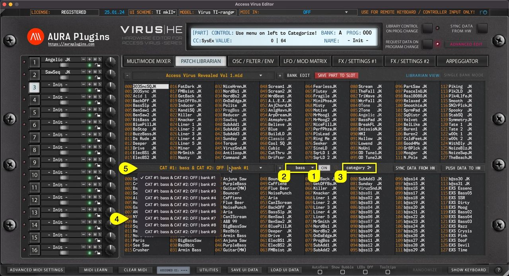

# Access Virus Editor – Category Filter

Category Filter can be toggled on by clicking the **CATEGORY [1]** on / off icon in the Patch Librarian View. You can define Category filtering with **primary filter [2]** and if you need further tuning to category drilling, use **secondary filter [3]** together.

Once filters are set, you’ll see that **Lower (SOURCE) [4]** list view gets updated with all programs containing the filter terms.

More filter results are shown by clicking the **bank name [5]** area to reveal how many banks of filter items were found.

*Figure: category filter toggles*

Filtering only works in SINGLE BANK mode.

> **NOTE:** To adjust how category works, use the Utilities Menu -> Librarian Preferences to determine how category sorting works.
