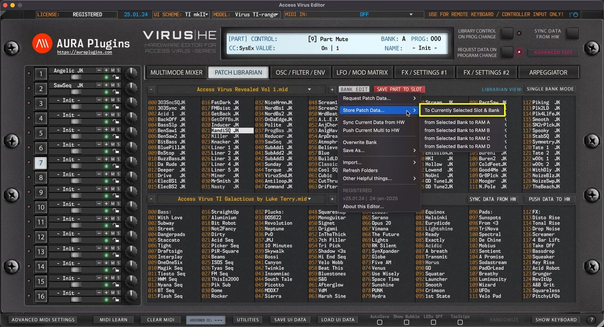
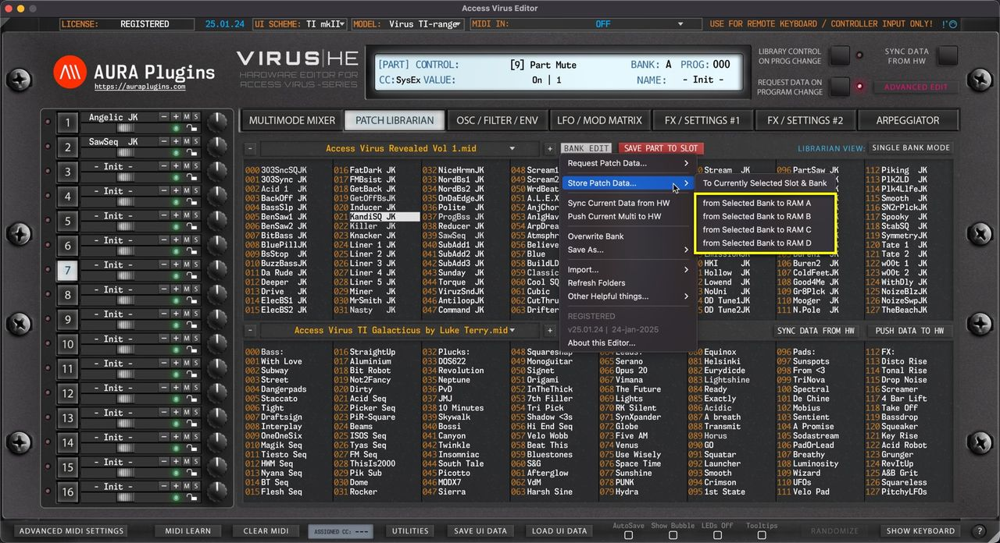

# Access Virus Editor – Store Patch Data to Hardware

> **NOTE:** Before you start data writing to hardware, make sure you know which slot you are overwriting and STOP all activities on your DAW in regards to the hardware to ensure data is written properly!

## To Currently Selected Slot & Bank

Open the **BANK EDIT** menu and choose **Store Patch Data … -> To Currently Selected Slot & Bank** to write currently selected Librarian Slot to hardware. In this case we would overwrite Slot 21 in bank RAM A which is chosen in the BANK menu at Editor Control Display.

*Figure: store patch data to slot*

## from Selected Bank to RAM A … D

Open the **BANK EDIT** menu and choose **Store Patch Data … -> from Selected Bank to RAM A … D** to write the entire USER bank of your choice with the data from Active Librarian View which in this case is UPPER view (slot 21 chosen on UPPER list).

This means, you can select either view (UPPER / LOWER) and write the hardware memory with a bank in question. Extension to this is that you can do search or category filtering, ie, bass and write all the results from the active view to hardware!

*Figure: store patch data to ram*
