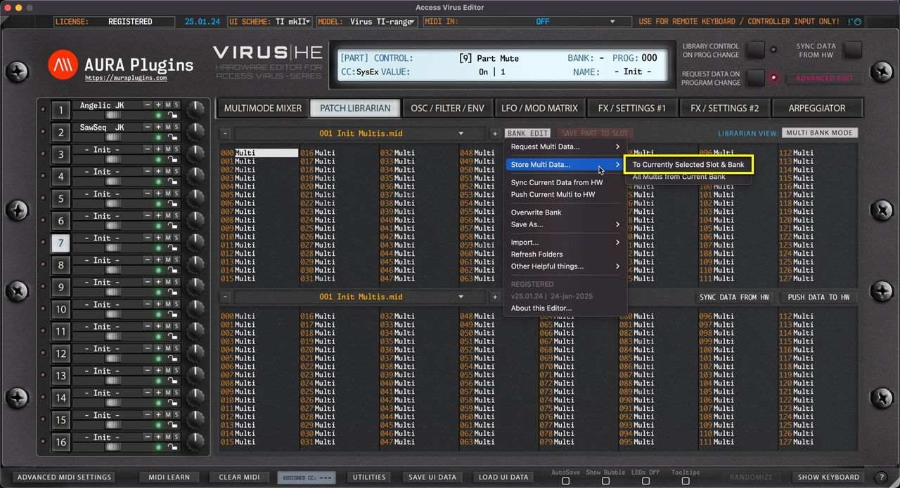

# Access Virus Editor – Store Multi Data to Hardware

> **NOTE:** Before you start data writing to hardware, make sure you know which slot you are overwriting and STOP all activities on your DAW in regards to the hardware to ensure data is written properly!

## To Currently Selected Slot & Bank

Open the **BANK EDIT** menu and choose **Store Multi Data … -> To Currently Selected Slot & Bank** to write currently selected Librarian Slot to hardware. In this case we would overwrite Slot 0.

*Figure: store multi data to selected slot*

## from Selected Bank to USER

Open the **BANK EDIT** menu and choose **Store Multi Data … -> All Multis from Current Bank** to write the entire USER bank with the data from Active Librarian View which in this case is UPPER view (slot 0 chosen on UPPER list).

This means, you can select either view (UPPER / LOWER) and write the hardware memory with a bank in question.

*Figure: store multi data to hardware*
