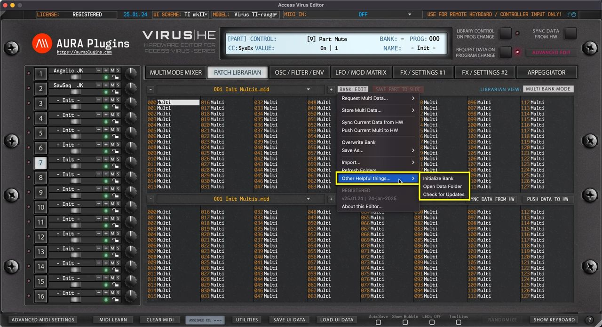

# Access Virus Editor – Other Helpful Things

Other Helpful things menu gives additional tools to speed up your sound-design work, ability to open your Data folder quickly & check for any updates from our server. Examples below.

## Initialize Bank

Open the **BANK EDIT** menu and choose **Other Helpful things … -> Initialize Bank** to initialize all slots from the bank. You can then overwrite or choose Save As from the BANK EDIT menu to continue working with bank edits. The result shown below after the initialization process has been processed.

*Figure: other helpful things initialize bank*

If you made this action by accident, you can always click the DISCARD button to revert any changes made to the bank.

## Open Data Folder

Open the **BANK EDIT** menu and choose **Other Helpful things … -> Open Data Folder** to open the root folder for the Access Virus Editor. In this folder you can find your license file, LOG file, PREFERENCES file and folders for UI DATA and PATCHES.

You can also see where the data path is as explained in the Data Locations article.

*Figure: other helpful things open data folder*

> **NOTE:** Multi and Single Patch files are both located in the PATCHES folder.

## Check for Updates

This will check our online repository for version status. No personal data is sent on this action, only version number comparison is done and if it differs, then you’ll get notified if a new version is available along with changelog.

Usually when we have an update available, it addresses any issues reported to us via the Bug Report form (https://auraplugins.com/my-account/bug-report/) and/or Discord (https://discord.gg/TeG7ukYcVW) reports.

> **NOTE:** Internet connection is required to handle this function!
