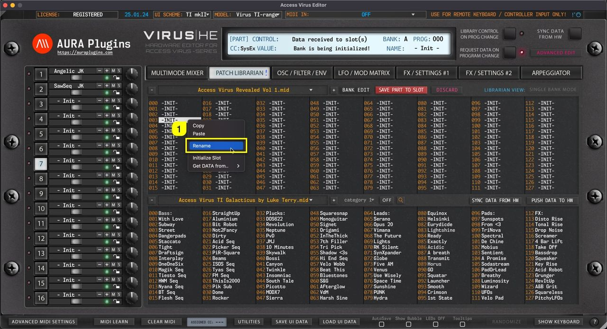
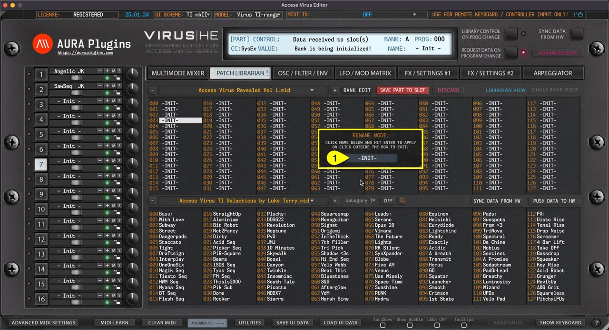

# Access Virus Editor – Rename Librarian Entities

If you want / need to rename items in the Librarian View, it can be done simply with **Right mouse click [1]** on a slot you want to rename and choose **Rename** …

*Figure: rename entities via right click menu*

This will open a small window, where you have to click on the **slot name [1]** to activate renaming. Keep in mind that name length is defined by the hardware specifications, in this case: 10 characters

*Figure: rename entities*

> **NOTE:** New name is only applied by pressing ENTER on your keyboard. Clicking outside the box will cancel the renaming.
