# Make The Connection

## Prepare your Hardware

Connect the MIDI cables from your synthesizer to the MIDI interface and Audio Jacks to your console / sound card. MIDI out from synth to MIDI interface IN and vice versa. MIDI thru connections will not work.

- MIDI Out from MIDI interface to JP MIDI In port.
    - Remote KBD port in JP-8080 works only to trigger the Arpeggiator!
- MIDI Out from JP to MIDI interface MIDI In port.
    - double check your cables!
- Audio from JP-8000 / JP-8080 L&R to console or sound card inputs.
    - Add more outputs if needed.

### Wiring diagram example


*Figure: Screenshot*

Power up your JP-8000 / JP-8080. Our editor is designed to work “out of the box” and control all parameters from a single application instance.

**NOTE:** Our Editor is designed to work in Performance-mode. Patch-mode is supported to load individual patches to the upper or lower layer.

## Configure JP-8000


*Figure: Screenshot*

### Click and hold SHIFT + MIDI SW (button 5) and apply these settings:

```
Tx/Rx Edit SW    = ON
Rx Exclusive SW  = ON
Tx/Rx ProgChg SW = BANK SEL + PC
Local Switch     = If JP-8000 would be my master keyboard, I would turn it off.
MIDI Clock       = External syncs to MIDI input clock. Check if you can provide a clock from your DAW.
MIDI Sync        = If on, hardware will sync to MIDI clock from MIDI.
```

### Next click MIDI PRM (button 4) and apply these settings:

```
Device ID        = 17 (for multiple JP’s in setup, choose individual ID for each).
Tx/Rx Edit Mode  = MODE1
Perform Ctrl Ch  = 3
Remote Ctrl Ch   = 16
```

### Next click PFM PART (button 2) and apply these settings

```
MIDI CH (LOWER)  = 1
MIDI CH (UPPER)  = 2
```

**External Clock Note** : Arpeggiator will not play unless your DAW is able to provide a MIDI Clock. Windows: Check our method of using MIDI OX and LoopBe together to provide MIDI clock from DAW to your synth.

## Configure JP-8080

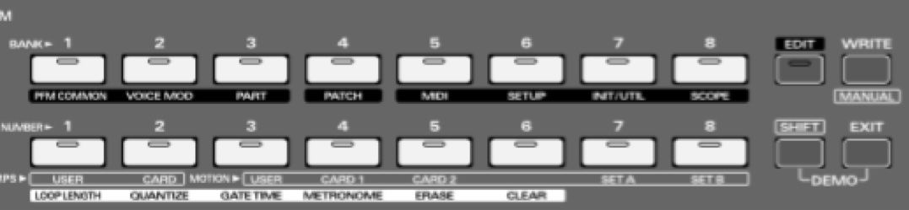

*Figure: Configure Roland JP-8080 - Edit Function Buttons*

### Click EDIT and choose MIDI (button 5) and apply these settings:

```
Tx/Rx Edit SW    = ON
Tx/Rx Edit Mode  = MODE1
Tx/Rx ProgChg SW = BANK SEL + PC
Local Switch     = Up to your desire. OFF means extra MIDI traffic back to JP!
MIDI Sync        = If on, hardware will sync to MIDI clock from MIDI.
Device ID        = 17 (for multiple JP’s in setup, choose individual ID for each).
Rx Exclusive SW  = ON
Perform Ctrl CH  = 3
Remote KBD CH    = 16
MIDI Thru        = OFF
```

### Next click PART (button 3) and apply these settings:

```
MIDI CH (LOWER)  = 1
MIDI CH (UPPER)  = 2
```

All set! We are now ready to open our plug-in in DAW or Standalone Application!

To get more information about how to adjust your synth, read the Roland JP-8000 / JP-8080 User Manual.

**External Clock Note**: Arpeggiator will not play unless your DAW is able to provide a MIDI Clock. Windows: Check our method of using MIDI OX and LoopBe together to provide MIDI clock from DAW to your synth.

**NOTE #2**: The only way to trigger arpeggiator with JP-8080 is to add a second MIDI cable from the MIDI splitter device or MIDI interface to the KBD Input port. Hardware control happens via regular MIDI port while arpeggio can be triggered with notes via KBD input port.

## macOS MIDI Configuration

This setup **is not mandatory if you remember** all of your port numbers & routings out of your head. This guide will help you, if your setup is anything like ours: dozens and dozens of ports in use!

**HEADS UP :** This is usually the step which is skipped and then you get connection timed out errors and such. Read the guide, it will help you to succeed with the setup in the long run!

### Audio MIDI Setup.app

Start by opening **Audio MIDI Setup.app [1]** – You can find the app from `/Applications/Utilities`


*Figure: Open Audio MIDI Setup app*

Next we want to view MIDI devices and to do that, click **Window [1]** and select **Show MIDI-Studio [2]**


*Figure: Open MIDI-Studio*

And this is what you get (contents of the window will vary depending what your setup has configured already!):


*Figure: MIDI-Studio view*

### Creating new Devices

If you haven’t added the JP-8000 / JP-8080 to your MIDI-studio yet, here is how to do it:

**Click + -sign [1]** from the top right corner (add external midi-device)


*Figure: Add external MIDI-device*

The newly added device will pop somewhere in the window (without any logical placement!)


*Figure: Newly added External Device*

Double click the newly added device so we can start to modify its properties


*Figure: View External Device properties*

In this example, I am gonna add a JP-8000 to my rig. Lets update the properties:

- **Device Name [1]** = JP-8000
- **Manufacturer [2]** = Roland
- **Model [3]** = JP-8000
- **Check MIDI clock [4]** if your JP is the Clock provider (rarely the case..)
- **Check MIDI clock [5]** if you want your JP model to receive MIDI clock information from the DAW and choose the **channels [6]** where the clock is transmitted to. Some DAWs require additional steps to transmit the MIDI clock.

You can update the device color if you want, but it is only visual feedback to find the device from the jungle.

Once all fields are good to go, hit **Apply** and you can see the device name and color gets updated.


*Figure: Change Device Properties*

If you have multiple JP’s in your setup, add more devices and make sure each of the devices have individual **Device Name [1]** as set above. Like JP-8080 #1 and JP-8080 #2 etc. This helps you down the road when we connect the hardware to the Editor.

### Connecting Device to MIDI-interface (virtually)

Making virtual connections within MIDI-studio helps us later down the line when we connect the hardware to the Editor and when we make external connections from DAW to hardware. Some DAWs like Logic Pro can see the Device Name created here in MIDI-studio.

Start by drawing the connection points from your external device output port to your MIDI-interface input port. Click and hold down the mouse button from **output port [1]** , start dragging the **cable [2]** towards your MIDI-interface **input port [3]** .


*Figure: Making connection in MIDI-studio*

Apply the same procedure for the MIDI input port from your device towards your MIDI-interface output port. The final result should have both cables connected as seen below. I have highlighted JP-8000 and JP-8080 and their cables from the spaghetti. (Keep in mind, this is our studio, yours can look a lot different).


*Figure: Roland JP-8080 and JP-8000 connected*

These settings are stored within macOS so you don’t have to re-do these settings unless you change your MIDI-interface.

## Windows MIDI Configuration

**HEADS UP :** Windows 11 with multiclient MIDI drivers will enable MIDI devices to be shared between applications - If you are on Windows 11, you can skip creating Virtual paths if you don’t have use for them.

If you plan to route MIDI messages from your DAW to the plug-in channel and send it to the synthesizer from there, then you don’t need to read this, and you can proceed with the DAW guide that is relevant to you.

However, if you use the synth as a master keyboard in your rig or you want to delay compensate the MIDI output with the DAW, then check the advanced procedure below.

Windows **CAN NOT** share MIDI devices between applications (DAW & Editor), therefore virtual ports are the only way to to use the hardware within the DAW and the Editor at the same time.

**ATTENTION** : This is usually the step which is skipped and then you get connection timed out errors and such. Read the guide, it will save our time, your time and you will succeed with the setup!

### Additional Applications needed

Before we jump ahead to launch our DAW, let's do some tweaks in our system to ensure the plug-in can work with maximum efficiency. For that, we are going to need some additional tools.

- MIDI-OX for making routings behind the scenes and
- loopMIDI to create virtual MIDI ports.

We recommend installing an old but trusty MIDI-OX application for Windows to make some virtual routings behind the scenes.

You can download MIDI-OX from here: http://www.midiox.com/zip/midioxse.exe

OR go to MIDI-OX website http://www.midiox.com and download the installer there.

The second application is loopMIDI by Tobias Erichsen which is perfect for creating Virtual MIDI cables inside your workstation.

You can download loopMIDI from here: https://www.tobias-erichsen.de/software/loopmidi.html

**NOTE:** Windows remembers loopMIDI and MIDI-OX settings during each launch. If you do this once, that's all it takes!

### Install MIDI-OX and loopMIDI

Install both MIDI-OX and loopMIDI.

This will allow us to clone the MIDI data from the physical MIDI interface ports to virtual ports and then later on route it inside MIDI-OX back to your DAW while the main port is assigned to the plug-in.

**Example**: MIDI out from JP-8000 -> Roland UM-ONE MIDI input -> MIDI-OX -> loopMIDI virtual port.

This configuration allows us to open the loopMIDI virtual port in the DAW while we use the Roland UM-ONE MIDI port with the plug-in itself. This way there won’t be a crash!

### Configure loopMIDI

Now that loopMIDI is installed, we can configure the ports. The reason why we are installing loopMIDI is so that we can loop back (clone) the MIDI data from the hardware MIDI port to the DAW via MIDI-OX.

*In the example below, we will add Virtual Ports for* ***JP-8000*** *and* ***JP-8080*** *. This is pretty straight forward, but we will guide you through.*

Open loopMIDI settings dialog from the Windows menu bar with right clicking the **loopMIDI icon [1]** and then choose **Configure loopMIDI [2]** .


*Figure: Right Click and choose Configure loopMIDI*

Once loopMIDI opens up, it should look something like the image below.

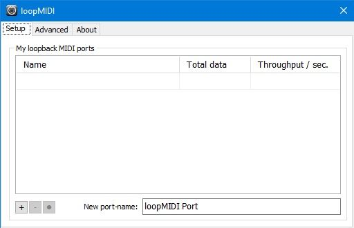

*Figure: loopMIDI initial view*

### Create Virtual Ports (JP-8000)

In the example below, we are gonna add our JP-8000 ports to loopMIDI. Click the **New port name: field [1]** and type in “JP-8000 vIn”. Click the **+ -sign [2]** to actually add it in.

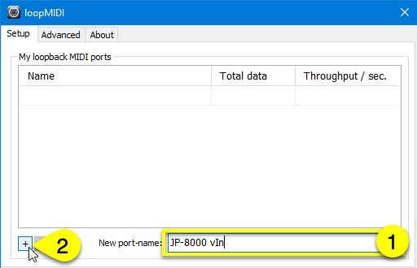

*Figure: Type in your port name and click + to add it in*

Next up we will add another port for output connection. Click the **New port name: field [1]** and type in your Virtual MIDI port connection name. Type in “JP-8000 vOut” and click the **+ -sign [2]** to actually add it in.

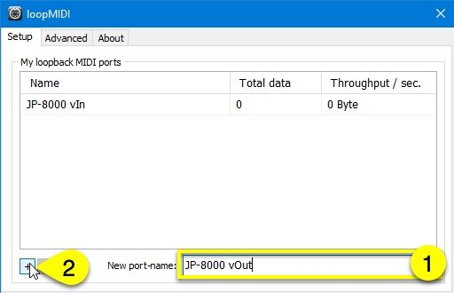

*Figure: Add another virtual port and click + to add it*

### Create Virtual Ports (JP-8080)

Since we have JP-8080 in our setup as well, we are going to add the virtual port for it. Click the **New port name: field [1]** and type in “JP-8080 vOut” and click the **+ -sign [2]** to actually add it in.

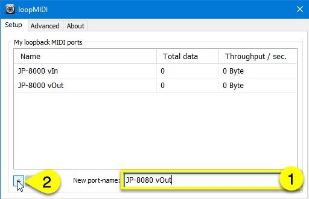

*Figure: Add JP-8080 virtual port and click + to add it*

Since we are not using our JP-8080 to trigger notes or any other CC data to our DAW, we are only adding a virtual output port. There is no point in adding a virtual input port because it is not used in our case.

**NOTE:** If you have multiple JP’s in your setup, add ports accordingly. We have JP-8000 and JP-8080, so we added both.

If you have two or more JP-8000’s, then make the virtual ports naming obvious to yourself i.e. JP-8000 #1 vIn, JP-8000 #2 vIn etc.

### Advanced Settings

**Open the Advanced [1]** settings tab and change the **SysEx Buffer [2]** size to 512. This will ensure there is enough buffer for incoming data flow.

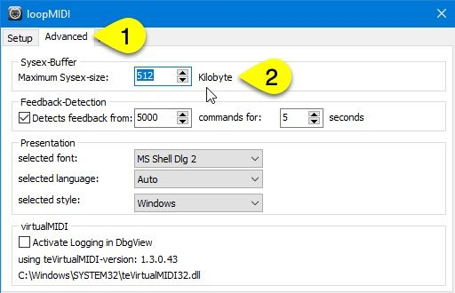

*Figure: Adjust SysEx buffer size*

### Finalize Setup

Right click on the **loopMIDI icon [1]** in the menu bar and toggle on “ **Start minimized** ” & “ **Autostart loopMIDI** ” **[2]** so you don’t have to worry about it during the next boot.


*Figure: Finishing touches to loopMIDI setup*

You can now **close [1]** loopMIDI configuration window.

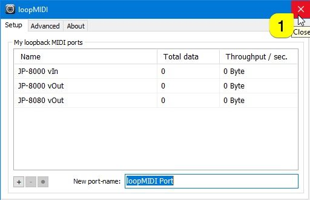

*Figure: Close loopMIDI configuration*

### Configure MIDI-OX

MIDI-OX is the second application needed in order to loop back the MIDI data to the DAW without crashing it. Windows / your DAW will crash if you try to open the MIDI ports twice since most MIDI devices don’t have multicast drivers available.

There are few steps to take in with MIDI-OX, but it will be worth the hassle to get data passing from the synthesizer to your DAW as well as in the plug-in without **crashing** your session.

**Search MIDI-OX [1]** from the Windows startup menu and **open [2]** the application.


*Figure: Search MIDI-OX and open it*

The default view of MIDI-OX setup should look like this when you first open it. If not, close all the windows inside MIDI-OX to follow the guide.


*Figure: MIDI-OX Initial state*

**Click View [1]** menu item and choose **Port Routings… [2]** . This should open a blank routing sheet where we will make our connections.

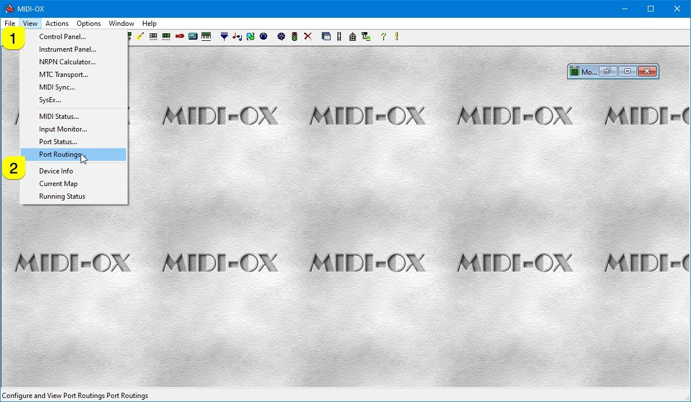

*Figure: Open Port Routings View*

After the Port Routings is opened, we need to open the **Physical** and **Virtual** MIDI ports for the MIDI-OX.

Click **Options [1]** and then choose **MIDI Devices… [2]** .


*Figure: Select MIDI Devices from the menu*

**NOTE:** There are no Input Ports and Output Ports defined yet in the MIDI Port Routing Window!

Now that the MIDI Devices config window is open, we can see all of your Physical and Virtual MIDI ports which are in our disposal. Before selecting any ports, **uncheck [1]** “ *Automatically attach Inputs to Outputs during selection.* ” or you will end up with a massive connection spaghetti which isn’t what we are making here!

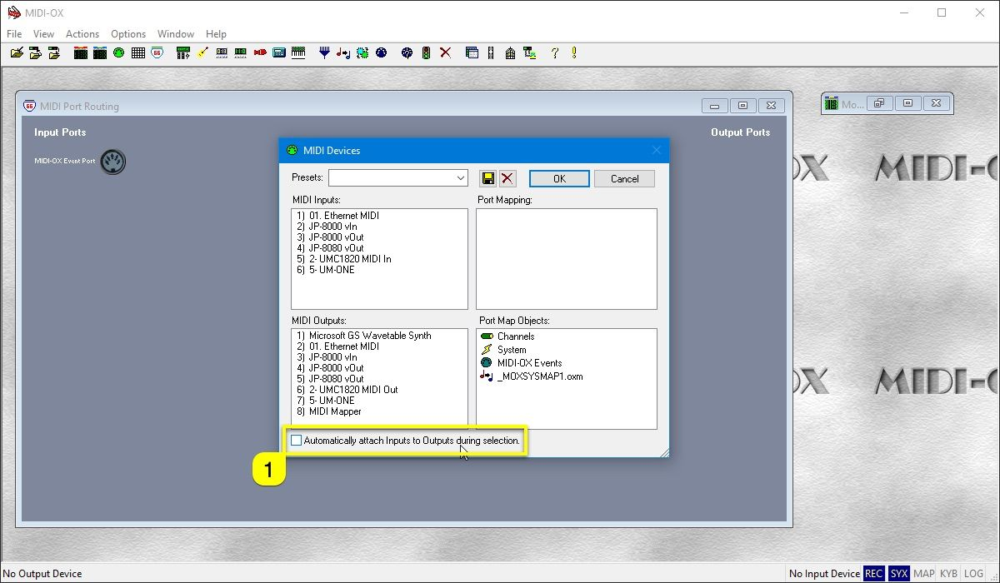

*Figure: Uncheck “Automatically attach Inputs to Outputs during selection”*

### Open MIDI Inputs

Since we have JP-8000 and JP-8080 in our setup, this is very simple.

**UM-ONE [1]** is where our JP-8000 is connected. **JP-8000 vOut [2]** connects to JP-8000 via DAW and **JP-8080 vOut [3]** connects to JP-8080 via DAW.

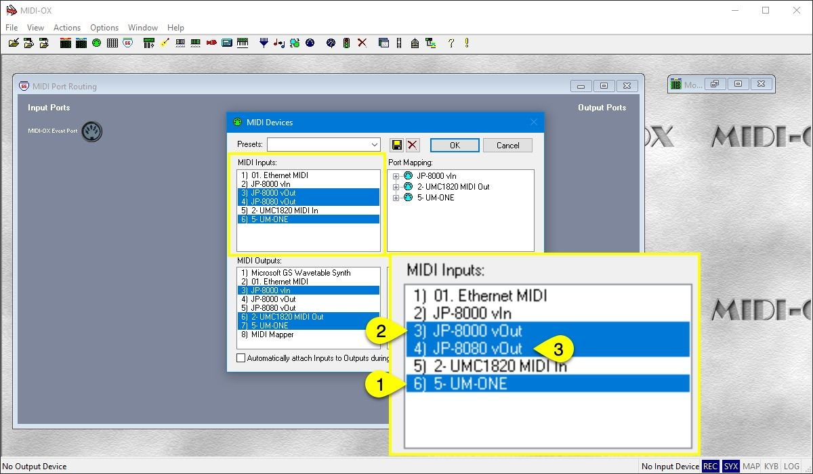

*Figure: Opening appropriate MIDI input ports*

You might wonder why the “vOut” ports are opened in the INPUT area.. Once we do the routing in MIDI-OX, the port names will appear in opposite order, making it odd to choose JP-8000 vOut in our DAW as a MIDI Input. That might not make sense at this point, but trust me, we’ve done this quite a few times now so follow along.

### Open MIDI Outputs

Now opening output ports is where this might get tricky. **UM-ONE [1]** is where our JP-8000 is connected. **JP-8000 vIn [2]** connects our JP-8000 to the DAW. **UMC1820 MIDI Out [3]** is where your JP-8080 is connected.

Same rule applies here for vIn ports being opened on the opposite side. More details in the port routing section below.

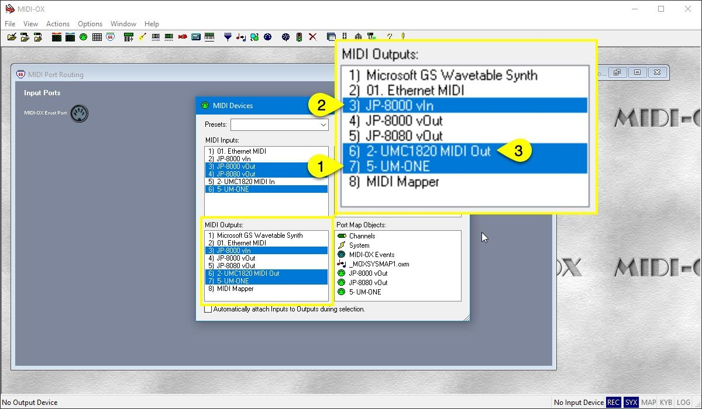

*Figure: Opening appropriate MIDI output ports*

**Click OK [1]** after you have verified your port selections.

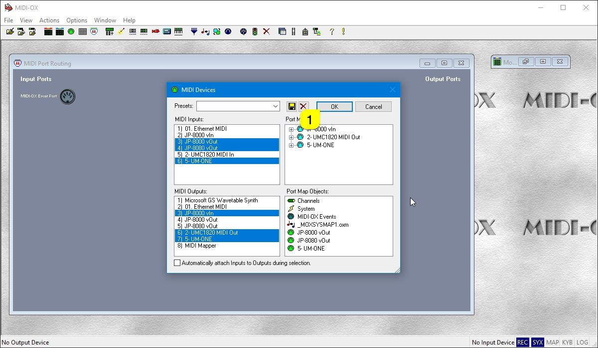

*Figure: Click OK after Port selections*

**NOTE:** Your MIDI input and MIDI output ports for your synth might be different to our example so we are only using them to refer where our JP is connected.

Once the MIDI ports are defined, MIDI-OX might automatically assign “MIDI-OX Event Port” to any of the Output Ports chosen.

In case there are pre-made connections in the window, right click one of the **gray nodes [1]** in the wire and choose **Disconnect All [2]** . This will clear all the pre-made connections so we can start from fresh!

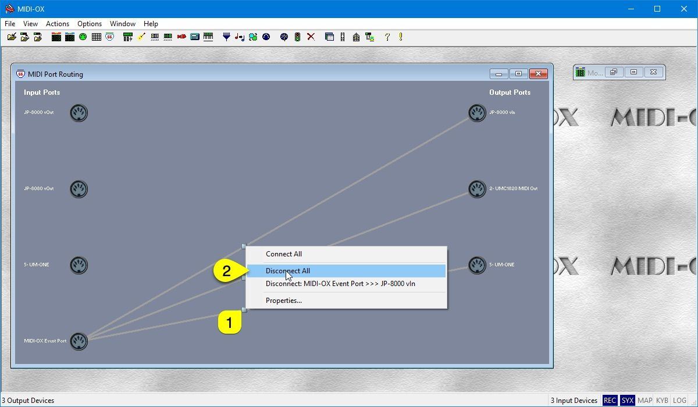

*Figure: In some cases, MIDI-OX might auto assign some connections..*

### Cloning Devices (virtually)

Start by drawing the connection points from your vOut device input port to your MIDI-interface output port. Click and hold down the mouse button from **JP-8000 vOut port [1]** , start dragging the **cable [2]** towards your **MIDI-interface output port [3]** .

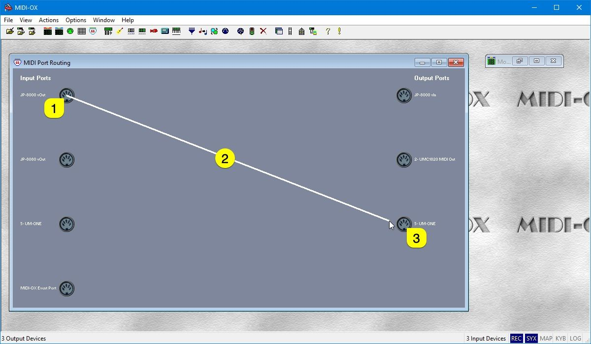

*Figure: Making connections in MIDI-OX*

Apply the same procedure for the MIDI input port from your device towards your JP-8000 vIn output port. The final result should have both cables connected as seen below.


*Figure: JP-8000 ports cloned*

**NOTE:** In order to establish the connection, you must drag the wire on top of the MIDI plug icon!

### Filtering Virtual connection data

Next up, we will modify the connection properties so that we will block unnecessary data flow. Right click on the **gray dot [1]** at the connection to reveal the menu and choose **Properties… [2]** . You should apply this only for the physical hardware **input port [3]** .

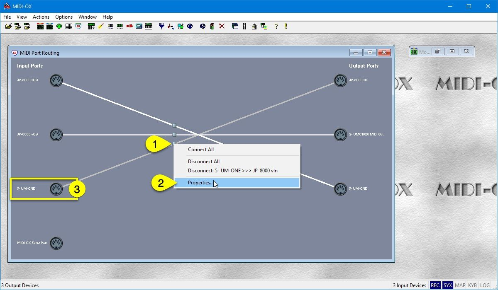

*Figure: Right click the dot in connection for Properties*

From the Properties window, let’s block **Common (MTC …)** , **Realtime (Clock, AS …)** and **Exclusive (SysEx)** message by unchecking the boxes in **System [1]** section.

We simply don’t need this data **unless** you send realtime clock info from your Synthesizer to the DAW!

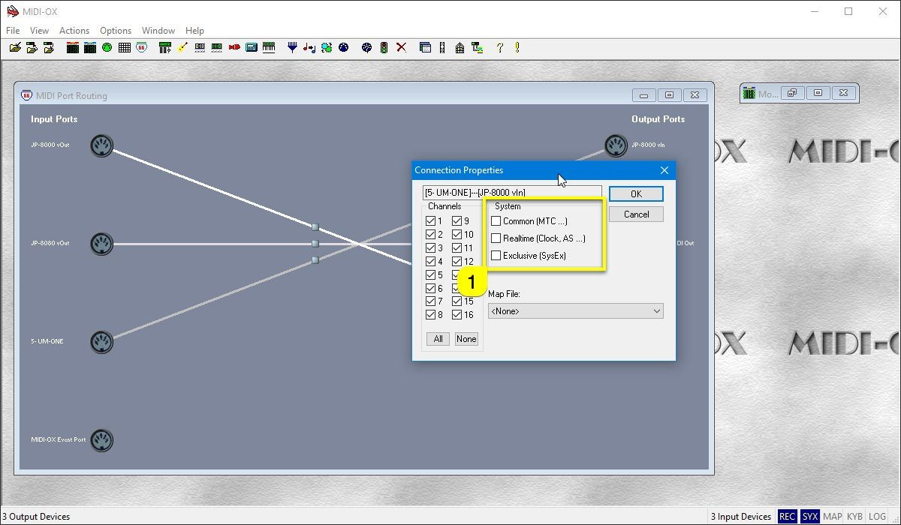

*Figure: Filter out unwanted messages*

Click **OK [1]** to apply and close the properties window.

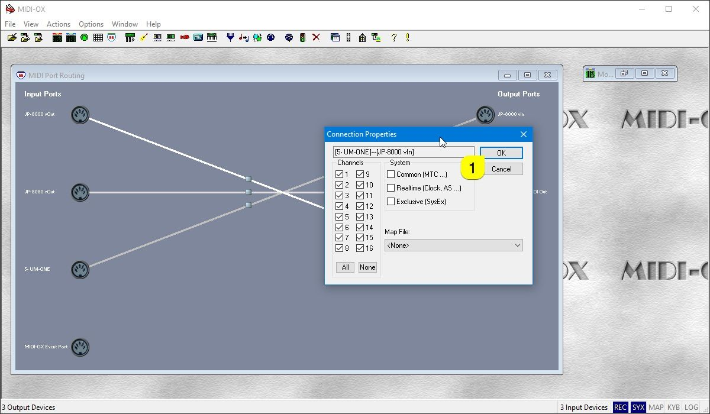

*Figure: Close connection properties*

### Finalize Setup

Here is our final connections:

1. JP-8000 vOut routed to Hardware port.
2. JP-8080 vOut routed to Hardware port.
3. UM-ONE routed to JP-8000 vIn port. (with data filter applied).

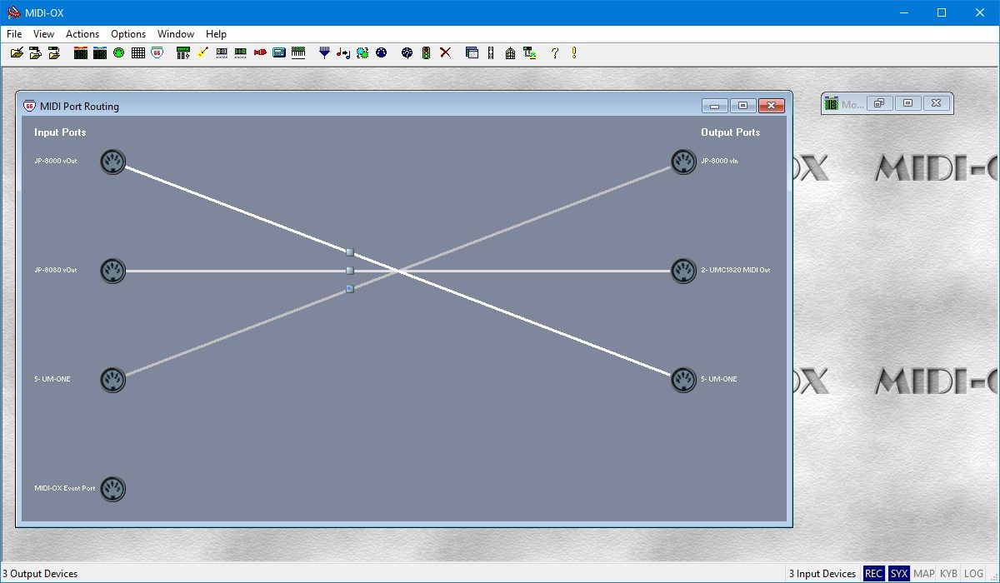

*Figure: Final connections for Roland JP-8000 and JP-8080*

Now after all of the connections are done and we are ready to proceed, click the **traffic light [1]** icon in the MIDI-OX tool bar to toggle MIDI-OX in the taskbar tray.

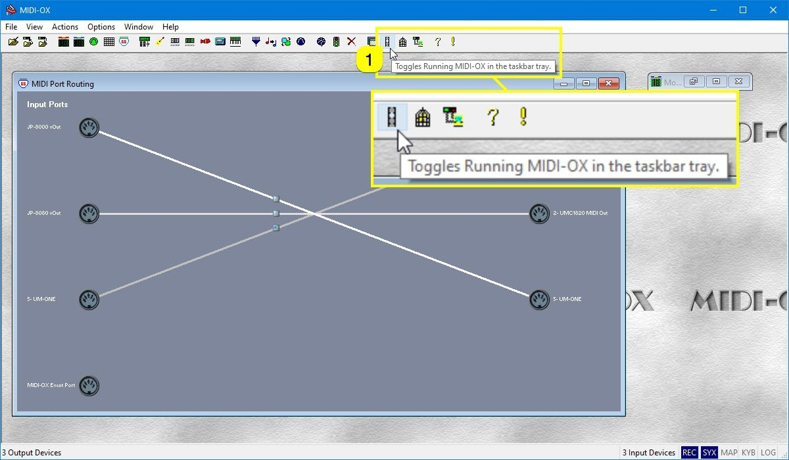

*Figure: Run MIDI-OX in taskbar tray*

You can now **minimize [1]** the window so it is out of the way!

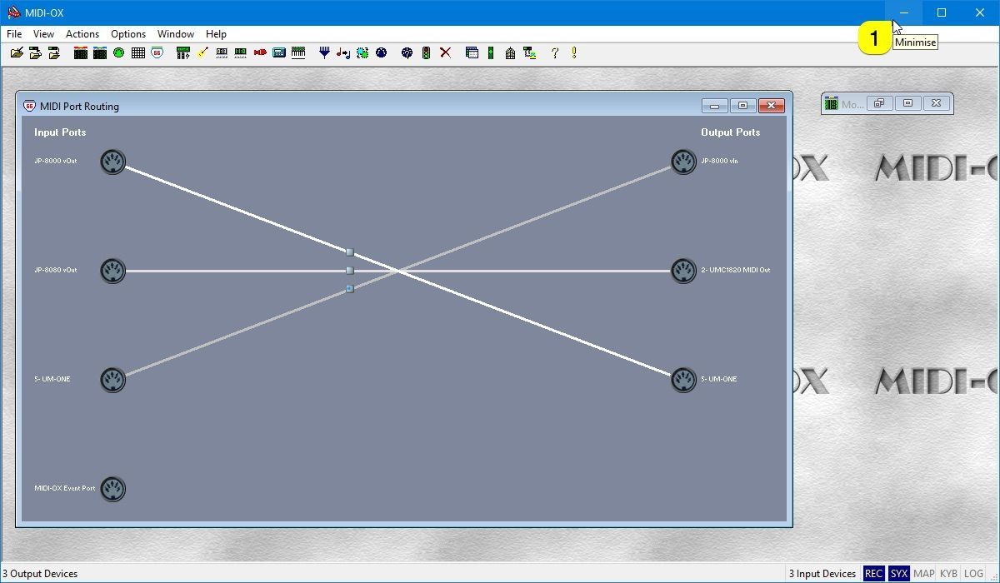

*Figure: Minimize MIDI-OX to continue!*


*Figure: MIDI-OX sent to taskbar tray*

**TIP** : You should be able to add MIDI-OX in the Windows start up menu so that it will launch automatically when you boot your OS. All the connections will remain, IF the MIDI Devices are connected as they were while making this guide.

## Configure Standalone APP

If DAW is not your thing and you just want to edit JP right from your computer, you can use the standalone application. Below is a guide to connect the Editor to the JP and do all the fun stuff DAW users do (without automation).

### Select MIDI ports with Standalone Application

If you use the Standalone Application, click “ **Roland JP-80x0 Editor [1]** ” from the top bar and choose **Preferences [2]** . This will open **Preferences dialog [3]** where you can set **MIDI Input Device** and **MIDI Output Device** .

On Windows machines, the same dialog can be opened from the File menu.


*Figure: JP-80x0 Editor User Manual – Setting MIDI Ports*

### Remote Keyboard MIDI Input

If you have an external MIDI controller you want to use with the Editor to trigger notes and tweak knobs with, you can select **MIDI IN** from the Editor top bar. This port won’t work with the synth itself and is only used for triggering MIDI events.


*Figure: Remote Keyboard Input available in Standalone App only!*

**NOTE** : Audio Device Settings in the preferences dialog does not have capability to transmit audio in this stage. Choose Audio Drivers, but keep in mind that audio has to go through Audio Jacks to console or sound card inputs.

### Hardware Check / Ping

After setting MIDI OUT, our Editor will start scanning for the hardware. If there is no immediate response, the Editor will attempt 3 more times. If there is no response, you might get a “ **Connection Timed Out** ” message. If so, double check your hardware settings and make sure your cables are good!

**NOTE:** MIDI ports for plug-in are set from the main window while Standalone Application MIDI ports are set from the Editor Preferences.

Editor **Control Display** will say “ **Editor is ready to go!** ” when response is received from the JP.


*Figure: JP-80x0 Editor User Manual – Ready to go!*

You can optionally enable Device ID probing function, which will check for the Device ID for you. This is good IF you have only one JP model in your setup. Function can be enabled from **Utilities [1]** menu -> **Editor Preferences [2]** -> **Enable DeviceID Scanning [3]** .


*Figure: JP-80x0 Editor User Manual – DeviceID Scanning*

Check Main Functions and Librarian guides to learn more about the Editor usage.

**NOTE:** If you have Device ID set to 17 on the JP and 17 on the Editor, our Editor will find and establish connection to your JP if everything else is configured properly.

## Configure DAW and Plug-in

In the guide series below, we are going to use **Ableton Live in Windows** to demonstrate how to configure your DAW audio ports, midi ports and how to insert the Editor into your project + apply all the settings needed.

If you are not using Ableton Live, check the configuration guide for your system below.

**ATTENTION** : We expect you’ve done Hardware and MIDI port configuration steps from the previous section – They are mandatory to understand what is going on in the guides below!

```
Config Guide           | Availability
Apple Logic Pro        | Online
AVID Pro Tools         | Online
Bitwig Studio          | Online
Cockos Reaper          | Online
Image-Line FL Studio   | Online
MOTU Digital Performer | Online
PreSonus Studio One    | Online
Reason Studios Reason  | Online
Renoise                | Online
Steinberg Cubase Pro   | Online
Universal Audio LUNA   | n/a
```

## Ableton Live

DISCLAIMER

*Our company & product has nothing to do with Ableton AG. If there is an issue with our product, open a support ticket in your account page. You can find support details at the end of this document. Support and updates are free to anyone who has bought the license from our store*

### Audio Configuration

First, open **Ableton Live** , click **Options [1]** from the top bar and select **Preferences… [2]** – We are making adjustments to Audio and MIDI settings which are crucial for our Editor to work flawlessly.


*Figure: Open Live Preferences*

**Open Audio [1]** tab and select your **Audio device [2]** you use for your setup (if not set already). We are going to use **UMC ASIO Driver [3]** .


*Figure: Assign Live Audio Device*

After the Audio engine is initialized, click **Input Config [1]** . Enable **input ports [2]** you use with your setup and **rename ports [3]** as they are routed.


*Figure: Live Input configuration*

Our **input ports [1]** are now renamed accordingly. **Click OK [2]** to close the input config.


*Figure: Input configuration completed*

### MIDI Configuration

Next we want to adjust MIDI ports and how they are shown in Live. Click on **LINK / TEMPO / MIDI [1]** to open it. Check and make sure all the **physical MIDI ports [2]** are disabled from the MIDI section.

Now you can Enable **Roland JP-8000 vIn [3]** to trigger other VSTs in your session (if JP-8000 is used as your master keyboard).


*Figure: Modify Live MIDI ports*

**ATTENTION :** Our Editor uses DIRECT connection from MIDI interface to the hardware. Therefore the hardware ports need to be disabled from the DAW settings!

While we are at it, let's **enable virtual ports [1]** created in loopMIDI / MIDI-OX guide. When you use the virtual ports on MIDI tracks, you get tight DAW timing. Note that **physical MIDI ports [2]** are unchecked so that we can use them with the Editor.


*Figure: Enable virtual MIDI ports in Live preferences*

Check “**tracking**” and “**sync**” for the JP virtual output ports. With sync toggled on, you can pass MIDI clock information from DAW to your hardware which is used when LFOs or Effects are clocked to incoming MIDI clock status.

Before we are all done, make sure the physical ports which are used to connect with JP are not used within the **Control Surfaces [1]** section!


*Figure: Disable physical hardware ports from control surface use*

Now can click **close [1]** to exit preferences.


*Figure: Live Preferences are done!*

## Creating Tracks

Before we add the Editor to the session, let's add AUDIO tracks and MIDI tracks for the JP.

### Creating Audio track(s)

**Click Create [1]** and select **Insert Audio Track [2]** to create Audio track or use key command Ctrl+T.


*Figure: Create new Audio track in Live*

**Assign input [1]** accordingly so that you get the JP signal into Live.


*Figure: Assign input for the JP in Live*

Now you can enable **Input Monitoring [1]** to hear the JP via Live. If you play any keys and you have your inputs configured properly, you should get Audio in!


*Figure: Enable input monitoring in Live*

### Creating MIDI tracks

Now we are ready to create MIDI tracks which we are going to use for making sequences

**Click Create [1]** and select **Insert MIDI Track [2]** to create MIDI tracks or use Ctrl+Shift+T key combination. Repeat so that you get 3 new MIDI tracks!


*Figure: Create new MIDI tracks in Live*

Assign MIDI output port to **virtual JP port [1]** for all three MIDI tracks just created.


*Figure: Assign MIDI port for all three MIDI tracks*

Assign MIDI channels so that the first MIDI track sends to channel 1, second to 2 and third to 3.


*Figure: Assign MIDI channels per tracks*

### Renaming tracks for clarity

To finalize this part of configuration, rename tracks as you prefer. Here is a screenshot how we’ve done it


*Figure: JP related tracks renamed for clarity*

Now we are ready to add the Editor (finally huh?!)

## Insert Plug-in in Live

### VST2 (legacy)

You have the option to use the legacy VST2 format if you wish to do so. We would recommend using VST3 for parameter automation simplicity and it has a modern SDK (developer framework) under the hood. VST3 MIDI integration isn’t that great, but we can’t fix that.

You can find the VST2 version from the **VST -> AURA Plugins** folder.


*Figure: VST2 plug-in location*

### VST3

You can find the VST3 version from **VST3 -> AURA Plugins** folder. In this guide, we are using VST3


*Figure: VST3 plug-in location*

### Insert the plug-in to Empty track

Drag the Editor to **empty area [1]** in your Live tracks view. Before you rush to open the Editor User Interface, **DISABLE track arm [2]** toggle while setting the MIDI ports!


*Figure: Insert plug-in and disable track arm toggle*

Now you can open the Editor User Interface by clicking the **wrench [1]** icon in Live.


*Figure: Open Editor user interface*

### Device ID check

First we have to match the Editor Device ID with what you’ve set in your JP. In our case it is 17. You can check how yours is set from the JP-8000 or JP-8080 Config guide if you skipped that part.


*Figure: Check and match Device ID with hardware*

### MIDI Input and MIDI Output ports

### MIDI Input

Click **MIDI IN [1]** area to view which MIDI ports are available. Select the MIDI input port where your JP MIDI Out is connected into. In our case, we have the JP-8000 connected in **UM-ONE port [2]** .


*Figure: Editor MIDI input port*

### MIDI Output

Click **MIDI OUT [1]** area to view which MIDI ports are available. Select the MIDI output port which is connected to your JP MIDI input. In our case, we have JP-8000 connected to **UM-ONE port [2]** .


*Figure: Editor MIDI output port*

Once you set the MIDI output port, our Editor will make a ping / request call to the hardware unit. If **MIDI ports [1]** are properly set, **Editor display [2]** will say “**Data request completed!**” or “**Click Sync Data from HW to continue**”.


*Figure: Editor connected to hardware*

Check Main Functions and Librarian guides to learn more about the Editor usage.

## Automation in Live

### Learning Parameters for Automation

You can automate almost every parameter of your JP with our Editor in DAW without having to remember CC numbers or have spread sheets constantly open on your screen.

**Click toggle [1]** to view the arrangement view. Now click the **Unfold Device Parameters [2]** button.


*Figure: Unfolding Device Parameters in Live*

**NOTE:** Parameters sent as **MIDI CC** can be automated smoothly. Automating **SysEx**-based parameters may make the Editor user interface or your DAW sluggish. We are looking into the cause. If you need to automate a SysEx parameter, automate a MIDI controller that the JP-8080 accepts for Control Up or Control Down instead (Aftertouch, Breath or a Control Change), and set that parameter’s range with Control Assign (MORPHING [CONTROL ASSIGN]). See your JP-8080 Owner’s Manual for the Control Assign steps.

Toggle **Configure [1]** from Device Parameters view to enable parameter learning.


*Figure: Configure Parameters for Automation*

Notice that if JP has **layer link [1]** toggled on, learning parameters will be troublesome. Click the **link [1]** button to unlink layers.

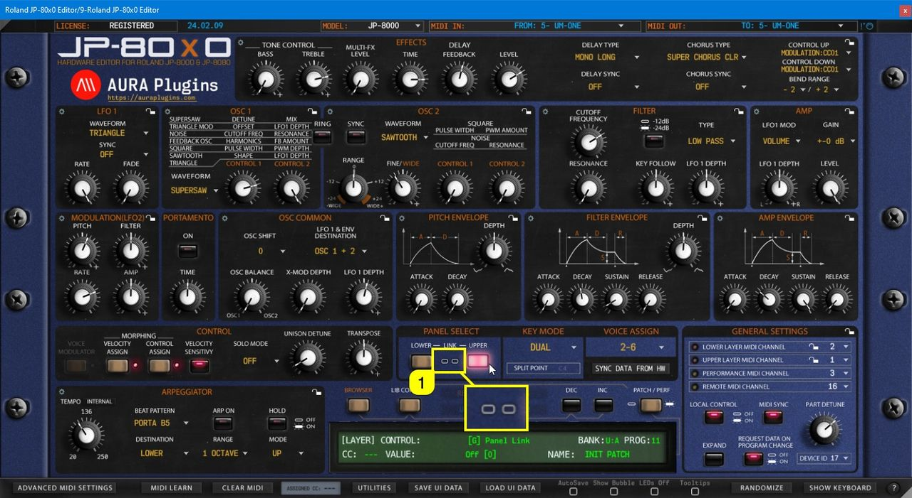

*Figure: Unlink layers before learning automation parameters*

Now if you move parameters from the **Editor User Interface [1]** or Hardware, Live will register the **parameters [2]** .

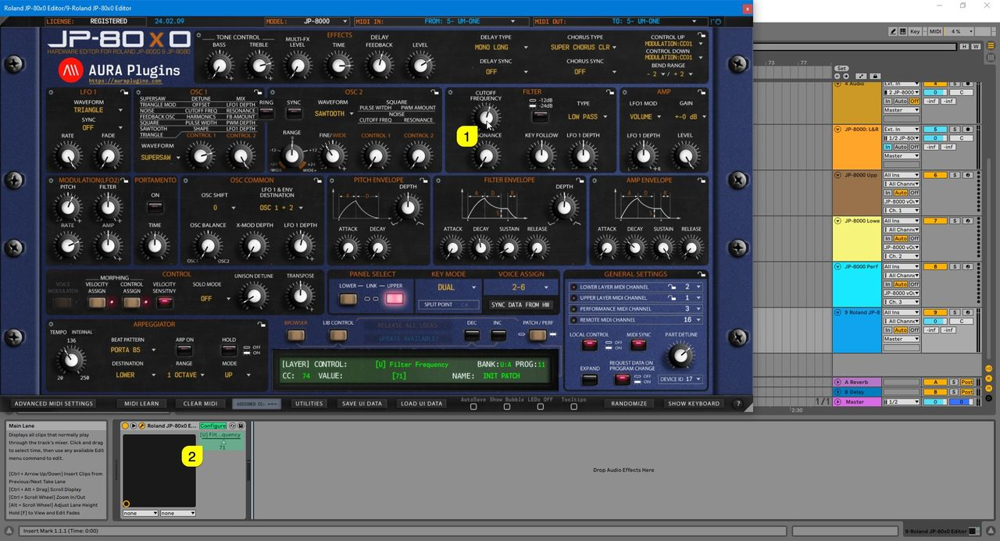

*Figure: Learning parameters*

Now if you toggle on **Automation [1]** , all of the parameters you assigned in Configuration mode will be shown in the **Editor track [2]** in Live.

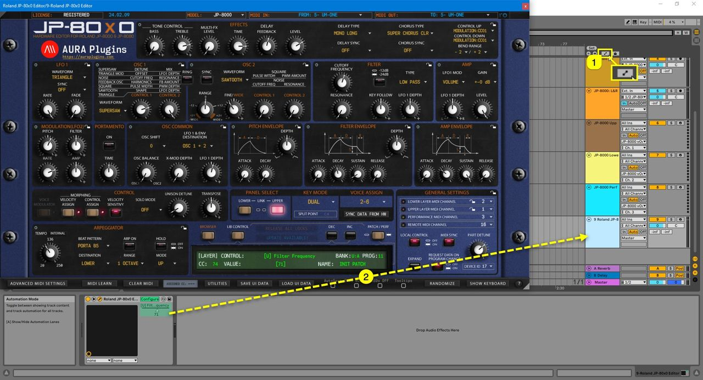

*Figure: View Automation and assigned parameters*

### Closure

Here is a summary of what is happening in Live now that everything is configured as they should be!

- **[1]** Track hosting our Editor.
    - Ideal for automation,
    - Patch and Performance change & value edits per layer,
    - Librarian Edits,
    - and Total Recall : Data is sent to hardware automatically when the project is loaded.
- **[2]** Stereo Audio track.
    - Audio Inputs from JP-8000 selected as source of audio.
    - Could be split into two Mono tracks if output mode is set to parallel out.
    - Input Monitoring is toggled on so that we can hear everything happening with the JP-8000.
- **[3 & 4]** MIDI tracks assigned to JP-8000 vOut Port.
    - MIDI channel is set to 1 and 2. Now if we take a look at the Editor MIDI channels in the General Settings area, we can see that channel 1 is assigned to the Upper Layer and channel 2 is assigned to the Lower Layer.
    - Best use for sending DAW clocked / timed MIDI notes to hardware.
- **[5]** same as above, but MIDI channel is assigned to channel 3.
    - This channel is the same as the Performance MIDI channel in the Editor.
    - If you change the output port destination to our Editor track, you can play both layers at the same time, even if they don’t share the same MIDI channel.

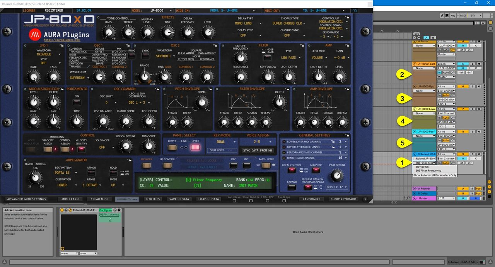

*Figure: Closure*

Check the rest of the Editor Functions from the Main Functions and Librarian sections.

If you have trouble with the Editor setup / configuration, check the troubleshooting section.

## Sync Data From HW

This is the final step before you can start making your own adjustments IF “ **Enable Hardware Auto-connect** ” is disabled from the Utilities menu as explained in the previous section! Click **Sync Data From HW [1]** button to synchronize active PERFORMANCE data and both LAYERS from your JP to the Editor user interface. This needs to be done only when a new instance is loaded so that the Editor and you know what was set in the hardware already.

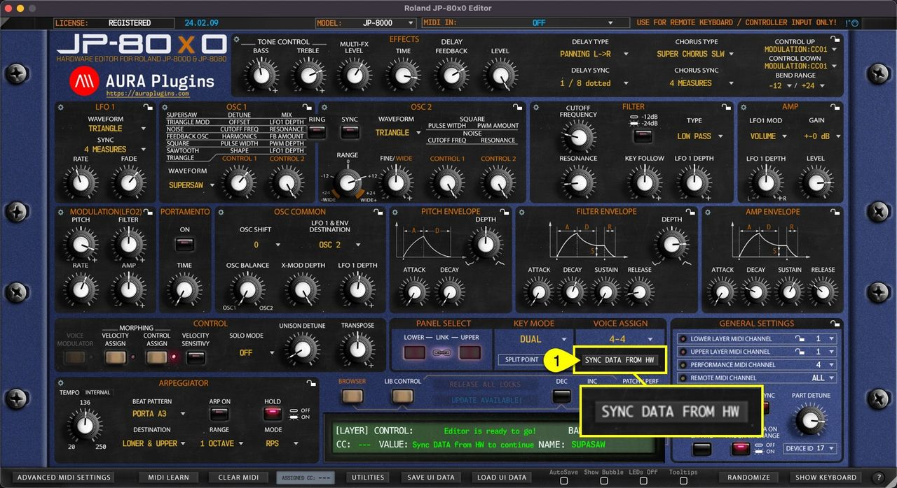

*Figure: JP-80x0 Editor User Manual – Sync Data From HW*

After the “**Sync data from HW**” process is completed, you should check the **GENERAL SETTINGS [1]** view and verify layer MIDI channels are what you expect them to be.

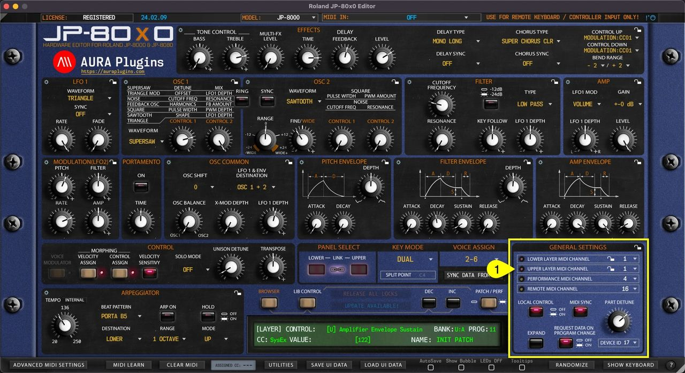

*Figure: JP-80x0 Editor User Manual – Check General Settings*

You can now pursue your own editing tasks, patch manipulations and experiments as you wish!

**NOTE #1** : Be patient and do not disturb the data flow with any knob movements or so. This will ensure the data packages are being sent and received as expected and you are not going to receive any SysEx error messages!

**NOTE #2** : All layers should ideally have individual MIDI channels to avoid control change conflicts. You can stack sounds together by setting the MIDI channel to the same value, just keep in mind that control changes affect both layers!

Issues with hardware data sync? Check our FAQ before opening a ticket.
