# Basic Functions

## Functions

Our Editor includes a lot of custom added functions as requested by our users.

In this part we will walk you through each of the functions, explain how they work and maybe you can find a way they improve your workflow.

If you are looking for a specific function, search bar is your friend. We are quite sure that the right document will pop up!

## Model Comparison Chart

### HARDWARE DIFFERENCES

To understand how the menus work in Roland JP-80x0 Editor, you need to understand the differences between the hardware models.

Here are the key differences:

```
Spec              | JP-8000               | JP-8080
Polyphony         | 8                     | 10
Inputs            | –                     | yes
Distortion FX     | –                     | yes
OSC 2 Noise       | –                     | yes
OSC 2 Inputs      | –                     | yes
Vocoder           | –                     | yes
Unison            | –                     | yes
Patches           | 128 User, 128 Presets | 128 User, 384 Presets
Performances      | 64 User, 64 Presets   | 64 User, 192 Presets
External Storage  | –                     | smart media
Keyboard          | yes                   | yes (kind of)
Ribbon Controller | yes                   | –
Pitch / Mod Wheel | yes                   | –
```

### ADDITIONAL JP-8080 MENUS, BUTTONS AND FUNCTIONS

When you have JP-8080 synth in use, there are extra menus, buttons and features shown in the user interface. Select **JP-8080 [1]** as your model and **new items [2]** will be updated to the user interface.

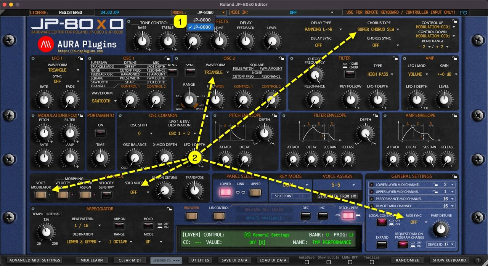

*Figure: JP-80x0 Editor User Manual - JP-8080 Additional Functions*

### Voice Modulator Controls

When you have JP-8080 synth in use, you can use the **Voice Modulator [1]** to trigger some interesting effects with line or microphone input. Knobs, menus and buttons with blue entities on **Voice Modulator layer [2]** can be edited. Voice Modulator always defaults to **JP-8080 Upper Layer [3]** .

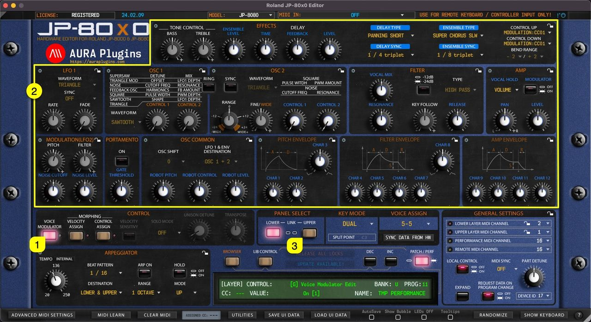

*Figure: JP-80x0 Editor User Manual - JP-8080 Voice Modulator*

### Loading patches between different models?

You can load patches and performances created on either model. When JP-8080 patches or performances are loaded to JP-8000, Unison, Distortion and some other features are not available in the JP-8000.

## How To Resize User Interface

### Real-time Resize

You can resize the Editor user interface in real time by clicking and dragging the **gray triangle [1]** in the bottom right corner. Double click will revert the scaling level back to 100%. This setting is saved with DAW project data, but Standalone Application always reverts to “zero” resize stage when Application is launched again.

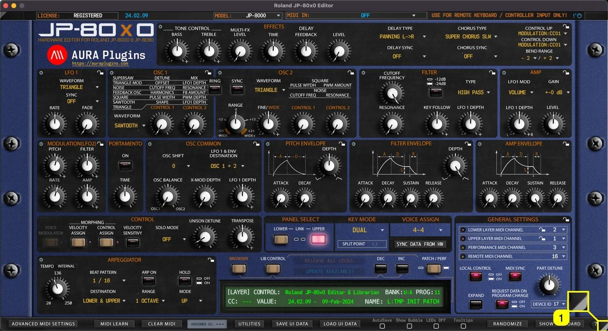

*Figure: JP-80x0 Editor User Manual - Real-time Resize*

### Minimize View

If the user interface is too big for your screen for some reason, a single click **gray triangle [1]** in the top left corner resizes the user interface to 50% of its size. Double click sets the view back to 100%.

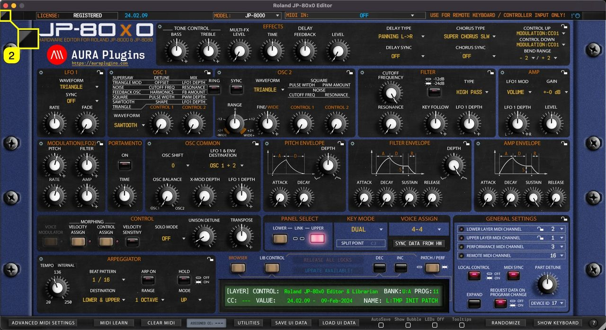

*Figure: JP-80x0 Editor User Manual - Minimize View*

### Setting Default Scaling Level

You can also set the “default” scaling level by opening the Utilities **[1]** menu -> **User Interface [2]** and **selecting the size [3]** that fits your setup the best.

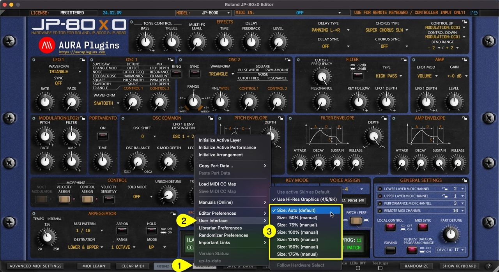

*Figure: JP-80x0 Editor User Manual - Set Default View Scaling*

**NOTE:** If your display cannot handle HD graphics and / or you have not enabled use of hi-res graphics, scaling results might look unpleasant. Adjust settings to your likings. Loading hi-res graphics takes longer for the Editor view to open.

## How To Check License Status

Displays current state of the Editor license. If DEMO version is installed, then display will show \*\*DEMO VERSION\*\*.

If the Full version is installed, then you will see RELOAD LICENSE or REGISTERED if license is applied. To learn more about registering our Editor, please use search above to find what you’re looking for.

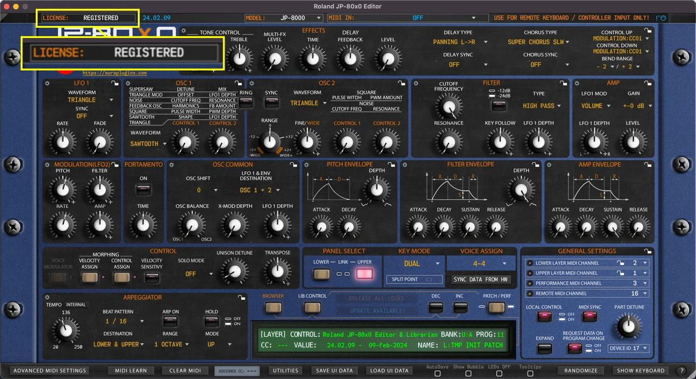

*Figure: JP-80x0 Editor User Manual - License Status*

Editor license status is also shown in the BROWSER view if you click **Bank Edit [1]** menu. **Status [2]** is shown here.

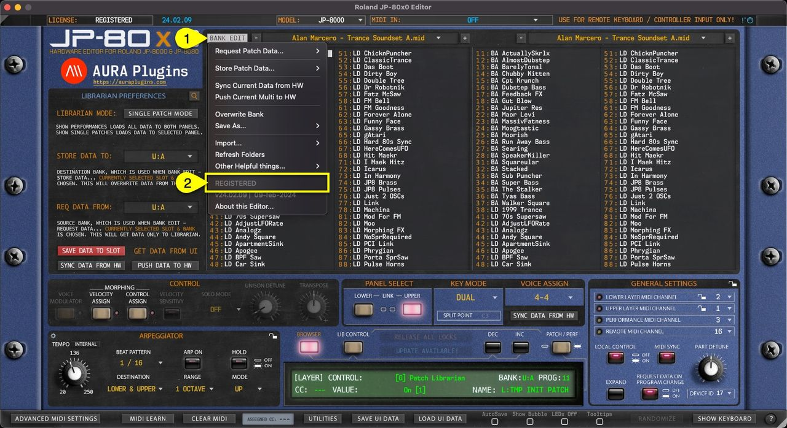

*Figure: JP-80x0 Editor User Manual - License Status via Bank Edit Menu*

## How To Register our Editor

If you made the decision to purchase the license for our Editor, you are the best! Just wanted to thank YOU.

License owners can enjoy the full advantages of the Editor, like:

- Plug-in parameters can be automated directly from your DAW.
- Librarian is fully functional and allows full editing capabilities.
- You can save your UI Data (full performance) to HDD.
- You can save your custom MIDI CC maps to HDD.
- Total Recall: Once you open your project after your last session, all the data used in your previous session will be automatically sent to your synthesizer.
- Get tech support and updates for the current major version for free!
- version information: yy(year/major).mm(month).dd(date)

If you purchased the Editor license from our store, download the license and the full installer from [https://auraplugins.com/downloads/roland-jp-80×0-editor/](https://auraplugins.com/downloads/roland-jp-80%C3%970-editor/) after you login.

### Manually placing the license file

If you have a plug-in inserted to your project, now it is time to delete the track / plug-in instance from your DAW.

**Rename** license.key manually as “Roland JP-80x0 Editor.license” and copy it to the Editor **data** folder (see location mentioned earlier). If all is good, you can now re-insert your plug-in to your DAW.

**NOTE:** Right click the license file on macOS and select “show info”. After that make sure the file name is shown as above. If it has a .key or .txt extension in it, remove it!

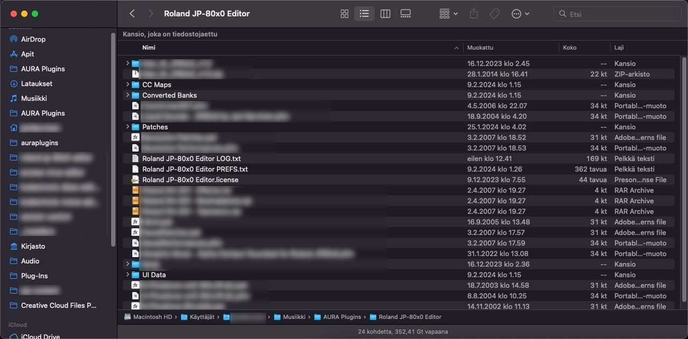

*Figure: JP-80x0 Editor User Manual - License file location in macOS*

### Register product from User Interface

### Method #1

Open the Editor Standalone Application and click the top left corner of the user interface where the Editor says, “ **RELOAD LICENSE [1]** ”. A new window will open to **prompt for license [2]** . Locate the **license [3]** and hit OK to register.

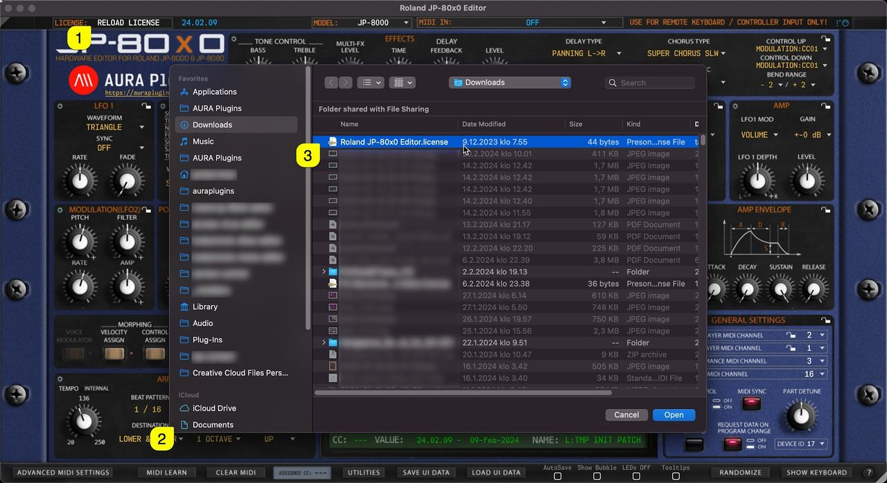

*Figure: JP-80x0 Editor User Manual - Register method #1*

### Method #2

Open the Editor Standalone Application and enter **BROWSER [1]** view, click **Bank Edit [2]** and choose **Register Editor… [3]** . A file prompt dialog will pop up just like in the image above.

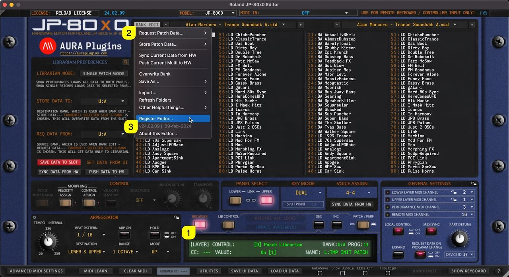

*Figure: JP-80x0 Editor User Manual - Register method #2*

After you have chosen the license file, close the application and reopen it. The editor display should now indicate “ **REGISTERED** ” in the top left corner.

IF the Editor shows “ **\*\* DEMO VERSION \*\*** ” you haven’t installed the FULL version yet or you might have the plug-in installed in several locations! Check the solution from the FAQ before you submit a ticket. You can submit ticket from My Account page once logged in

## How To Set MIDI Input and MIDI Output ports

### Set MIDI ports with Standalone Application

If you use the Standalone Application, click “ **Roland JP-80x0 Editor [1]** ” from the top bar and choose **Preferences [2]** . This will open **Preferences dialog [3]** where you can set MIDI Input Device and MIDI Output Device .

On Windows machines, the same dialog can be opened from the File menu.

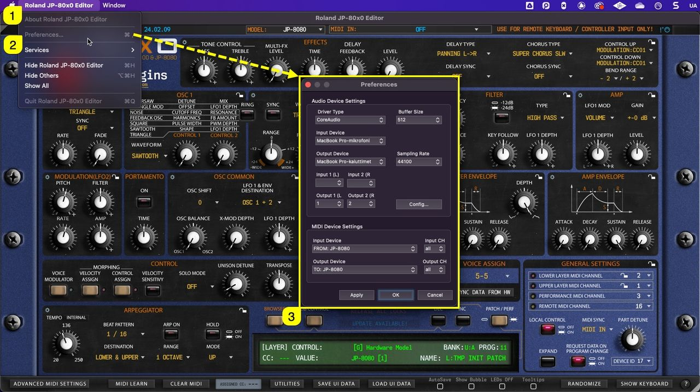

*Figure: JP-80x0 Editor User Manual – Setting MIDI Ports*

### Remote Keyboard Input

If you have an external MIDI controller you want to use with the Editor to trigger notes and tweak knobs with, you can select **MIDI IN** from the Editor top bar. This port won’t work with the synth itself and is only used for triggering MIDI events.


*Figure: Remote Keyboard Input available in Standalone App only!*

This port is only visible with Standalone Application.

**NOTE:** Audio Device Settings in the preferences dialog does not have capability to transmit audio in this stage. Choose Audio Drivers, but keep in mind that audio has to go through Audio Jacks to console or sound card inputs.

### Set MIDI ports with the Plug-in

**Select MIDI IN [1]** , where your JP MIDI Out is connected in at.

**Select MIDI OUT [2]** port which will send data to your JP MIDI Input.


*Figure: JP-80x0 Editor User Manual – Plug-in MIDI Ports*

### Hardware Check / Ping

After setting MIDI OUT, our Editor will start scanning for the hardware. If there is no immediate response, the Editor will attempt 3 more times. If there is no response, you might get a “ **Connection Timed Out** ” message. If so, double check your hardware settings and make sure your cables are good!

**NOTE:** MIDI ports for plug-in are set from the main window while Standalone Application MIDI ports are set from the Editor Preferences.

Editor Control Display will say “ **Editor is ready to go!** ” when a response is received from the JP.


*Figure: JP-80x0 Editor User Manual – Ready to go!*

You can optionally enable Device ID probing function, which will check for the Device ID for you. This is good IF you have only one JP model in your setup. Function can be enabled from **Utilities [1]** menu -> **Editor Preferences [2]** -> **Enable DeviceID Scanning [3]** .

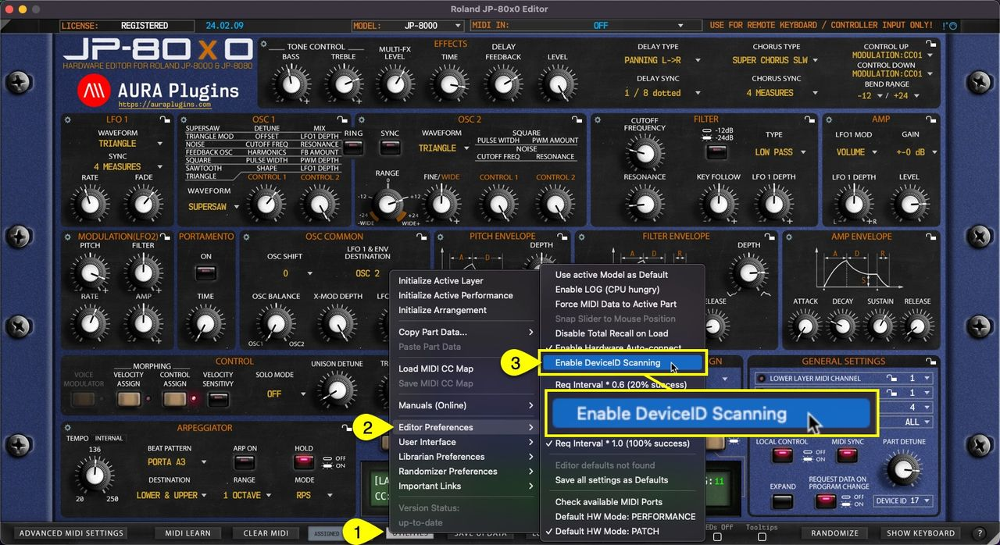

*Figure: JP-80x0 Editor User Manual – DeviceID Scanning*

**NOTE:** If you have Device ID set to 17 on the JP and 17 on the Editor, our Editor will find and establish connection to your JP if everything else is configured properly.

## How To Reset Stuck Notes (MIDI Panic)

If you get stuck notes or if you need to initiate a full MIDI reset, click the **MIDI Panic [1]** button. This function will send all notes off the MIDI message to the JP.

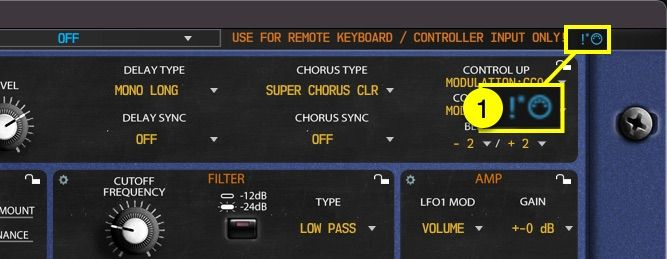

*Figure: JP-80x0 Editor User Manual - MIDI Panic*

## How To Adjust Advanced MIDI Settings

You can control which messages get processed and which do not. Open the Advanced MIDI Settings window by clicking **ADVANCED MIDI SETTINGS** button in the Editor user interface.

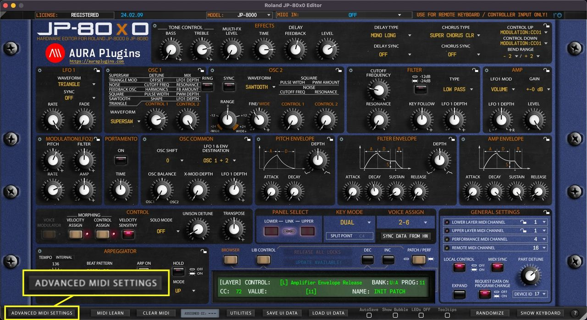

*Figure: JP-80x0 Editor User Manual – Open Advanced MIDI Settings from bottom left corner*

You can block messages being processed from DAW or from the Synthesizer itself. Settings seen in the image below are default values.

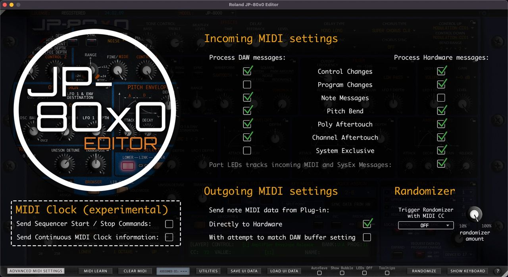

*Figure: JP-80x0 Editor User Manual – Advanced MIDI Settings view*

### Advanced Incoming MIDI Settings

Allow certain MIDI messages to pass into the Editor processor within the Incoming MIDI setting section. Green check mark means it will be processed and when there is no check mark, it will be bypassed. **Process DAW messages [1]** and **Process Hardware messages [2]** has their own set of data “filters” **[3-9]** available as follows:

- **[3]** Control Changes
- **[4]** Program Changes
- **[5]** Note Messages
- **[6]** Pitch Bend
- **[7]** Poly Aftertouch
- **[8]** Channel Aftertouch
- **[9]** System Exclusive
- **[10]** Part LEDs tracks incoming MIDI and SysEx messages\
  When the green check mark is on, incoming data from DAW and Hardware ports is monitored and an LED indicator will flash when data is coming in. When the check mark is off, outgoing data is being monitored. Check LEDs Off function to disable.

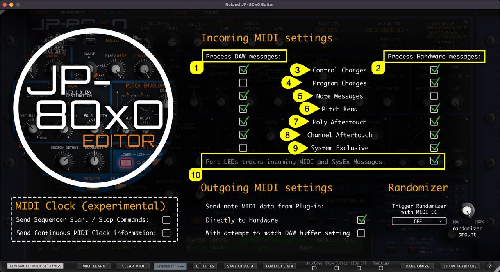

*Figure: JP-80x0 Editor User Manual – Advanced Incoming MIDI Settings*

**Note #1** : If you disable Control Changes and System Exclusive messages from the Hardware port, the Editor might stop responding to hardware knob movements completely.

**Note #2** : In Standalone Application use, Remote Keyboard MIDI Input data is handled in the Process DAW messages section.

### Advanced Outgoing MIDI Settings

In the Outgoing MIDI settings section, you can adjust a few options to fine tune the Editor behavior.

Send note MIDI data from Plug-in:

- **Directly to Hardware [1]** = Send all MIDI related commands directly to hardware from the MIDI output port.
- **With attempt to match DAW buffer setting [2]** = experimental attempt to sync with DAW time.


*Figure: JP-80x0 Editor User Manual – Advanced Outgoing MIDI Settings*

**NOTE:** If the Editor MIDI note handling is out of time, we would advise NOT to adjust these settings at all. Check your DAW user guide to figure out how to delay or advance your MIDI note timing / delay compensation.

### MIDI Clock (experimental)

We are experimenting to add a general MIDI clock to the Editor by standard feature. This might crash on some systems on a specific setup, so be cautious when experimenting with it.

Check **Send Sequencer Start / Stop Commands [1]** if you want to send MTC start and stop commands.

Check **Send Continuous MIDI Clock information [2]** if you want to sync MIDI clocked Effects and Arpeggiator to the Editor tempo information.


*Figure: JP-80x0 Editor User Manual – Advanced Outgoing MIDI Settings*

**NOTE:** The clock with the Editor might be inaccurate, so if you have another solution to sync clock information from your DAW to the hardware, use that instead.

## How To Use MIDI Learn

### MIDI LEARN (Map External Controller)

**MIDI LEARN [1]** allows you to map incoming MIDI CC control messages to certain controls of the Editor.

To activate MIDI LEARN, toggle on the button and follow instructions given in the Editor display.

- Move a knob or button on the Editor user interface.
- Move your remote controller slider, knob or button to assign CC.
- Toggle off **MIDI LEARN [1]** once completed.

Use the **Clear MIDI [3]** button to remove assignments. More details below.

The editor has an **Assigned CC [3]** display in the bottom bar to help you see what controller has been assigned to a selected parameter.

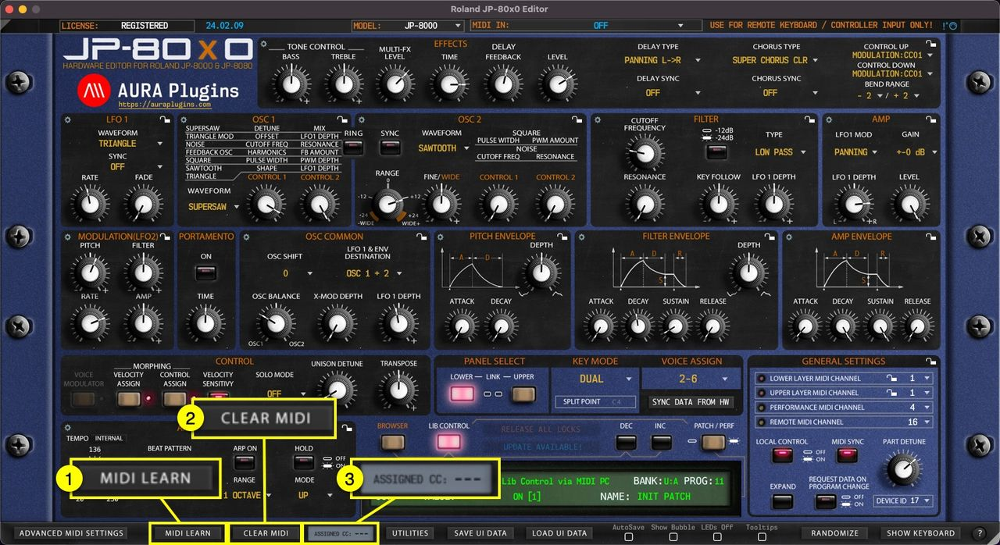

*Figure: JP-80x0 Editor User Manual - MIDI Learn Toggles*

### CLEAR MIDI (mappings)

**CLEAR MIDI [1]** opens a popup menu, where you can choose to **Clear All Assignments** at once, or **Clear Active Parameter** to remove assignment for set parameter. Active parameter is the knob / button / menu you have last clicked from the Editor user interface.

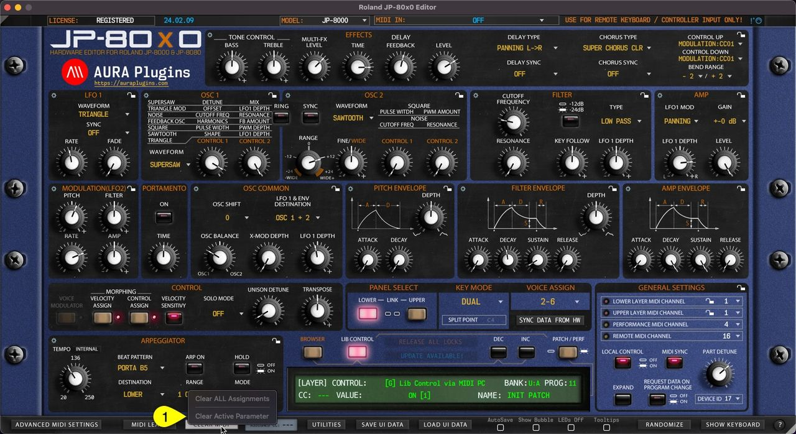

*Figure: JP-80x0 Editor User Manual - Clear MIDI mappings*

Both options are greyed out in the sample, because there are no assignments for set parameter.

## How To Save and Load UI Data

**Save UI Data** saves all the Editor settings in a single file, including global, performance and individual layer settings.

This is the best option to back up your favorite settings per project and it gives you portability to share your settings with someone else, or use the saved data in other projects.

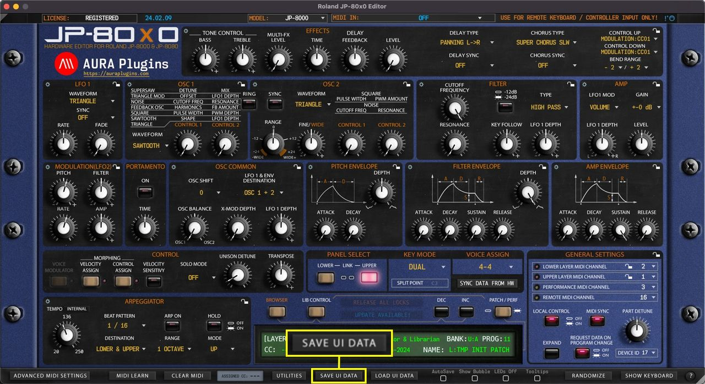

*Figure: JP-80x0 Editor User Manual - Save UI Data*

**Load UI Data** loads all the Editor settings from a single file, including global, performance and individual layer settings.

Once loading is completed, data will be automatically transmitted over to the JP temp buffer. You can load any UI Data saved with previous sessions.

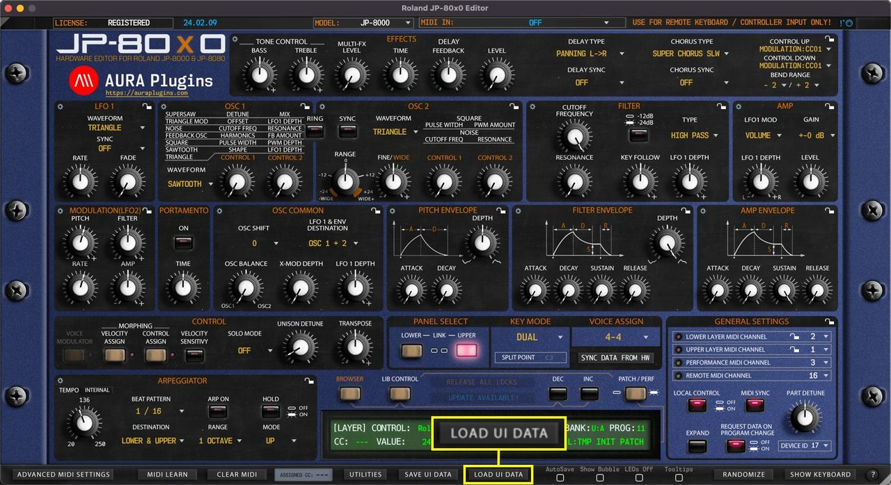

*Figure: JP-80x0 Editor User Manual - Load UI Data*

## How To AutoSave Librarian Edits

When **AutoSave** is toggled on, any changes made in the librarian left bank view will be automatically saved. This is a dangerous function, but as per request, we included this feature.

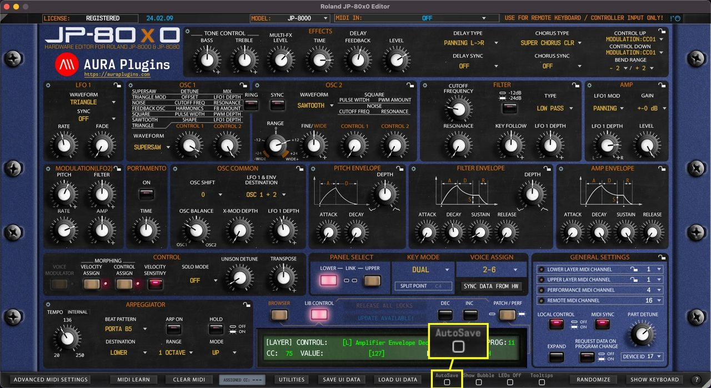

*Figure: JP-80x0 Editor User Manual - AutoSave Librarian Changes*

**NOTE:** Be aware that there is **NO** UNDO function, so you cannot revert to the previous state if you make a mistake. We would advise to make a copy of the original bank (if needed) before making changes to the bank with autosave on. Defaults to off state.

## How To Use Show Bubble Function

**Show Bubble [1]** does what it says, when the parameter is adjusted with the mouse, a **bubble [2]** will pop up above the parameter displaying the parameter value as you change it. You can also see the parameter name and value in the **Editor control display [3]** .

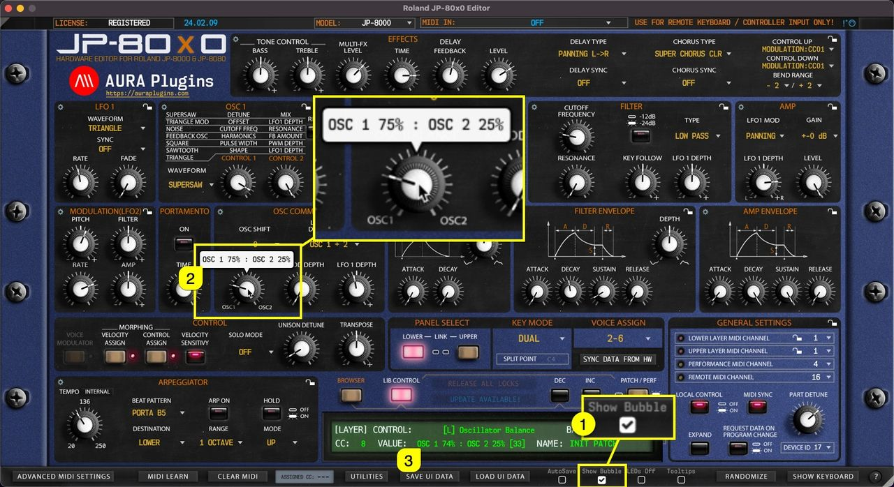

*Figure: JP-80x0 Editor User Manual - Show Bubble*

## How To Disable Editor LEDs

If you don’t like or need to see the **LEDs [2]** blinking, you can toggle **LEDs Off [1]** with once click.

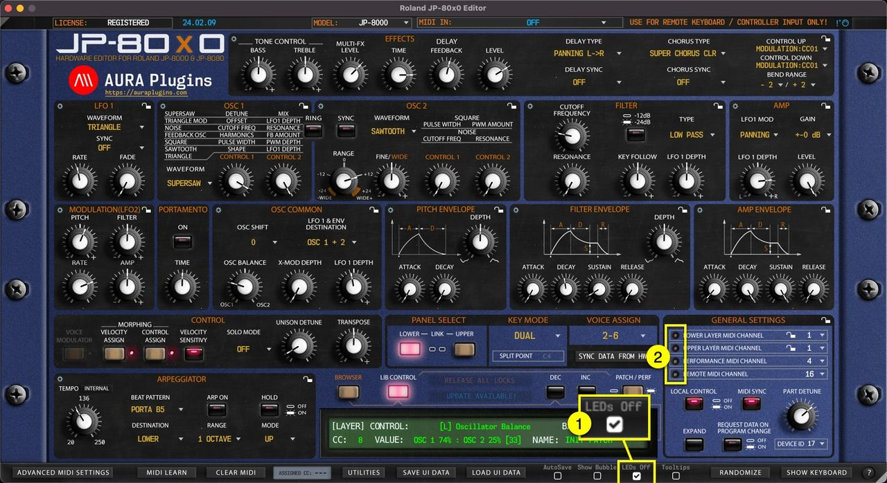

*Figure: JP-80x0 Editor User Manual - LEDs Off*

**TIP** : Open ADVANCED MIDI SETTINGS page you can define if LEDs will blink when MIDI is being received or when it is being transmitted. Default value is set to follow incoming MIDI data.

## How To Display Parameter Tooltips

**When Tooltips [1]** is toggled on, **tooltip text [2]** will appear if you hold your mouse cursor steadily over the parameter. You also get parameter info displayed in the **Editor control display [3]** while hovering over parameters, like CC number assigned by default, parameter name and the current value.

*Tooltips are courtesy of Roland Corporation and more details can be found from JP-8000 / JP-8080 User Manual.*


*Figure: JP-80x0 Editor User Manual - Tooltips*

## How To Use Randomizer

With the **RANDOMIZE [1]** button, you can trigger randomization on the currently active part. **Different Sections [2]** can be locked individually to prevent changes during randomize / patch change process. More about Section Locks further below.

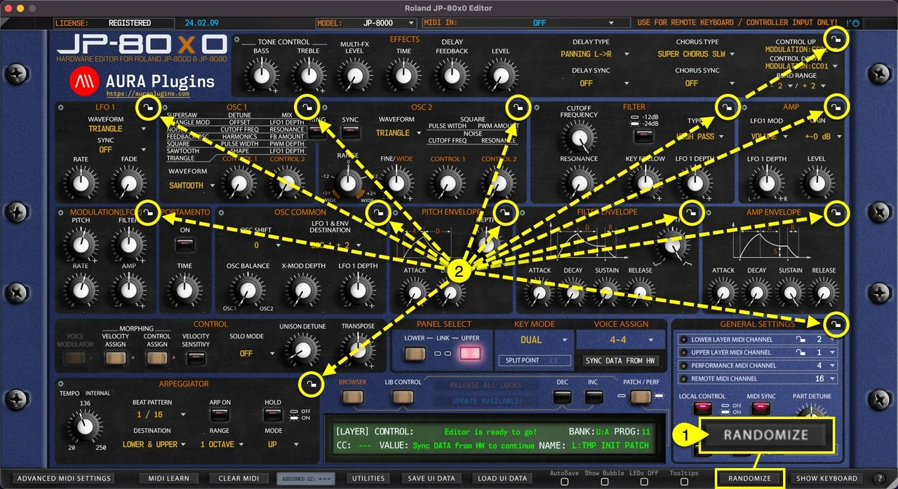

*Figure: JP-80x0 Editor User Manual - Randomize*

By default, Randomize will take effect on the active edit tab. If you want to randomize the whole patch at once, open **Utilities [1]** menu -> **Randomizer Preferences [2]** and uncheck **Focus on Active TAB content**. You can further fine-tune your randomization process by unchecking excluded options below that or then check them if they are off.

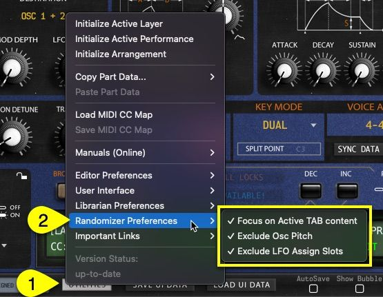

*Figure: JP-80x0 Editor User Manual - Randomize Preferences*

Open **Advanced MIDI Settings [1]** view to further adjust Randomizer settings. You can set **MIDI CC [2]** from the menu which will trigger the randomization, and the **randomizer amount [3]** in percentages to get more subtle randomization or turn it all the way for maximum effect.

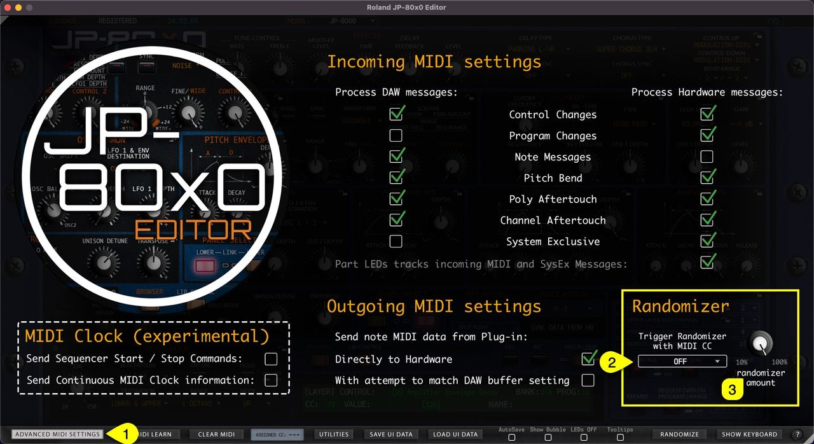

*Figure: JP-80x0 Editor User Manual - Randomize Settings*

## How To Show Keyboard (Part Focus)

Toggle on **SHOW KEYBOARD [1]** to display “on-screen” keyboard, **Pitch Wheel [2]** and **Modulation wheel [3]** . You can play individual keys with mouse click or you can use your computer “QWERTY”-keyboard, in other words: normal typing keyboard to play in notes.

Keyboard also features velocity sensitivity when played with a mouse.

- If you click closer to the “root” **[4]** of the key, the lower velocity input is given.
- If you click closer to the “end” **[5]** of the key, the higher velocity input is given.


*Figure: Screenshot*

Use keys **A, W, S, E, F, T, G, Y, H, U, J, K, O, L** to play the keyboard.

Use keys **Z** and **X** to adjust the octave range.

### SHOW KEYBOARD & PART FOCUS

When **SHOW KEYBOARD [1]** is toggled on, the Editor will focus all incoming MIDI data to the currently selected Layer. Now when UPPER layer is selected you see a **DIN indicator [2]** in set layer warning that all MIDI is routed to UPPER layer. You can also see a **text entry [3]** indicating that part focus is on!


*Figure: JP-80x0 Editor User Manual - Part Focus*

**NOTE:** When DAW playback is on, MIDI data is transmitted normally per layer.

## How To Show Quick Help

Get quick tips of the bottom bar functions when you click the **? [1]** mark in the bottom bar.


*Figure: JP-80x0 Editor User Manual - Quick help Trigger*

Use the same button to close the quick tips view.


*Figure: JP-80x0 Editor User Manual - Quick help for Bottom Bar*

## How To Sync Data From Hardware

### Performance data and individual layers

### Method #1

If **PERFORMANCE [1]** mode is toggled on, **Sync Data from HW [2]** button will request **performance data [3]** and individual layers to the user interface like discussed earlier. This will take some time depending on the selected JP model. JP-8080 requests take a bit longer due to differences in the data package.

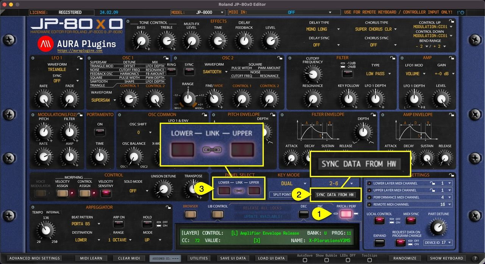

*Figure: JP-80x0 Editor User Manual - Sync Data Method #1*

### Method #2

If **BROWSER [1]** view is toggled on, **Sync Data from HW [2]** button will request performance data and individual layers to the user interface just like the previous method. This will also request Global data which is essential on the first sync.

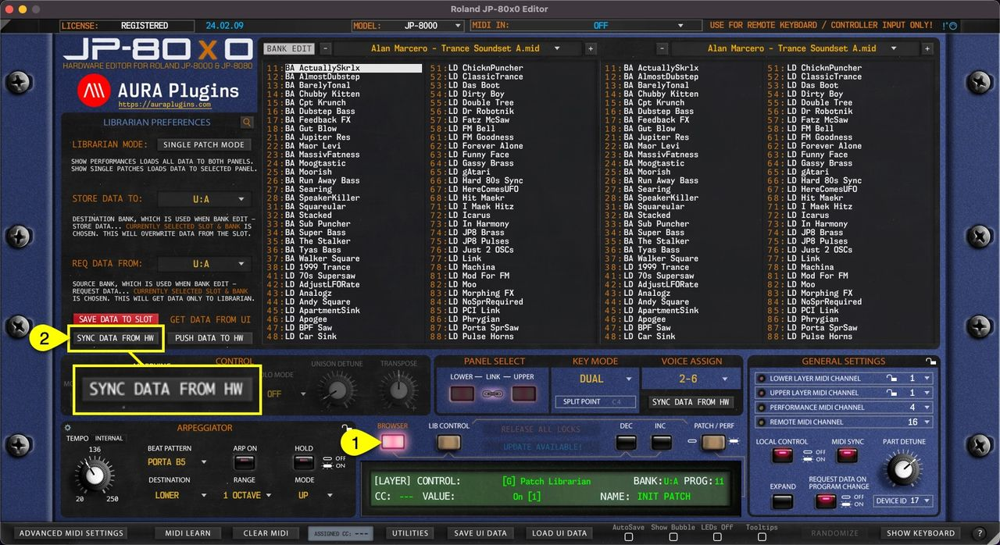

*Figure: JP-80x0 Editor User Manual - Sync Data Method #2*

### Individual Layers

You can also make a quick request for individual layers when **BROWSER [1]** is toggled off. **Sync Data from HW [2]** will request active data to the **selected layer [3]** instead of complete data request, but ONLY if data mode is set to **Patch Mode [4]** .

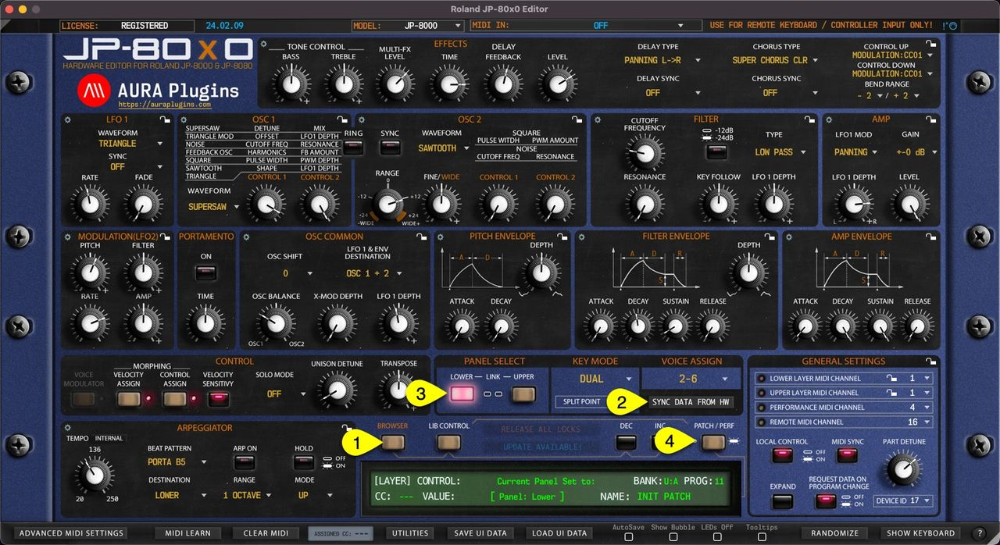

*Figure: JP-80x0 Editor User Manual - Sync Individual Layers*

**TIP** : Be patient and do not disturb the data flow with any knob movements or so. This will ensure the data packages are being sent and received as expected and you are not going to receive any SysEx error messages!

If you feel like your MIDI device can do faster requests than what we have set, you can try to play around with the Request Interval multiplier. **Open Utilities [1]** menu, select **Editor Preferences [2]** and select first value from the **options [3]** available. The editor will automatically increase the value if it experiences drop-outs during the request process.

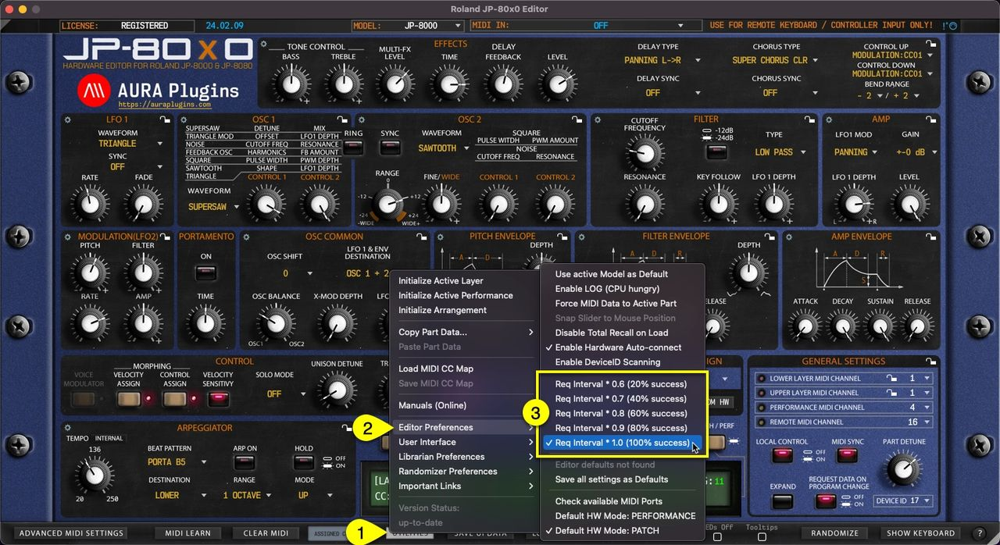

*Figure: JP-80x0 Editor User Manual - Sync Request Interval*

## How To Push Data To Hardware

Another great feature we added is the ability to force data being sent to your synthesizer if needed. This could happen for couple of reasons:

1. MIDI interface ports are no longer available, and you have assigned new MIDI ports manually.
2. You open your session in a studio, where the studio JP is connected to a different port.
3. Failure of Total Recall function.

**Open BROWSER [1]** view and click **PUSH DATA TO HW [2]**. This will send current Performance data and each individual layer's data to the JP.

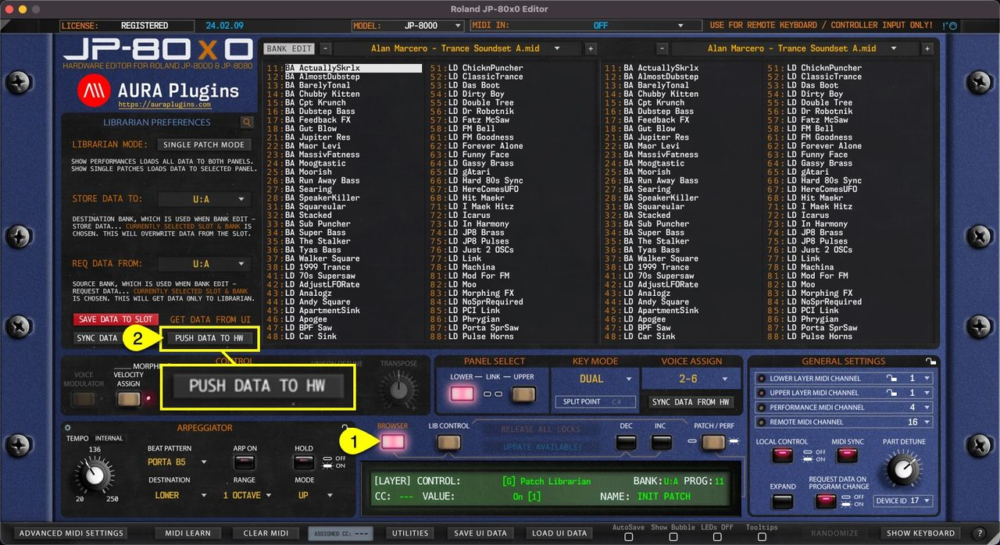

*Figure: JP-80x0 Editor User Manual - Push Data to JP*

**NOTE:** Data sending takes time depending which model you have in question. Let the Editor do its thing and don’t tweak any parameters during this time. It could potentially disturb the SysEx data sending process and you need to start again.

## How To Abort Processes

Cancel current request / writing task by clicking **ABORT PROCESS** button, if the process is taking too long, or if you get constant Device ID checks while any data request is active.

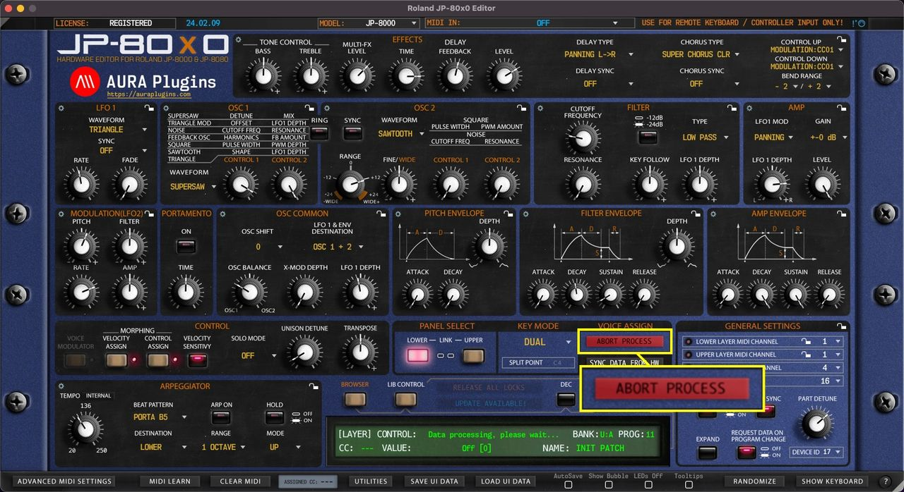

*Figure: JP-80x0 Editor User Manual - Abort Process*

The Abort Process button will disappear after the Editor has scanned Device IDs and/or if the request process has timed out.

## How To Use Section Locks

We added a Section Lock function to lock certain sections of the Editor to prevent changes up on part program changes or when a randomizer is triggered. This is great when you find a perfectly adjusted filter or oscillator: lock the section to keep those settings locked in.

You can lock any of the sections which have the **LOCK [1]** symbol in it – There are more locks available in the other tabs too!

When **LOCK [1]** is toggled on at any section, **RELEASE ALL LOCKS [2]** button will allow you to release all locks with one click. This is ideal if you have overlooked your layers and data is being transmitted back and forth even if you don’t want that.

**LOCK [3]** on the “ GENERAL SETTINGS ” view locks or unlocks the entire layer at once. There are individual locks for both layers.

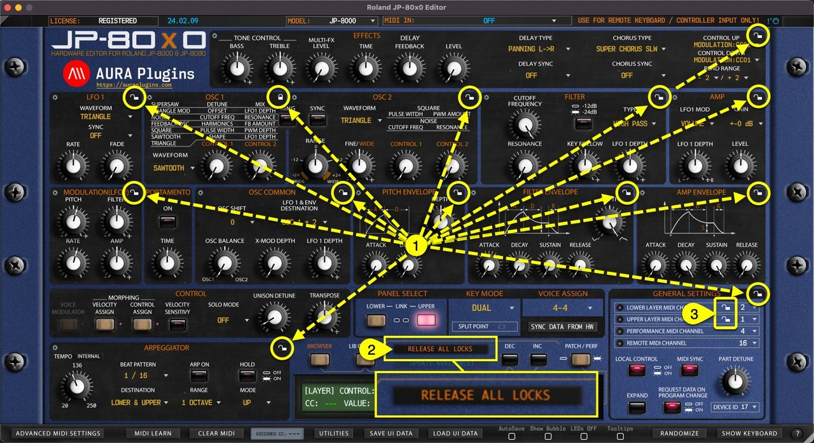

*Figure: JP-80x0 Editor User Manual - Section Locks*

**NOTE:** When you have sections locked, there will double the amount of SysEx traffic in the MIDI stream due to the fact that the Editor has to send the ”locked” info back to the hardware after the patch is changed. If you scroll patches from the librarian, then the data stream is normal.

## How To Use Section Menus

We added a Section Menu function to aid with creating sounds, recalling favorite section settings or saving your own as you go. You can even Randomize a single section to create exciting new textures! Section Menu opens when you click any of the “ **gears** ” **[1]** icon in the user interface.


*Figure: JP-80x0 Editor User Manual - Section Menus*

### Section Menu Items


*Figure: JP-80x0 Editor User Manual - Section Menu Items*

- **Copy Data**\
  Copy Section Data to clipboard.
- **Paste Data**\
  Paste Section Data from clipboard.
- **Randomize**\
  Randomize Section Data with Randomizer settings applied from Utilities Menu & Advance MIDI Settings page.
- **Presets**\
  Load a preset saved for the set Section. The first item on the list is always “ **Set to Initial Values** ” which loads Section default settings.
- **Save As…**\
  You have a great Filter setup you want to use in later sound design? No problem, just save your Filter or any other section data to HDD for later use.

Data is stored in

*~/Music/AURA Plugins/Roland JP-80x0 Editor/UI DATA/Section Presets/(section name)*

## How To Change Programs

### PROGRAM CHANGE BUTTONS

**DEC [1]** button will change to previous program.

**INC [2]** button will change to the next program.

This will trigger a MIDI Out message with appropriate program number based on the PROG Display value. Each part has its own set of Program Change buttons.

See below how it will behave when **Request Data on Program Change** is toggled on / off.


*Figure: JP-80x0 Editor User Manual - Program Change Buttons*

### REQUEST DATA ON PROGRAM CHANGE

**REQUEST DATA ON PROGRAM CHANGE** means that if the Editor receives a program and/or bank change message from MIDI input, our Editor will initiate a Data request from the JP to the Editor user interface.

Inputs valid for this function:

- MIDI In port (Plug-in).
- DAW gateway (Plug-in).
- Remote Keyboard MIDI In port (Standalone Application).
- Editor Program Change buttons (per part) (\*1).
- Editor Program Number display (per part) (\*2).
- Editor Bank Number display (per part) (\*3).

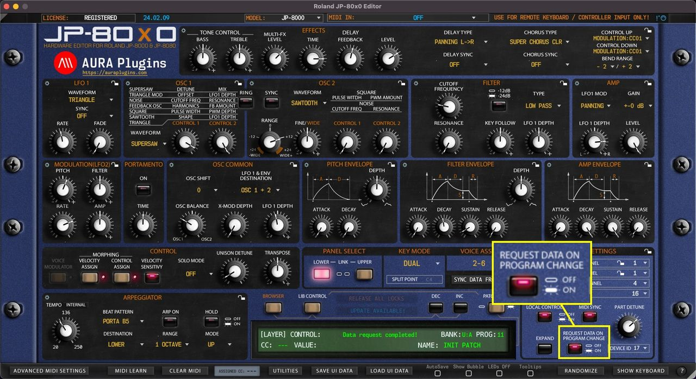

*Figure: JP-80x0 Editor User Manual - Request Data on Program Change*

If this switch is toggled off, our Editor will only send the program change messages to the hardware but won’t be requesting any data back. This is good in some cases where you might want to quickly browse hardware patches.

(\*1 See above for Program Change Buttons).

(\*2 See below for Program Number Display).

(\*3 See next page for Bank Number Display).

**TIP**: Turn off Request Data On Program Change and Lib Control to quickly browse through the hardware presets. Once you hit a sound you want to work on, click Sync Data from HW button to request the data to the Editor user interface and work it from there!


*Figure: JP-80x0 Editor User Manual - Change Program on Hardware Only*

### LIBRARY CONTROL ON PROGRAM CHANGE

**Lib Control** switch allows you to take control of your library patches with incoming program changes via MIDI or with the Editor user interface DEC / INC buttons and Bank Number Display / Program Number Display menus.


*Figure: JP-80x0 Editor User Manual - Library Control on Program Change*

**Note #1** : Patches are sent to the hardware on the currently selected part when the menu is used to change programs.

**Note #2** : If the program change message is received from MIDI channel 4 and none of your layers are set to channel 4, no action will be taken.

**Note #3** : If the program change message is received from MIDI channel 1 and both layers are set to channel 1, no action will be taken. Change the MIDI channel temporarily to a different channel.

### PROGRAM NUMBER DISPLAY / SELECTION MENU (\*3)

**PROG Display [1]** acts as a menu as well as a display to show the current Part Patch program number. You can quickly navigate to different banks of programs without having to click Program Change buttons like crazy.

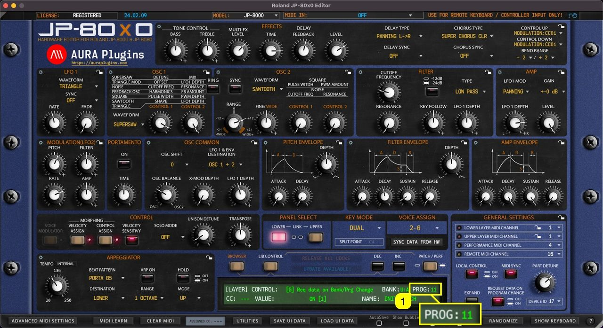

*Figure: JP-80x0 Editor User Manual - Program Change Menu*

In default status ( **REQUEST DATA ON PROGRAM CHANGE** ), this popup menu will display program numbers in different banks of programs. See image below.

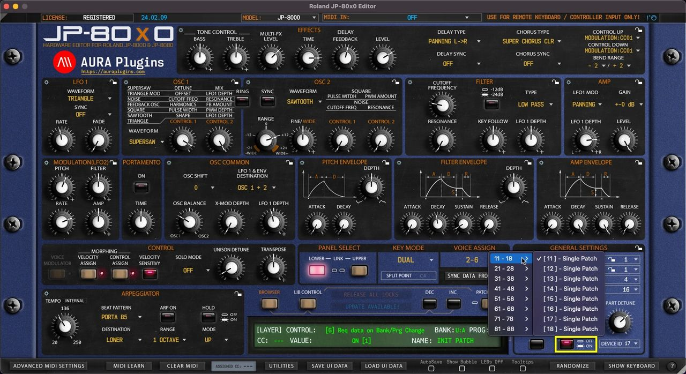

*Figure: JP-80x0 Editor User Manual - Program Change Menu Default mode*

But things get exciting when you toggle on **LIB CONTROL [1]** switch: You can now view currently active Librarian Bank patches on the menu and browse them directly from the main user interface!

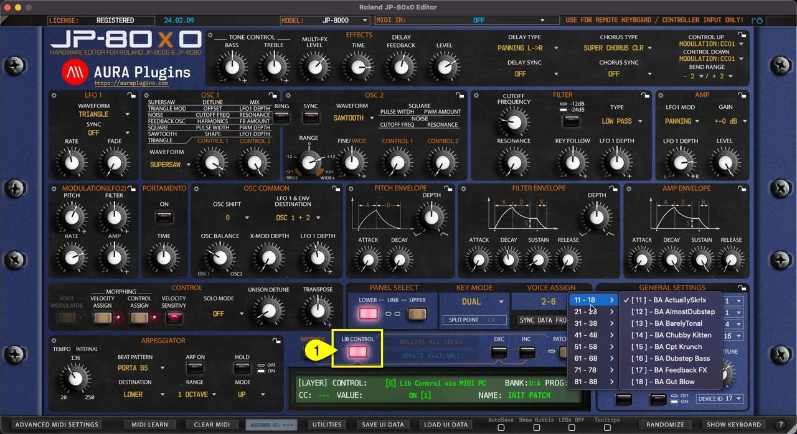

*Figure: JP-80x0 Editor User Manual - Program Change Menu Lib Control On*

Check above for further details about the Library Control function.

## How To Change Banks

**BANK Display [1]** acts as a menu as well as a display to show the active Layer Patch bank number. You can navigate to different banks based on your selected JP model.

If your model is set to JP-8000, the bank menu does not have as many options as when JP-8080 is set as a current model. This is because JP-8080 has a bigger memory capacity. When **REQUEST DATA ON PROGRAM CHANGE** is toggled on, this popup menu will display bank numbers available to browse.

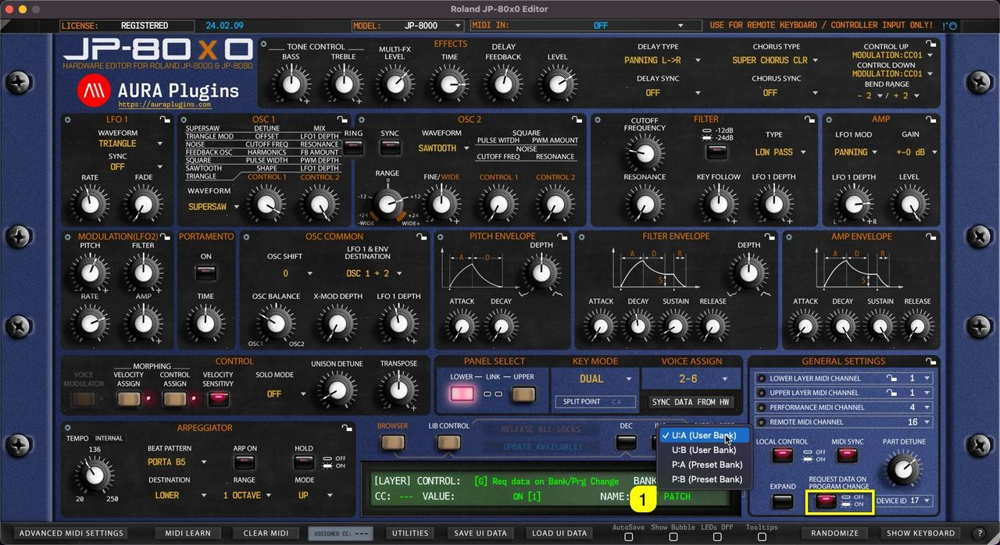

*Figure: JP-80x0 Editor User Manual - Bank Change Menu*

Like with PROG Display, **BANK Display [1]** will behave completely differently when **LIB CONTROL [2]** is toggled on. You can now view all available Patch Banks located in the Patches folder.

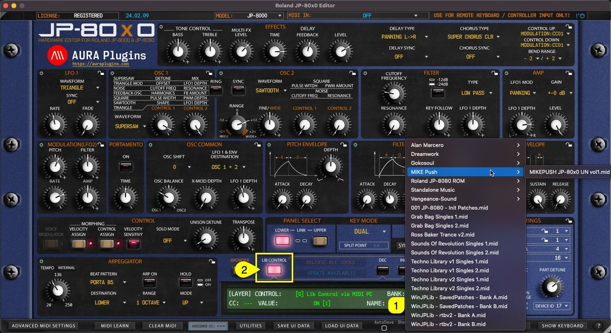

*Figure: JP-80x0 Editor User Manual - Bank Change Menu Lib Control On*

## How To Change Layers

### LAYER SELECT

**Layer Select [1]** is a standard feature of the JP, which will change the current Performance Layer of the synthesizer. Data from the Editor user interface will be sent to the currently selected layer. i.e., if you move Filter Cutoff 1 from the UI while Upper Layer is selected, then Filter Cutoff in the Upper Layer of the synth will change.

Now, some of you don’t know, but you can have TWO massive supersaw engines in a single JP!

Each layer has its own set of **Parameters [3]** – These parameters are spread across **three different tabs [2]** . Also, Browser can handle each layer individually meaning, you have full access to all patches per layer.

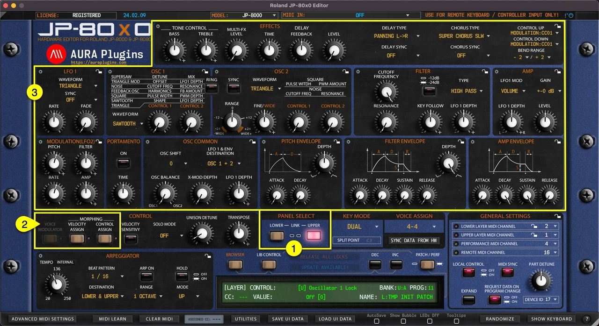

*Figure: JP-80x0 Editor User Manual - Layer Select*

### Active Layer quick actions menu

With a right mouse click, you can open the Layer Quick actions menu for active **layer [1]** . Most of these are utilities menu items but they are faster to reach right after selecting a layer.

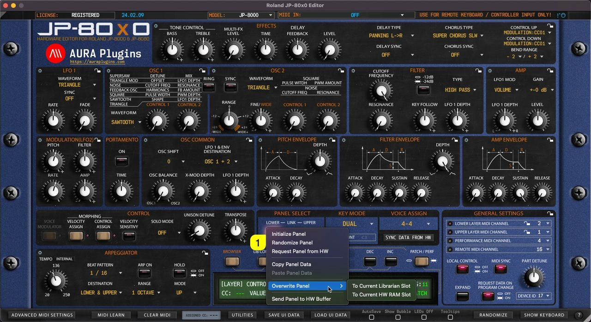

*Figure: JP-80x0 Editor User Manual - Layer Action Menu*

### VELOCITY ASSIGN LAYER

**Velocity Assign [1]** Layer allows you to set keyboard velocity range per **knobs [2]** , per **panel [3]** . This means the upper and lower layer can have individual Velocity Assignment values to create interesting textures. If layer parameters have Velocity range set, you can see a little red LED being lit up next to the **Velocity Assign [1]** button.

From this view, you can choose the level of your Velocity amount for knobs which have an orange ring on top of the knob. This amount can be negative or positive. When the knob is at 12 o’clock, the amount is 0. When you move the knob counterclockwise, you will apply a negative amount of sensitivity and when you move the knob clockwise, you will apply a positive amount of sensitivity.

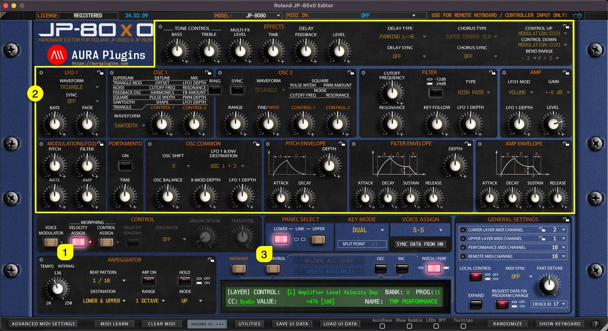

*Figure: JP-80x0 Editor User Manual - Velocity Assign Layer*

### CONTROL / RIBBON ASSIGN LAYER

**Control Assign [1]** Layer allows you to set Mod Wheel / Ribbon range per **knobs [2]** , per **panel [3]** . This means the upper and lower layer can have individual Control Assignment values to create interesting textures. If layer parameters have a Control range set, you can see a little red LED being lit up next to the **Control Assign [1]** button.

From this view, you can choose the level of your Control amount for knobs which have an orange ring on top of the knob. This amount can be negative or positive. When the knob is at 12 o’clock, the amount is 0. When you move the knob counterclockwise, you will apply a negative amount of sensitivity and when you move the knob clockwise, you will apply a positive amount of sensitivity.

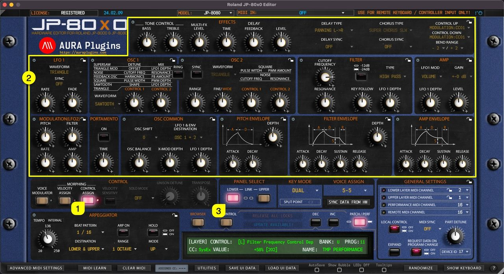

*Figure: JP-80x0 Editor User Manual - Control / Ribbon Assign Layer*

### GLOBAL SETTINGS

When the **EXPAND [1]** button is toggled on, you can view and modify **Global Settings [2]** . These settings are additional settings on top of **General Settings [3]** which are mainly for Performance Control.

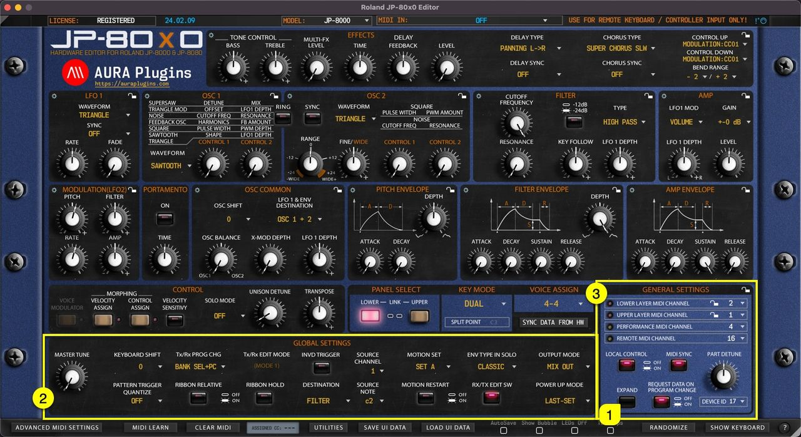

*Figure: JP-80x0 Editor User Manual - Global and General Settings*

## How To View Patch Name

**Patch Name [1]** can be viewed and/or set when the Editor is in **Patch MODE [2]** . Patch name is individual per **layer [3]** . Rename layer by clicking the patch name.

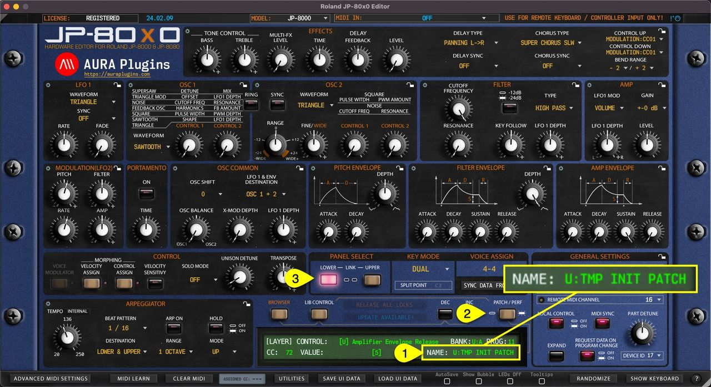

*Figure: JP-80x0 Editor User Manual - Patch Name Display*

**NOTE:** Renaming a single patch from the “Control Display” does not change the name in the librarian. If you want to rename librarian items, check Related Docs below or use search function.

## How To View Performance Name

**Performance Name [1]** can be viewed and changed when the Editor is in **Performance MODE [2]** . Rename performance by clicking the performance name.

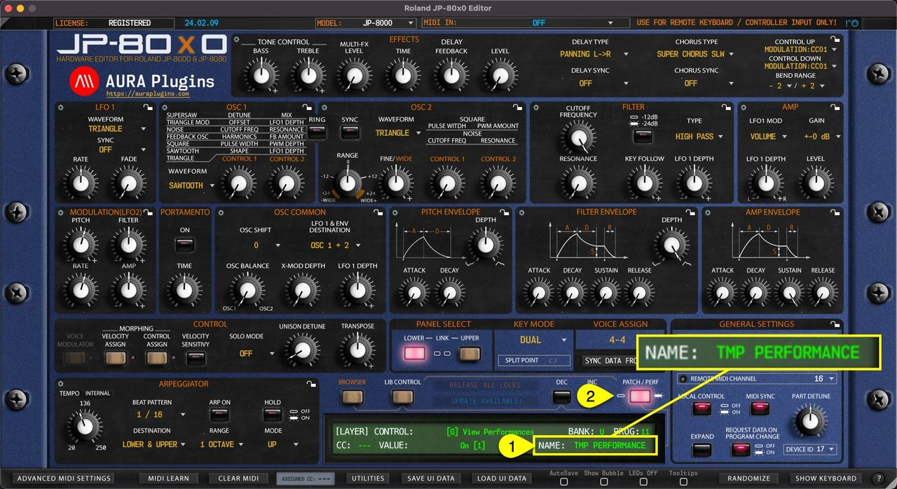

*Figure: JP-80x0 Editor User Manual - Performance Name Display*

**NOTE:** Renaming the Performance from the “Control Display” window does not change the name in the librarian. If you want to rename librarian items, check Related Docs below or use search function.

## How Total Recall Works

This is one of the best features we can think about our plug-in, total recall. It does what it says: recalls your saved session data from the plug-in user interface to your synthesizer, without the need of doing it manually! It is all automated, if you have the same MIDI device hooked into your setup as it was when saving the project.

If there are any trouble with the total recall, please check below for further instructions on how to Push Data to HW manually.

Possible reasons for failure of total recall are:

1. Your MIDI interface is no longer in the system.
2. Plug-in update does not fully support the previous version data package.

There is a work-around for that as well, so be sure to check out our knowledge base for more details about that.

If you don’t need the Total Recall function, click **Utilities [1]** menu -> **Editor Preferences [2]** and check **Disable Total Recall on Load [3]** .

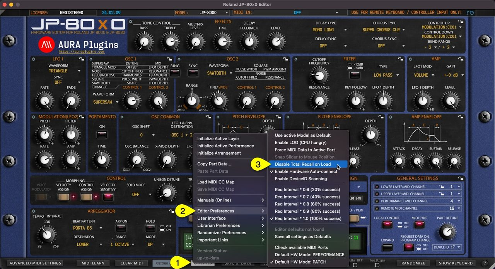

*Figure: JP-80x0 Editor User Manual - Disable Total Recall*
