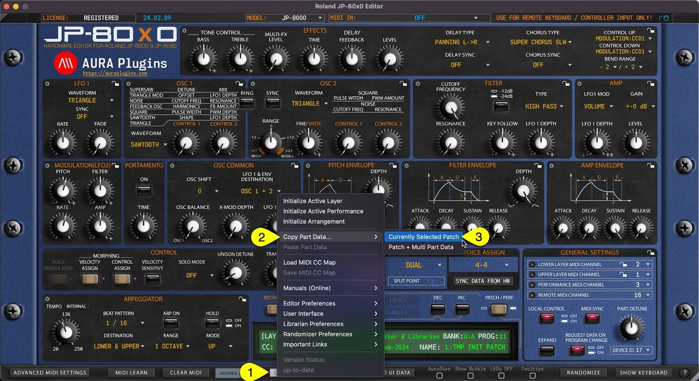
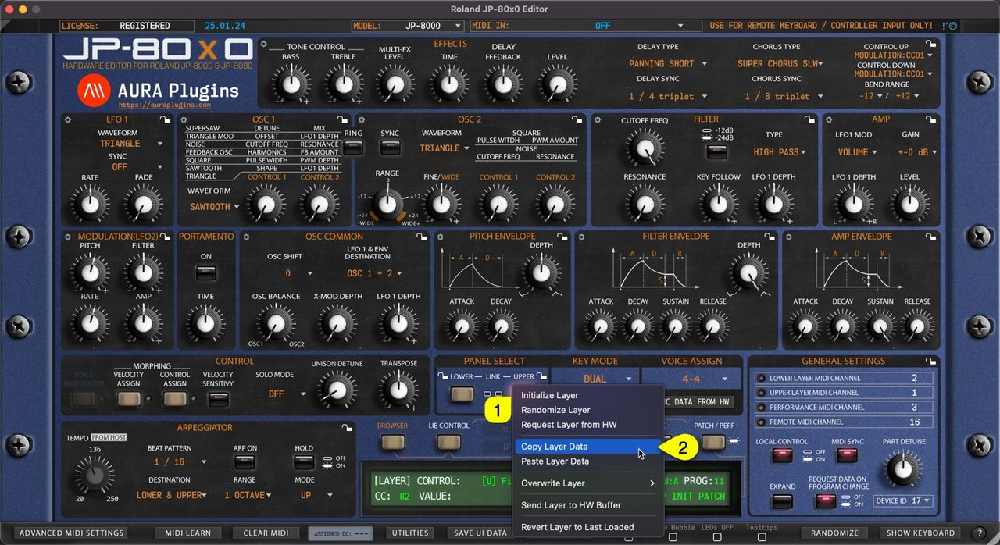
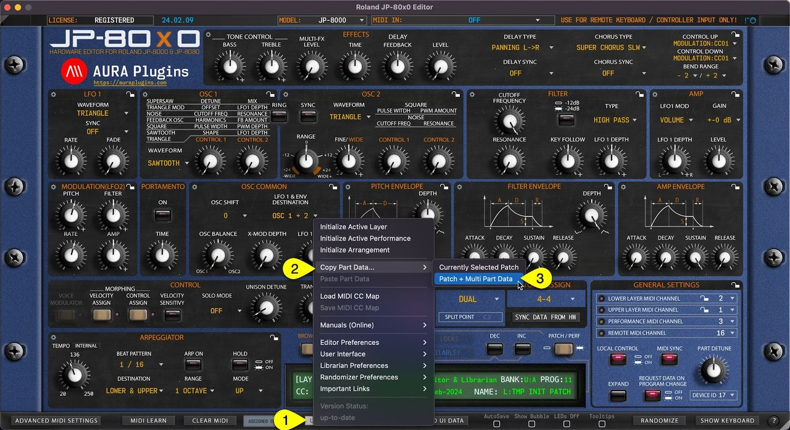
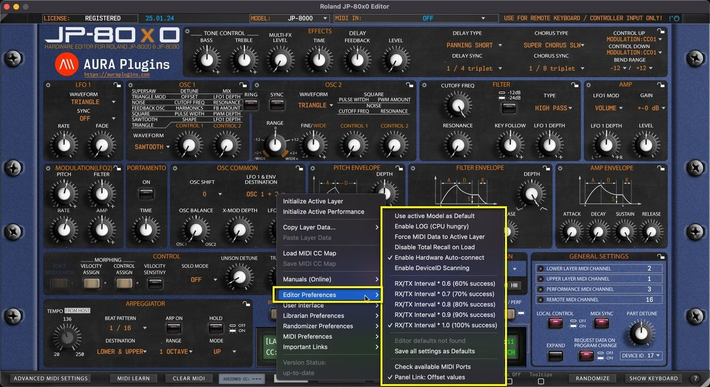
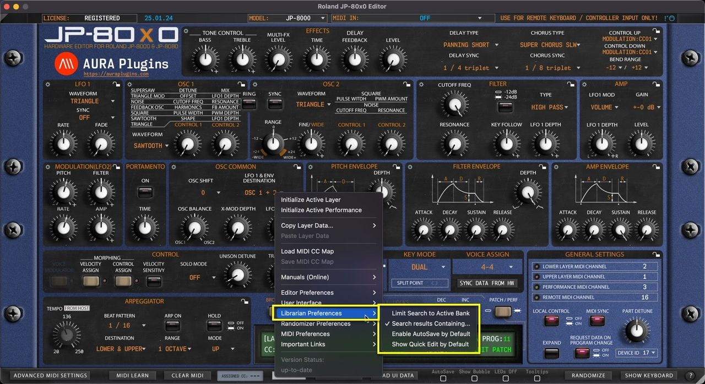
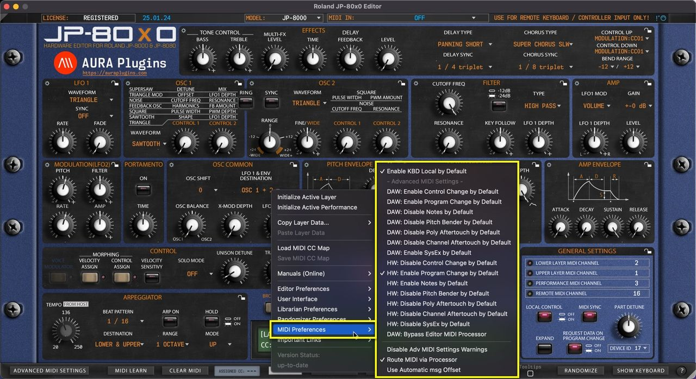

# Utilities Menu

## Utilities Menu

**UTILITIES [1]** menu can be found from the bottom bar of the Editor. Once you click the UTILITIES button, a popup menu will appear giving you a lot of different utilities. We will go through these one by one.

*Figure: JP-80x0 Editor User Manual - Utilities Menu*

### Utilities menu items

- **Initialize Active Layer**
- **Initialize Active Performance**
- **Initialize Arrangement**
- **Copy Part Data…**
    - Currently Selected Patch
    - Patch + Layer Performance Data
- **Paste Part Data**
- **Load MIDI CC Map**
- **Save MIDI CC Map**
- **Manuals (Online) These are obvious, so not covering these..**
- **Editor Preferences**
    - Use active Model as Default
    - Enable LOG (CPU hungry)
    - Force MIDI Data to Active Layer
    - Disable Total Recall on Load
    - Enable Hardware Auto-connect
    - Enable DeviceID Scanning
    - Req Interval \* 0.6 -> \* 1.0
    - Save all settings as Defaults
    - Check available MIDI Ports
    - Panel Link
- **User Interface**
    - Use Hi-Res Graphics (4/5/8K)
    - Size: Auto (default)
    - Size: 50% – 175%
    - Enable Bubble Control by Default
    - Disable LEDs by Default
    - Enable Tooltips by Default
    - Show param values on Mouse over
    - Double Click resets control to…
- **Librarian Preferences**
    - Limit Search to Active Bank
    - Search results Containing…
    - Enable AutoSave by Default
    - Show Quick Edit by Default
- **Randomizer Preferences**
    - Focus on Active TAB content
    - Exclude Osc Pitch
    - Exclude LFO Assign Slots
    - Exclude Mode Menus
- **MIDI Preferences**
    - Enable KBD Local by Default
    - Advanced MIDI Settings default overwrites
    - DAW: Bypass Editor MIDI Processor
    - Disable Adv MIDI Settings Warnings
- **Important Links**

These are obvious, so not covering these..

- **Version Status**
    - Up-to-date
    - Update available

## Initialize Active Layer

You can Initialize Active Layer by clicking **Utilities Menu [1]** and then **Initialize Active Layer [2]** . This function will initialize whichever Layer you have active at the moment.

Upper or Lower Layer Patch, Velocity and Control assigned values will be initialized.

This is helpful if you load a performance which has a great patch on one layer, but the other one needs crafting from scratch.

*Figure: JP-80x0 Editor User Manual - Initialize Active Layer*

You can achieve the same result if you right click on the currently selected **layer toggle [1]** and select **Initialize Layer [2]** from the menu.

*Figure: initialize layer*

## Initialize Active Performance

You can Initialize Active Performance by clicking **Utilities Menu [1]** and then **Initialize Active Performance [2]** . This function will initialize both Layers.

Upper and Lower Layer Patch, Velocity and Control assign values will be initialized as well as Performance Settings also known as General Settings.

*Figure: JP-80x0 Editor User Manual - Initialize Active Performance*

## Initialize Arrangement

You can Initialize Arrangement by clicking **Utilities Menu [1]** and then **Initialize Arrangement [2]** . This function will initialize the whole Editor to initial state.

This will also Initialize the Global Settings to default values.

*Figure: JP-80x0 Editor User Manual - Initialize Arrangement*

## Copy Layer Data

### Currently Selected Layer

You can copy currently selected Layer data to clipboard and paste the data to another Layer for further processing. Here is how you can do it: **Open Utilities Menu [1]** , select **Copy Layer Data… [2]** and then select **Currently Selected Layer [3]** .

This function will only copy the layer patch data to clipboard.

*Figure: JP-80x0 Editor User Manual - Copy Currently Selected Layer*

You can achieve the same result if you right click on the currently selected layer **toggle [1]** and select **Copy Layer Data [2]** from the menu.

*Figure: copy layer data*

### Layer + Performance Settings

This function works just like the function above but additionally it will copy the Performance Layer data in clipboard as well. This data contains MIDI channel, LFO and effect sync settings etc. Open **Utilities Menu [1]** , select **Copy Layer Data…[2]** and then select **Layer + Performance Settings [3]** .

*Figure: JP-80x0 Editor User Manual - Copy Layer + Performance Settings*

## Paste Layer Data

### Paste Layer Data

You can paste currently copied Layer data from the clipboard. Open Utilities Menu and select **Paste Layer Data… [1]** .

If you have single Layer data copied, then this is only pasted. On the other hand, if you have Layer and Layer Performance data on clipboard, then this will be pasted.

*Figure: paste layer data*

See previous page for explanation for each copy function and what they include.

You can achieve the same result if you right click on the currently selected layer **toggle [1]** and select **Paste Layer [2]** from the menu.

*Figure: paste layer data*

## Save and Load MIDI CC Maps

*Figure: load save cc maps*

### Save MIDI CC Map

If you have learned MIDI CC controls from your master controller you can save the mapping to HDD. Say you have General MIDI controls cc #12 assigned to filter cutoff (74) and #13 assigned to filter resonance (71), you can save the current mapping to a file and open it every time you insert a new instance of the Editor.

### Load MIDI CC Map

This function loads your custom CC mapping to the Editor and over-rides the default CC assignments.

**NOTE:** Loading custom CC mappings does not over-ride hardware CC messages. ie. Cutoff from hardware is still assigned to #74, while DAW (midi controller) CC is mapped to #12

## Utilities: Editor Preferences

*Figure: utilities editor preferences*

### Utilities Menu – Editor Preferences Breakdown

### Use active Model as Default

If you have only synth in your setup, you can toggle on “**Use active Model as Default**” AFTER you have chosen your model from the top row dropdown list.

This way each new instance is automatically set to a specific model, ie JP-8080.

### Enable LOG

If you have trouble loading the Editor, you enable the LOG function via the Roland JP-80x0 Editor PREFS.txt file found in:

Change the line “log: no ” to “log: yes ” and the line with “ 0 ” (zero) to “ 9000 “. Save the file, close it and then re-open the Editor.

If any errors occur, open the Roland JP-80x0 Editor LOG.txt found in the same place as above, see what the last line says. If the last line is saying

“ Loading bank x.mid ” and log ends there, the issue is with that specific bank. Send it over to us for inspection via the ticket form and we will fix it.

### Force MIDI Data to Active Layer

This function routes all incoming MIDI CC data to the currently active LAYER.

This only applies while the DAW playback is OFF. If playback is toggled ON, then MIDI is routed normally from channels received.

Playback OFF: MIDI received from channel 4 is sent to currently active LAYER channel ie 2. Playback ON: MIDI received from channel 4 is sent to hardware channel 4 (which might be unaddressed).

### Snap Slider to Mouse Position

When toggled on, slider controls will snap to clicked mouse position. Otherwise you can start adjusting the slider control from the current click position (if within control range).

### Disable Total Recall on Load

This is a handy function if you DON’T want to send Editor data to hardware upon project load. You can always manually dump the Editor data to hardware via Patch Librarian -> Push Data to HW toggle.

### Enable Hardware Auto-connect

Allow Editor to automatically connect with the hardware after MIDI in and MIDI out are set. Connection usually succeeds with 100% rate IF Device IDs match in the hardware and in the Editor.

### Enable DeviceID Scanning

If enabled, it will take a bit longer for the Editor to find the hardware IF the hardware Device ID is not 1. Usually when the Editor is opened, we recommend to set Device ID, Model and then MIDI input & output ports.

### Adjust Request Interval

You can manually adjust the Request interval via the menu options as follows:

0.6 (60% success) to 1.0 (100% success). Usually 100% is enough and there is no further action needed from users. Some speedy pants like to experiment with faster rates but there might be errors occurring while experimenting.

### Save all settings as Defaults

Gets all the Editor MIDI I/O, Device ID and global settings and stores them as defaults.

Worth a note, if the MIDI interface is not connected or if the Editor core has changed, then this option is known to cause crashes.

### Check Available MIDI Ports

If you forgot to power on your MIDI device before inserting the Editor, you can rescan the MIDI ports with this function.

### Panel Link: Offset values

When toggled on, all linked controls follow each other while respecting the offset they have on each other. ie, lower panel cutoff is 40 and upper if 80, now if you move cutoff down 20 steps, then lower panel is 20 and upper 60.

When toggled off, linked controls follow the adjusted control value, ie, lower is 20 and upper is 60, now if you move upper up 10 steps, both panels are set to 70.

## Utilities: User Interface

*Figure: utilities user interface*

### Utilities Menu – User Interface Breakdown

### Use Hi-Res Graphics (4/5/8K)

Loads a bit better graphics for the end user – recommended if you have a proper display to show more pixels. Sharp graphics!

### Adjust Interface Size

Automatic or manually adjusted User Interface size. Automatic is recommended, but there might be cases where lower or much higher UI size is needed. Then this is your tool for it.

Double click top left corner triangle = adjusts UI to 100%. Single click shrinks the UI to 50%.

### Enable Bubble Control by Default

When enabled, Bubble is shown on the control by default when the parameter is adjusted.

### Disable LEDs by Default

Removes all the distraction LED blinks from the user interface and saves a bit of CPU/GPU. If you know what you are doing, then this can be toggled on all the time.

### Enable Tooltips by Default

This will show the tooltip everytime mouse is moved over to a control. Not all controls support tooltip, but when they do, it is shown with a bit of delay.

### Show param values on Mouse over

When enabled, the Editor Control Display area will always show the currently hovered control parameter value.

### Double Click resets control to…

### Last Loaded value

When double clicked, control is “reset” to the last loaded value. ie, when you change a patch, then a new “default” is memorized.

### Default value

If this option is chosen, then Initial Patch value is applied to the double function.

## Utilities: Librarian Preferences

*Figure: librarian preferences*

### Utilities Menu – Librarian Preferences Breakdown

### Limit Search to Active Bank

Execute search function to currently active bank only. This narrows down double entries (if any) while keeping the search results contained.

### Search results Containing…

Executes search so that if you type “ **bass** ” in the search field and the patch name is “my **bass** -sound01″, then search picks it up. Unchecking this will execute the search from the beginning of the names instead of containing words.

### Enable AutoSave by Default

This will by default write all the bank changes to the HDD up on action. ie if you paste data to the librarian slot, then data gets overwritten in HDD immediately.

**NOTE:** Autosave Doesn’t have UNDO / REDO functions. Everything you do with Autosave toggled on are permanent changes!

### Show Quick Edit by Default

Defines if Quick Edit view is shown by default or not. If you don’t have plans to use search, or limit patches by categories / manipulate banks, then this could be toggled on so you can “quick edit” the patches you are auditioning.

## Utilities: Randomizer Preferences

*Figure: randomizer preferences*

### Utilities Menu – Randomizer Preferences Breakdown

### Focus on Active TAB content

When toggled on, Randomizer focuses on randomizing actions towards the currently selected layer.

### Exclude Osc Pitch

When toggled on, Randomizer will exclude all Pitch related functions such as LFO pitch depth, Pitch Env and Osc 2 Pitch controls.

### Exclude LFO Assign Slots

When toggled on, all LFO assignments will by bypassed when randomizer is triggered

### Exclude Mode Menus

All MODE menu items will be excluded by the randomizer when this option is toggled on

## Utilities: MIDI Preferences

*Figure: Screenshot*

### Utilities Menu – MIDI Preferences Breakdown

### Enable KBD Local by Default

Set Local KBD control on by default on new Editor instances – Use case, if you have JP-8000 Keyboard in your setup and it is NOT your default MIDI controller, you can keep the local control on to play it “independently”.

### Advanced MIDI Settings Defaults

You can modify default Advanced MIDI Settings defaults here.

### DAW: Bypass Editor MIDI Processor

In case you don’t want certain events to reach the Editor, you can bypass DAW MIDI event processing to Editor with this option.

### Disable Advanced MIDI Settings Warnings

This will MUTE Editor control display messages indicating Advanced MIDI Settings filter actions. ie. If a note is received but events are filtered via Advanced MIDI Settings, then the control display will indicate a warning that the message is filtered.

### Route MIDI via Processor

This function will be deprecated soon, no point in using it.

### Use Automatic msg Offset

This function will be deprecated soon, no point in using it.

## Version Status

*Figure: version status*

### up-to-date

Displays that the current version of the Editor is up-to-date.

### Update Available

If there is an update available, you’ll see “**Update Available**” enabled here. Clicking it will reveal the most recent update changelog.
