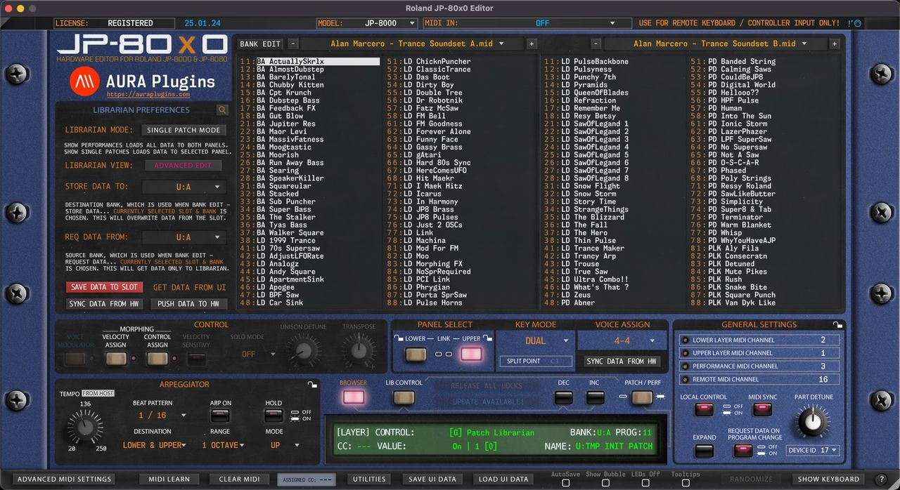
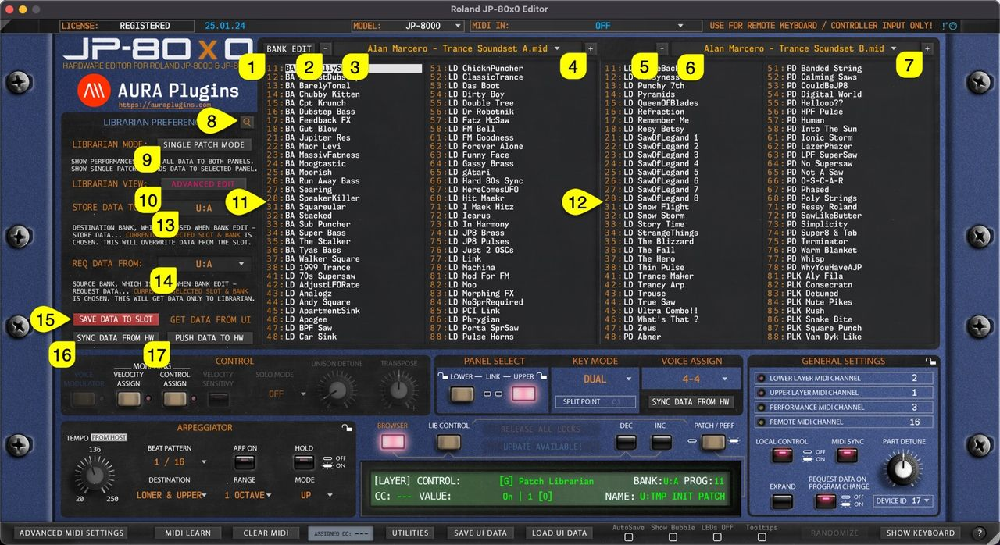
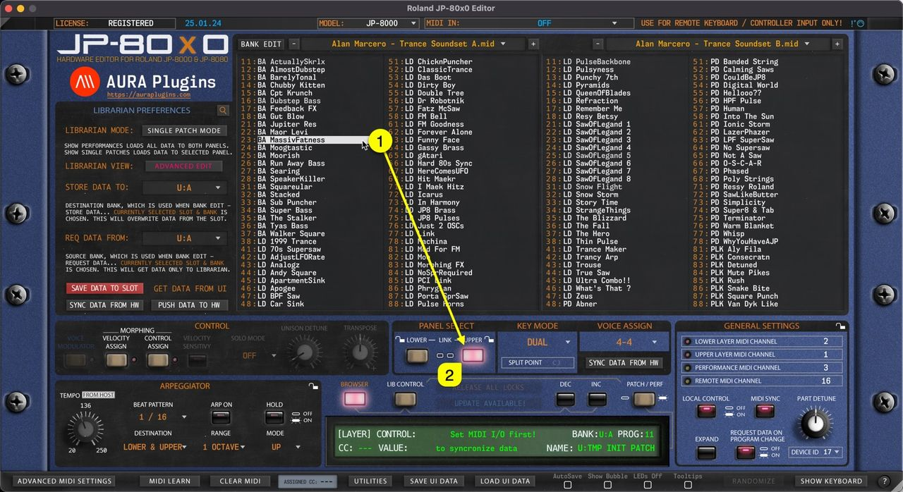
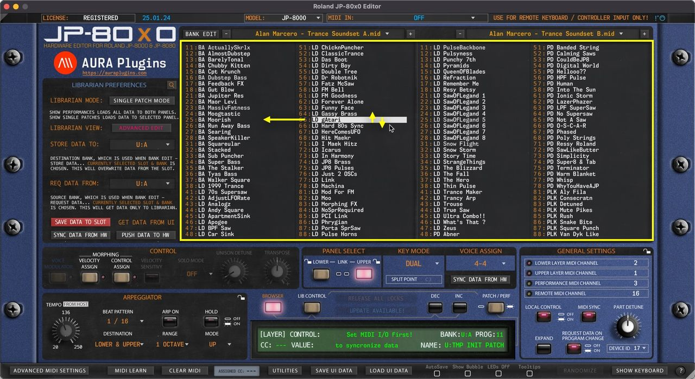
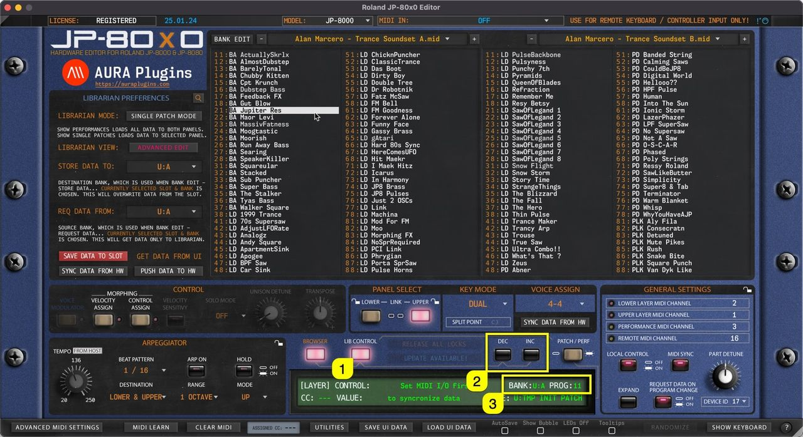
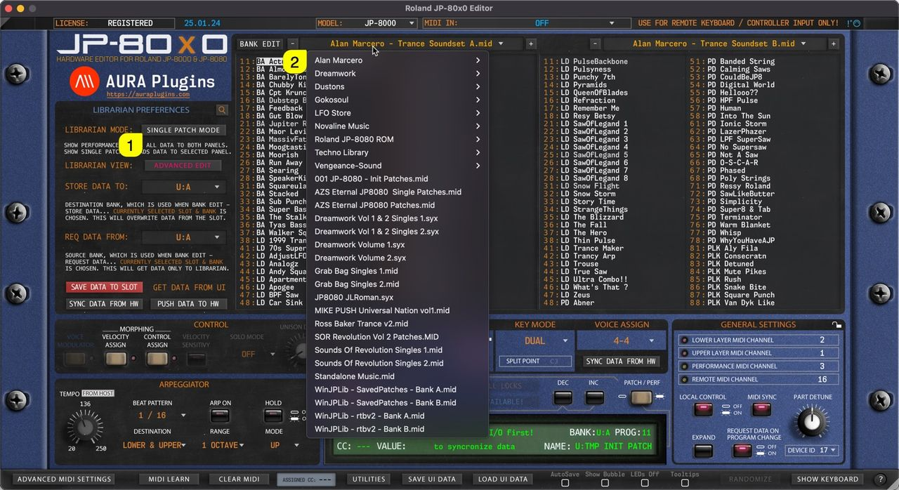
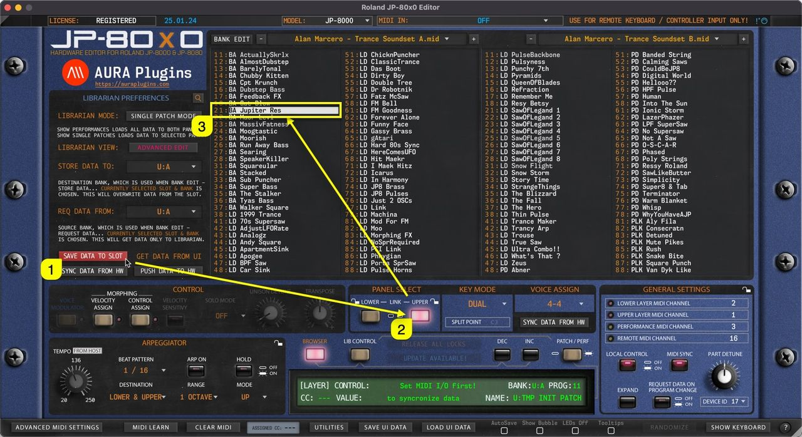

# Patch Librarian

## Patch Librarian

### Librarian View

In this chapter, we are going to walk through the usage of the **Patch Librarian** and all its functions & possibilities. It might take some time to understand how it works, but for those who used **Emagic SoundDiver** in the past, this workflow is pretty much the same.

*Figure: patch librarian*

We have made the librarian look and feel the same across all our products. i.e., Waldorf Blofeld Editor has the same functions in the librarian, but every Editor has their own specialities.

But in general, you can request data from hardware to the librarian, store data from librarian to hardware, store banks to HDD as you make edits etc.

**NOTE:** Librarian view is **not** synchronized with hardware memory. Librarian view displays **PATCH** or **PERFORMANCE** data stored in your HDD ( [data folder]/Patches/ -folder ).

**NOTE:** Keep your banks organized. If you have too many levels in your folder tree, the librarian is not able to solve it. Details below.

- [data folder]/Patches/sub folder 1/sub folder 2/my bank.mid – **this is OK**.
- [data folder]/Patches/sub folder 1/sub folder 2/sub folder 3/my bank.mid – **this is NOT OK**.

There is a lot to cover in this chapter, so it is the perfect time to get some coffee or tea.

### Layout and Functions

Let’s start with the definitions of basic layout and button / menu explanations.

*Figure: librarian overview*

- **[1]** = Bank Edit menu, SINGLE or PERFORMANCE request functions, write functions, overwrite & save as functions and import functions.
- **[2]** & **[5]** = Select previous SINGLE or PERFORMANCE bank from the bank tree.
- **[3]** & **[6]** = Display popup menu of SINGLE or PERFORMANCE banks. Menu displays banks from the data folder .
- **[4]** & **[7]** = Select next SINGLE or PERFORMANCE bank from the bank tree.
- **[8]** = Toggle on Search function. Search results will be shown in the right data view. Check Utilities menu functions earlier to learn more about Librarian Preferences regarding Search settings.
- **[9]** = Display SINGLE or PERFORMANCE programs in the Librarian View.
- **[10]** = Show Quick Edit View to adjust parameters without leaving the Librarian View
- **[11]** = Left data view, also used as EDIT BUFFER. Data can be edited only in the left data view.
- **[12]** = Right data view. This view can be changed while the left data view is locked due to unsaved data changes.
- **[13]** = Set destination bank where SINGLE or PERFORMANCE data is stored.
- **[14]** = Select source where SINGLE or PERFORMANCE data is requested from.
- **[15]** = Save Data from the currently selected LAYER TO currently selected librarian slot.
- **[16]** = Sync Data From Hw toggle to get data from the hardware to the Editor User Interface.
- **[17]** = Push Data To Hw toggle to send Editor User Interface data to the hardware.

Now that we understand the basic layout, we can dive into more specific details per function.

## Librarian Data Types

### Single Patch Mode

Editor defaults to **SINGLE PATCH MODE** on new instances. Singles from the Librarian can be loaded to the UPPER or LOWER panel of your choice. If the UPPER panel button is lit, then data will be sent to the UPPER panel in the hardware.

You can load two individual SINGLES in the JP, giving you two different “parts”. ie, load a PAD on LOWER panel and a LEAD on UPPER panel. Panels can be linked to the same MIDI channel or they can have individual channels too.

*Figure: librarian data types performance mode*

### Performance Mode

When PERFORMANCE MODE is toggled on, Editor will show the PERFORMANCE banks in the Librarian View. Each PERFORMANCE is built containing data from BOTH layers.

When PERFORMANCE is loaded, it will overwrite both panels on the hardware temp memory.

**NOTE:** With Section Locks, you can lock a specific section from Performance Changes. ie, if the UPPER PANEL is locked, then changing Performance only affects the LOWER PANEL.

## Librarian Data Views

Our Librarian has two views: primary is “ **Edit Buffer** ” view and secondary is “ **Source** ” view.

This is really straight forward, left is your Edit Buffer , where you can request, rename, move and paste data. The right view is your Source of copy / search results view which can be changed once the Edit Buffer is locked due to unsaved changes.

Let's break down how they perform below..

*Figure: librarian view left*

### Left Data View

Like mentioned earlier, the LEFT view is your “ **BUFFER** ” view. All bank requests are fetched into this view, where you can store them in your HDD. You can drag’n’drop and paste data to the left view, rename items in the left view etc.

*Figure: librarian view right*

### Right Data View

This is our “ **SOURCE** ” view. Going further: Any data from source view can be copied & pasted or dragged over to “BUFFER” view.

If search is triggered, search results will be shown in this view.

You can change the banks in the SOURCE view while the BUFFER view is locked due to unsaved changes.

This is helpful when you want to make a bank of your own from different patches / performances / search results and what not.

Data can not be pasted to any of the slots in this view.

## Librarian Drag and Drop

### Librarian Drag’n’Drop

You can drag’n’drop data from:

- **[1]** SOURCE -> BUFFER list
- **[2]** BUFFER -> BUFFER list

BUT you can NOT drag’n’drop data **from [3]** SOURCE -> SOURCE list. BUFFER -> SOURCE list is also disabled. This is by design explained in the previous article.

*Figure: librarian drag and drop 1*

**NOTE:** You can also drag’n’drop data from Librarian slots to PANEL SELECT buttons (UPPER / LOWER), which will load the PATCH data to the slot you drop it on!

### Drag’n’Drop to PANEL

As note above states, you can drag’n’drop data from any **Librarian Slot [1]** to **UPPER** or **LOWER [2]** panel toggles and data is then sent to hardware on that specific layer.

*Figure: librarian drag and drop 2*

## Sending Data To Hardware

### Double Click

You can send any **slot data [1]** from the Librarian view to a selected Panel / **Layer [2]** by **double clicking** the item.

In SINGLE PATCH mode this data will be sent to the **currently selected [2]** Layer.

In PERFORMANCE mode the data will replace both layers.

*Figure: librarian double click*

### Arrow Keys

You can use the computer keyboard arrow up, down, left and right keys to navigate librarian slot content as long as the mouse cursor is above the librarian view.

Data is sent to the currently active slot in the hardware while Librarian View is in SINGLE PATCH mode. PERFORMANCE mode overwrites both layers.

*Figure: librarian arrow keys*

### Program Change Buttons

Program Change DEC / INC buttons have two functions:

1. If **LIB CONTROL [1]** is toggled on, then data from the Librarian View is sent to currently active slot on **Program DEC / INC [2]** trigger, ie. INC is clicked, then BA Maor Levi is sent to the currently active slot.
2. If **LIB CONTROL [1]** is toggled off, then Program Change command is sent to hardware based on **BANK and PROG menu [3]** values, ie. if PROG is 11 and INC is clicked, then PROG 12 is requested from hardware to the currently active layer.

*Figure: librarian program change*

### MIDI Program Change

Similar to User Interface Program Change DEC / INC buttons, incoming MIDI Program Change has the same effect. You can optionally disable incoming MIDI Program Change commands from the Advanced MIDI Settings view.

Data is either sent to hardware from the Librarian View based on the incoming Program Change value or requested from the hardware to the Editor User Interface based on the same Program Change value.

**NOTE:** When user toggles between LIB CONTROL states, REQUEST DATA ON PROGRAM CHANGE button gets disabled. Engage the button again if you want to request hardware programs to the Editor User Interface after MIDI Program Change is sent. See image below.

*Figure: librarian request data on program change*

### PROG menu

Users can also send Programs to the hardware by clicking the **PROG [1]** menu and selecting an item from the list. Note that **LIB CONTROL [2]** is on, so data is sent to hardware from the Librarian View and PROG menu items are populated with the currently active Librarian View program names.

*Figure: librarian prog menu*

### and BANK menu…

Other option is to change BANK via the **BANK [1]** menu. Note that in this case the **LIB CONTROL [2]** is toggled off, which results in renaming menu items with hardware bank locations. Also, **REQUEST DATA ON PROGRAM CHANGE [3]** is on, which means data is requested to the User Interface instead of sending it to the hardware.

*Figure: librarian bank menu*

## Browsing Banks

### Single Patch mode

When **SINGLE PATCH MODE [1]** is selected, users can open a drop down menu by clicking the **bank name [2]** area with mouse click. With this drop down list, users can see all of the available banks detected by the Editor.

*Figure: librarian patch banks*

### Performance mode

Same applies to Performances when **PERFORMANCE MODE [1]** is toggled on. Users can view all of the detected Performance Banks by clicking the **bank name [2]** area.

*Figure: librarian performance banks*

**NOTE:** When a bank is selected, slot names are updated in the list view with corresponding program names.

## Search Filter

Search Filter can be toggled on by clicking the **SEARCH [1]** icon in the Librarian View. Before entering the search term, you can define if search is taking character caps into account by clicking the “ **aa ” [2]** toggle.

Now once the **search term [3]** is input and you hit enter, you’ll see that **Right (SOURCE) [4]** list view gets updated with all programs containing the search term.

More search results are shown by clicking the **bank name [5]** area to reveal how many banks of search items were found.

*Figure: librarian search*

Search follows the current Librarian View mode, ie. PATCH mode shows results only from Patch banks, while Performance mode shows only results from Performance banks.

**NOTE:** To adjust how search works, use the Utilities Menu -> Librarian Preferences to determine how search works.

## Quick Edit View

Librarian has an additional view to make quick edits on SINGLE PATCHES or PERFORMANCES while browsing them through the Librarian: Quick Edit Mode.

Once **Quick Edit Mode [1]** is toggled on, RIGHT list view is replaced with Quick Edit controls and customizable XY PAD.

You can choose different controls for the X and Y axis by clicking the **control name [2]** on each of the axes.

*Figure: librarian quick edit mode*

## Save Data To Slot

Save Data to Slot gets current User Interface data and places it into the currently selected slot in the librarian.

In this case we click the **Save Data To Slot [1]** button while **UPPER [2]** layer is selected. This will then get Editor data from the UPPER slot and place it into **Librarian slot 21 [3]** which is currently selected.

You can change the slot to your liking as long as it is in the left (BUFFER) view. Otherwise the Save Data To Slot button won’t work.

*Figure: librarian save data to slot*

**NOTE:** The user has to **overwrite** or choose a custom bank name via **Bank Edit -> Save As..** function in order to save bank changes. OR click the DISCARD button to cancel all the changes made.
