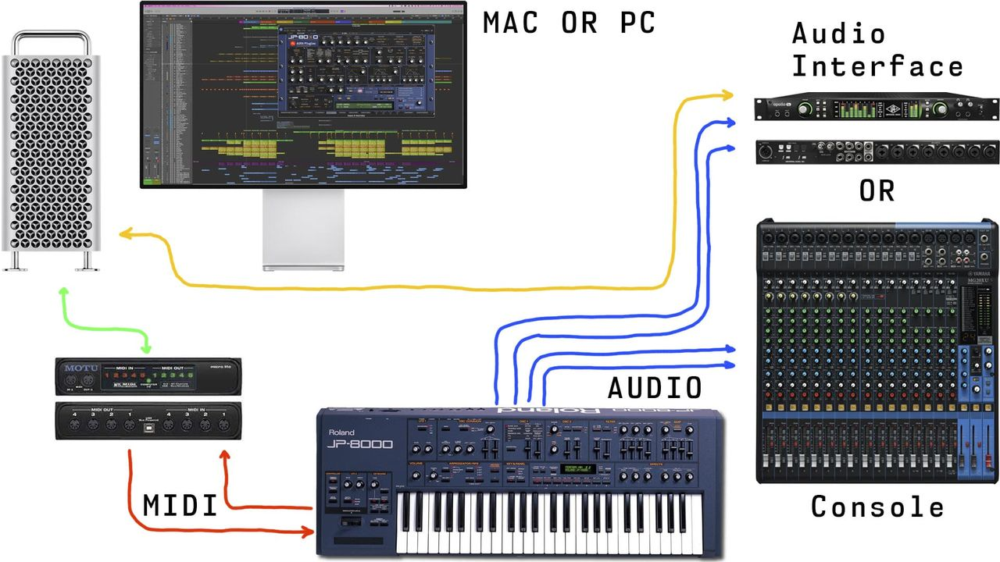

# Roland JP-80×0 Editor – Prepare your Hardware

Connect the MIDI cables from your synthesizer to the MIDI interface and Audio Jacks to your console / sound card. MIDI out from synth to MIDI interface IN and vice versa. MIDI thru connections will not work.

- MIDI Out from MIDI interface to JP MIDI In port.
    - Remote KBD port in JP-8080 works only to trigger the Arpeggiator!
- MIDI Out from JP to MIDI interface MIDI In port.
    - double check your cables!
- Audio from JP-8000 / JP-8080 L&R to console or sound card inputs.
    - Add more outputs if needed.

## Wiring diagram example

*Figure: Screenshot*

Power up your JP-8000 / JP-8080. Our editor is designed to work “out of the box” and control all parameters from a single application instance.

**NOTE:** Our Editor is designed to work in Performance-mode. Patch-mode is supported to load individual patches to the upper or lower layer.
