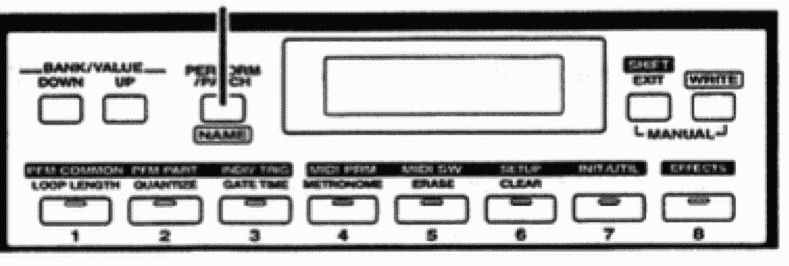

# Roland JP-80×0 Editor – Configure JP-8000



*Figure: Screenshot*

## Click and hold SHIFT + MIDI SW (button 5) and apply these settings:

```
Tx/Rx Edit SW    = ON
Rx Exclusive SW  = ON
Tx/Rx ProgChg SW = BANK SEL + PC
Local Switch     = If JP-8000 would be my master keyboard, I would turn it off.
MIDI Clock       = External syncs to MIDI input clock. Check if you can provide a clock from your DAW.
MIDI Sync        = If on, hardware will sync to MIDI clock from MIDI.
```

## Next click MIDI PRM (button 4) and apply these settings:

```
Device ID        = 17 (for multiple JP’s in setup, choose individual ID for each).
Tx/Rx Edit Mode  = MODE1
Perform Ctrl Ch  = 3
Remote Ctrl Ch   = 16
```

## Next click PFM PART (button 2) and apply these settings

```
MIDI CH (LOWER)  = 1
MIDI CH (UPPER)  = 2
```

**External Clock Note** : Arpeggiator will not play unless your DAW is able to provide a MIDI Clock. Windows: Check our method of using MIDI OX and LoopBe together to provide MIDI clock from DAW to your synth.
