# Librarian Edit Menus

## Librarian Edit Menus

Librarian BANK EDIT menu offers functions to:

- Request Single Patch Data from the hardware to the Librarian.
- Request Performance Data from the hardware to the Librarian.
- Write Single Patch Data to hardware memory slots.
- Write Performance Data to hardware memory slots.
- Overwrite Bank changes.
- Save Bank as a new item in the Data folder if chosen so..
- Import Roland SH-201 Banks.
- Import Roland GAIA SH-01 Banks.
- Initialize the entire bank to start working on your own bank.
- And then some functions we’ve covered in previous articles prior to this.

This is a long list of items, but there is even more with…

### Librarian Right Click Menu

… this menu. Librarian **Right click menu [1]** opens additional options to rename entities in the librarian view, copy & paste entities and much more.. So let's start diving into these.

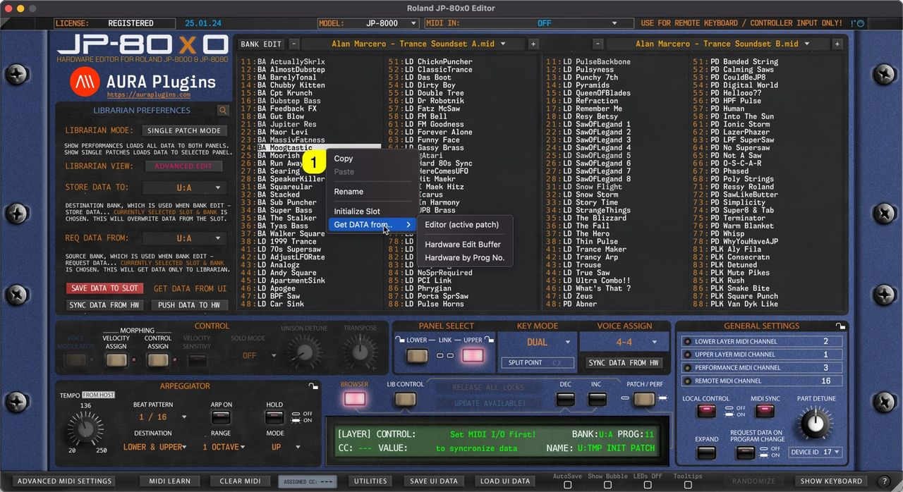

*Figure: right click menu*

## Request Patch Data from Hardware

**NOTE:** To successfully request the patch data from the hardware, STOP all activities on your DAW so that the SysEx data is received as expected!

### from Active Layer to Editor GUI

Open the **BANK EDIT** menu and choose **Request Patch Data … -> from Active Layer to Editor GUI** to get the buffer data from the Hardware to the Editor User Interface. In this case, Librarian will get the data to Editor UI from the UPPER PANEL as it is the selected panel.

*Figure: request patch to user interface*

### from Active Layer to Librarian

Open the **BANK EDIT** menu and choose **Request Patch Data … -> from Active Layer to Librarian** to get the buffer data from the currently selected panel to the Librarian. In this case, UPPER PANEL data is requested to the selected slot, which is slot 81.

*Figure: request patch from layer to librarian*

You can achieve the same result with **Right mouse click** at the top of slot 81 and choose **Get DATA from … -> Editor (active patch)** .

*Figure: request patch data to librarian via right click*

### Hardware Edit Buffer

If the Edit buffer differs from the Editor buffer, you can also request the Edit Buffer to the Librarian slot with **right mouse click** at the top of slot and choose **Get DATA from … -> Hardware Edit Buffer** .

*Figure: request edit buffer to librarian*

### from Selected Program Slot

Open the **BANK EDIT** menu and choose **Request Patch Data … -> from Selected Program Slot** to get Patch from U:A 81.

U:A is defined in the REQ DATA FROM menu on the left hand side view. Slot is determined by the user selection in the Librarian View.

*Figure: request patch from slot*

You can achieve the same result with **right mouse click** at the top of any slot and choose **Get DATA from … -> Hardware by Prog No** .

*Figure: request data from slot right click*

**NOTE:** REQ DATA FROM menu selection defines the Bank Address for hardware requests!

### All Data from USER Bank

Open the **BANK EDIT** menu and choose **Request Patch Data … -> All Patches from USER A / B** of your choice.

This action will request all USER bank Patches to the Librarian from your hardware.

*Figure: request user data to librarian*

### All Data from PRESET Bank

Open the **BANK EDIT** menu and choose **Request Patch Data … -> All Patches from PRESET A, B** … of your choice.

This action will request all PRESET bank Patches to the Librarian from your hardware.

*Figure: request from preset banks*

When **Hardware MODEL [1]** is set to JP-8080, you have a lot more options for PRESET banks as well as for Smart Memory Card slots (if inserted).

*Figure: request patches from roland jp-8080*

## Store Patch Data to Hardware

**NOTE** : Before you start data writing to hardware, make sure you know which slot you are overwriting and STOP all activities on your DAW in regards to the hardware to ensure data is written properly!

### To Currently Selected Slot & Bank

Open the **BANK EDIT** menu and choose **Store Patch Data … -> To Currently Selected Slot & Bank** to write currently selected Librarian Slot to hardware. In this case we would overwrite Slot 81 in bank U:A which is chosen in the left hand side view under the STORE DATA TO menu.

*Figure: store patch to slot and bank*

### from Selected Bank to USER A / B

Open the **BANK EDIT** menu and choose **Store Patch Data … -> from Selected Bank to USER A / B** to write the entire USER bank of your choice with the data from Active Librarian View which in this case is LEFT view (slot 81 chosen on LEFT list).

This means, you can select either view (LEFT / RIGHT) and write the hardware memory with a bank in question. Extension to this is that you can do search, ie, bass and write all the results from the active view to hardware!

*Figure: write user bank*

## Request Performance Data from Hardware

**NOTE:** To successfully request the multi data from the hardware, STOP all activities on your DAW so that the SysEx data is received as expected!

### from Temp Buffer to Editor GUI

Open the **BANK EDIT** menu and choose **Request Performance Data … -> from Temp Buffer to Editor GUI** to get the buffer data from the Hardware to the Editor User Interface. This action will request performance data, which includes both layers.

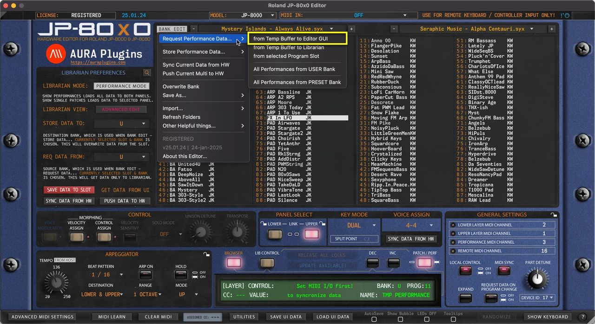

*Figure: request performance to ui*

### from Temp Buffer to Librarian

Open the **BANK EDIT** menu and choose **Request Performance Data … -> from Temp Buffer to Librarian** to get the buffer data from the hardware to the Librarian.

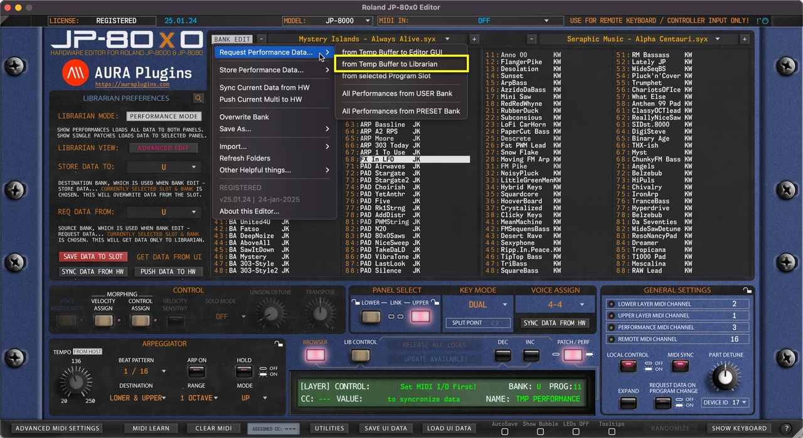

*Figure: request performance to librarian*

You can achieve the same result with **right mouse click** at the top of slot 68 and choose **Get DATA from … -> Hardware Edit Buffer** .

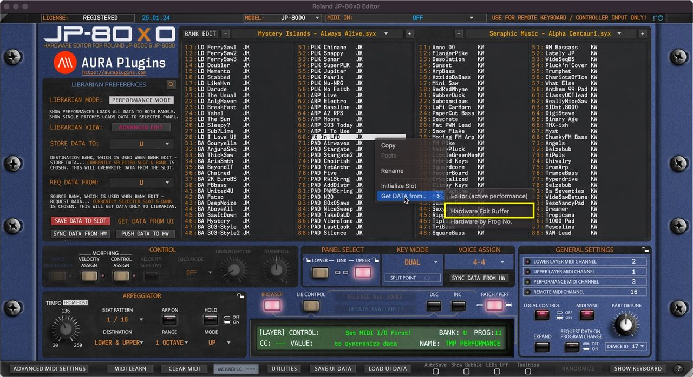

*Figure: request performance to librarian via right click*

### Editor User Interface

If the JP Edit buffer differs from the Editor buffer, you can also request User Interface data to the Librarian slot with **right mouse click** at the top of the slot and choose **Get DATA from … -> Editor (active performance)** .

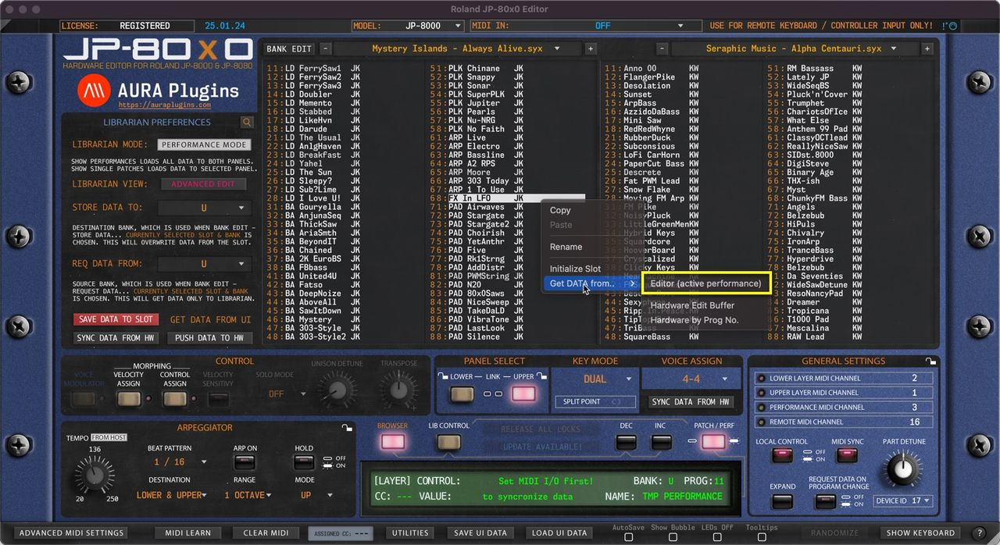

*Figure: request performance to librarian from editor*

### from Selected Program Slot

Open the **BANK EDIT** menu and choose **Request Performance Data … -> from Selected Program Slot** to get Performance from U 68.

U is defined in the REQ DATA FROM menu on the left hand side view. Slot is determined by the user selection in the Librarian View.

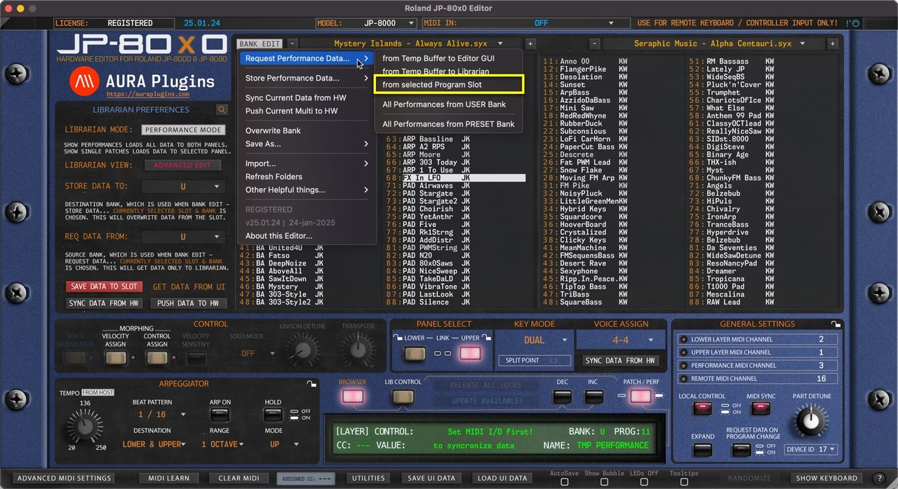

*Figure: request performance from slot*

You can achieve the same result with **right mouse click** at the top of slot 68 and choose **Get DATA from … -> Hardware by Prog No** .

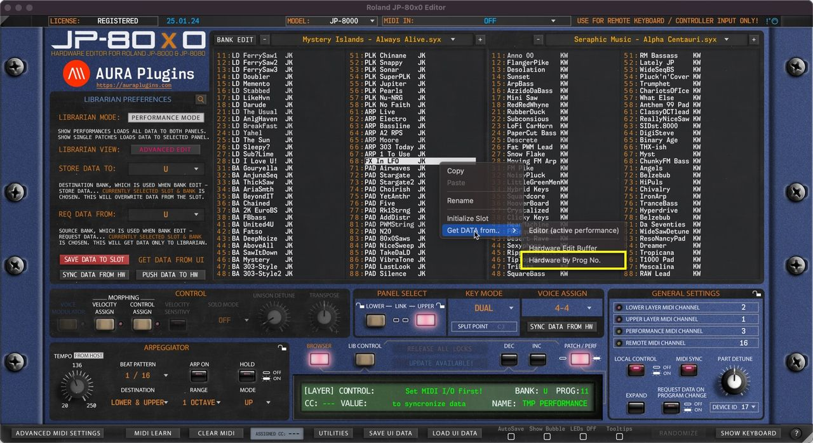

*Figure: request performance from slot via right click*

**NOTE:** REQ DATA FROM menu selection defines the Bank Address for hardware requests!

### All Data from USER Bank

Open the **BANK EDIT** menu and choose **Request Performance Data … -> All Performances from USER Bank** .

This action will request all USER bank Performances to the Librarian from your hardware.

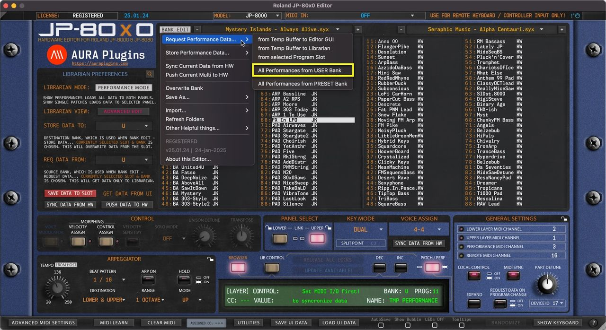

*Figure: request user performances*

### All Data from PRESET Bank

Open the **BANK EDIT** menu and choose **Request Performance Data … -> All Performances from PRESET Bank** .

This action will request all PRESET bank Performances to the Librarian from your hardware.

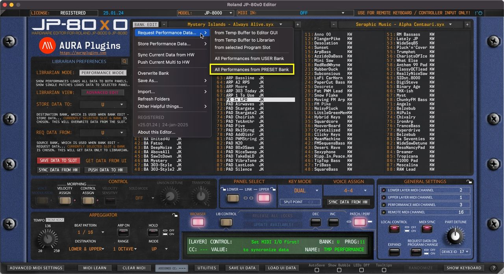

*Figure: request preset performances*

When **Hardware MODEL [1]** is set to JP-8080, you have a lot more options for PRESET banks as well as for Smart Memory Card slots (if inserted).

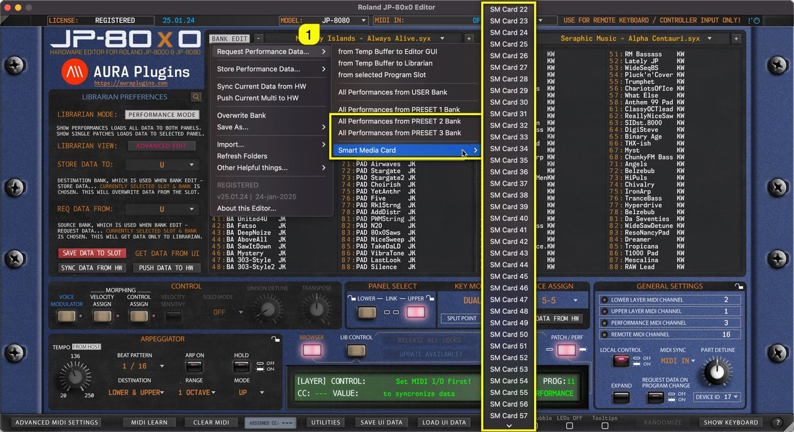

*Figure: request performances from jp-8080*

## Store Performance Data to Hardware

**NOTE** : Before you start data writing to hardware, make sure you know which slot you are overwriting and STOP all activities on your DAW in regards to the hardware to ensure data is written properly!

### To Currently Selected Slot & Bank

Open the **BANK EDIT** menu and choose **Store Performance Data … -> To Currently Selected Slot & Bank** to write currently selected Librarian Slot to hardware. In this case we would overwrite Slot 68 in bank U which is chosen in the left hand side view under the STORE DATA TO menu.

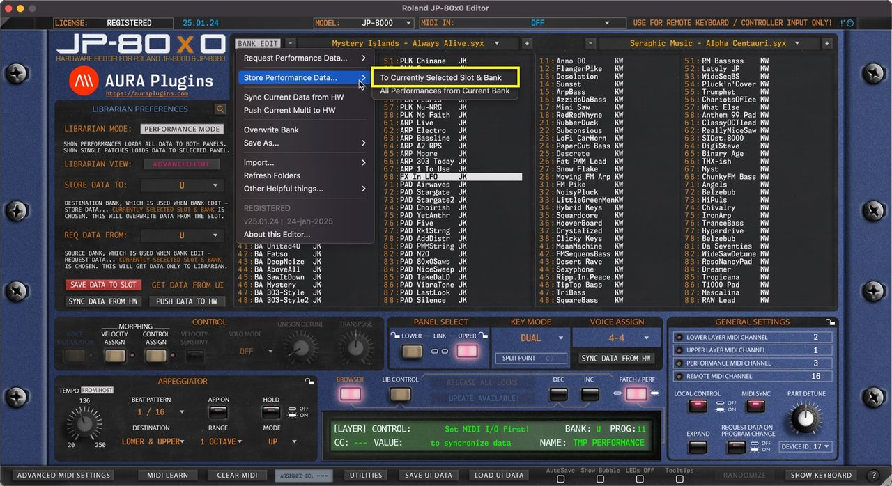

*Figure: store performance to slot and bank*

### from Selected Bank to USER

Open the **BANK EDIT** menu and choose **Store Performance Data … -> All Performances from Current Bank** to write the entire USER bank with the data from Active Librarian View which in this case is LEFT view (slot 68 chosen on LEFT list).

This means, you can select either view (LEFT / RIGHT) and write the hardware memory with a bank in question. Extension to this is that you can do search, ie, pad and write all the results from the active view to hardware!

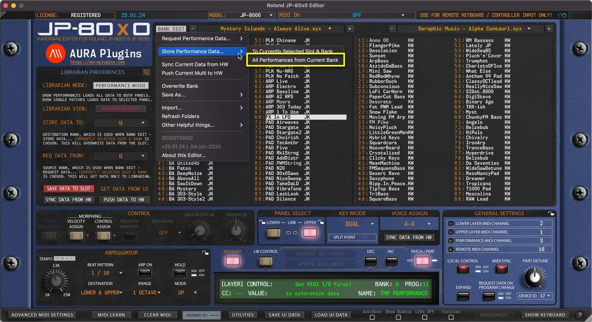

*Figure: store all performances to user*

## Sync Current Data from HW

Open the **BANK EDIT** menu and choose **Sync Current Data from HW** to request Global settings, Performance data and data from each Panel to the Editor User Interface.

This function extends the basic Sync Data From HW toggle from main User Interface with Global settings request – Therefore this menu option or Sync Data From HW toggle in the Librarian View is the best option to choose after MIDI input and output are set!

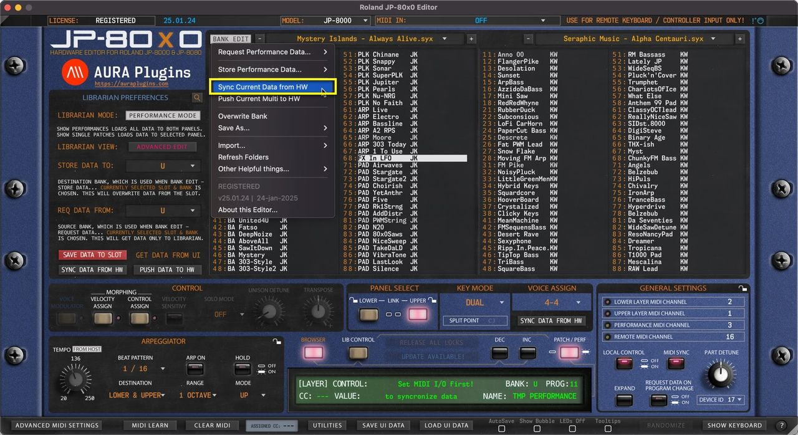

*Figure: sync data from hardware*

## Push Current Data to HW

Open the **BANK EDIT** menu and choose **Push Current Data to HW** to send your Global Settings, Performance and Layer settings to your Hardware. This can be used to force the hardware buffer to match with the Editor.

*Figure: push current data to hardware*

**NOTE:** With Push Current Data to HW function you can recover your User Interface data back to your Hardware in case your MIDI interface ports are different to previously set ports!

## Saving Banks

### Overwrite Bank

Open the **BANK EDIT** menu and choose **Overwrite Bank** to overwrite any changes you’ve made to the current Bank. This will permanently overwrite the currently selected bank in your HDD which in this case would be Mystery Islands – Always Alive.syx .

*Figure: overwrite bank*

### Save As…

Open the **BANK EDIT** menu and choose **Save As… -> Standard MIDI / JP-80x0 HE Format** to save any changes you’ve made to the bank with a new name. This keeps the banks and their edits in good order – And you will always have the original file in hand just in case something goes wrong!

We recommend j8k format, but standard MIDI works too – it is up to you.

*Figure: save as*

**NOTE #1 :** You can always DISCARD any changes you’ve made in the Librarian by clicking the **DISCARD [1]** button.

**NOTE #2 :** You can see a **red asterix [2]** right next to the BROWSER toggle in the main User Interface IF Librarian has any unsaved changes! This will disappear once save or discard is triggered.

**NOTE #3 :** Librarian Mode toggle becomes unavailable IF there are any unsaved changes in the Librarian.

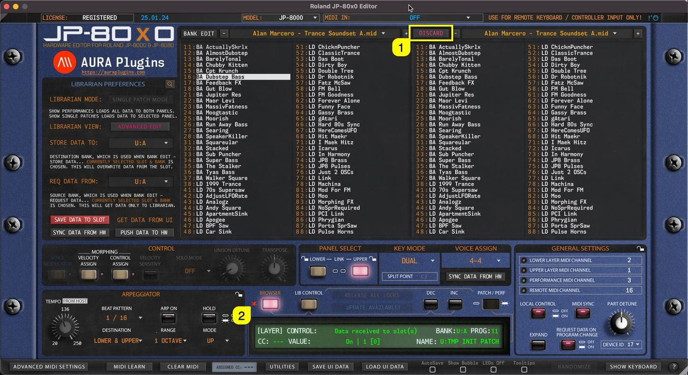

*Figure: discard bank changes*

## Importing Banks

Open the **BANK EDIT** menu and choose **Import …** to import Performance / Single Patch banks into the Librarian.

We have a variety of options to choose for import: MID, SYX, PAT, PFM, SHL, SHE and SVD file formats.

- PAT / PFM formats are files from the legacy WinJPLib software.
- SHL / SHE formats are files from the legacy Roland SH-201 Editor.
- SVD format is file from the legacy Roland GAIA Editor

With SHL / SHE & SVD imports you CAN import SH-201 and GAIA SH-01 sounds right into our JP-80x0 Editor. Keep in mind that some features are not available in the JP-8000 / JP-8080 which are used with SH-201 and/or GAIA and vice versa.

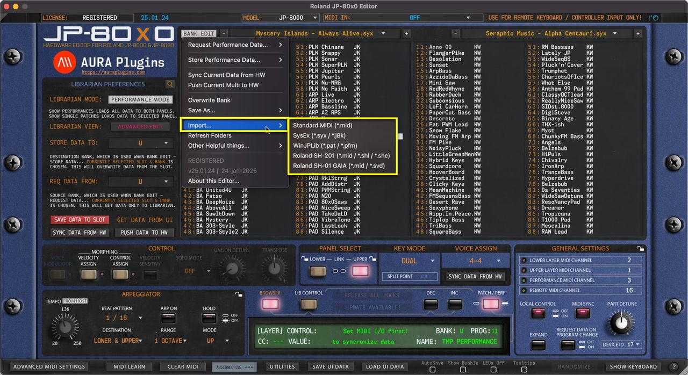

*Figure: import banks*

### Standard MIDI (\*.mid)

Import Standard MIDI files that contain Roland JP-8000 or Roland JP-8080 Performance / Patches

### SysEx (\*.syx / \*.j8k)

Import System Exclusive / j8k (JP-80x0 Editor) files which contains Roland JP-8000 or Roland JP-8080 Performances / Patches

### WinJPLib \*.pat / \*.pfm)

Import WinJPLib files that contain Roland JP-8000 or Roland JP-8080 Performances / Patches

### Roland SH-201 (\*.mid / \*.shl / \*.she)

Import Roland SH-201 Library or Single files and convert them to Roland JP-80x0 Editor format (as close as possible).

### Roland SH-01 GAIA (\*.mid / \*.svd)

Import Roland GAIA SH-01 Library or Single files and convert them to Roland JP-80x0 Editor format (as close as possible).

## Refresh Folders

Open the **BANK EDIT** menu and choose **Refresh Folders** to manually trigger PATCHES folder rescan. This is helpful in case you have copied files over or bought new content and placed it in but can’t see it when opening the Librarian View.

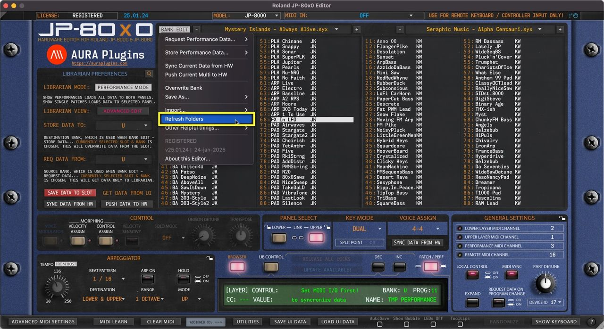

*Figure: refresh folders*

**NOTE #1 :** If the Editor hangs or crashes while this action is in effect, see Enable LOG article from Utilities menu section to learn how to detect faulty banks.

**NOTE #2 :** If you can’t see the file you have placed in the Patches folder, try toggling between Performance / Single Patch mode to see if the file is there.

## Other Helpful Things

Other Helpful things menu gives additional tools to speed up your sound-design work, ability to open your Data folder quickly & check for any updates from our server. Examples below.

### Initialize Bank

Open the **BANK EDIT** menu and choose **Other Helpful things … -> Initialize Bank** to initialize all slots from the bank. You can then overwrite or choose Save As from the BANK EDIT menu to continue working with bank edits. The result shown below after the initialization process has been processed.

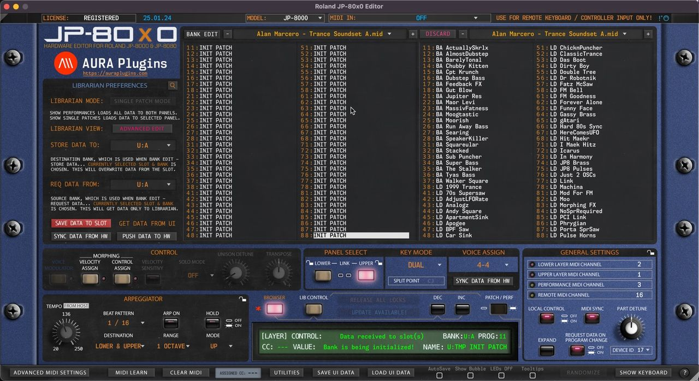

*Figure: initialize bank*

If you made this action by accident, you can always click the DISCARD button to revert any changes made to the bank.

### Open Data Folder

Open the **BANK EDIT** menu and choose **Other Helpful things … -> Open Data Folder** to open the root folder for the Roland JP-80x0 Editor. In this folder you can find your license file, LOG file, PREFERENCES file and folders for UI DATA and PATCHES.

You can also see where the data path is as explained in the Data Locations article.

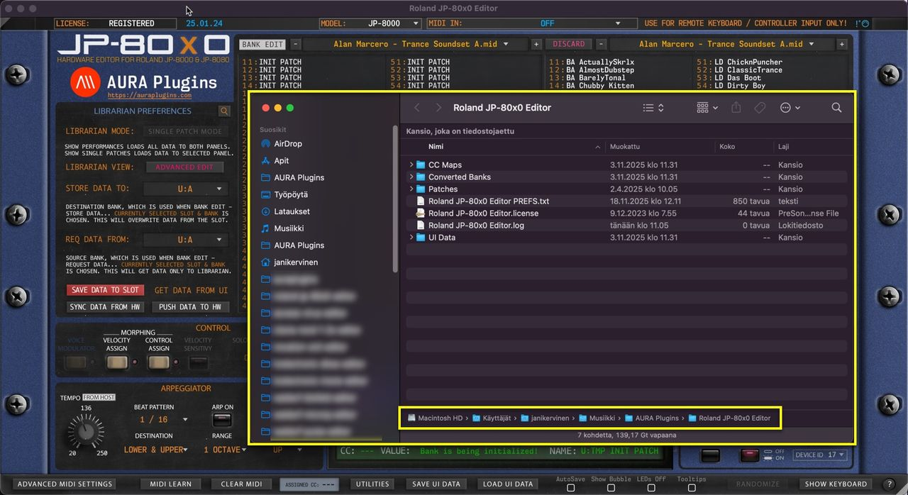

*Figure: open data folder*

**NOTE:** Performance and Single Patch files are both located in the PATCHES folder.

### Check for Updates

This will check our online repository for version status. No personal data is sent on this action, only version number comparison is done and if it differs, then you’ll get notified if a new version is available along with changelog.

Usually when we have an update available, it addresses any issues reported to us via the Bug Report form (https://auraplugins.com/my-account/bug-report/) and/or Discord (https://discord.gg/TeG7ukYcVW) reports.

**NOTE:** Internet connection is required to handle this function!

## Rename Librarian Entities

If you want / need to rename items in the Librarian View, it can be done simply with **Right mouse click [1]** on a slot you want to rename and choose **Rename** …

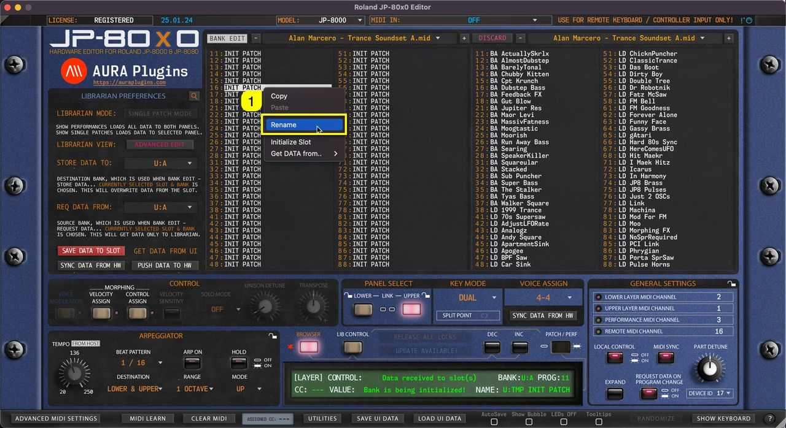

*Figure: rename menu*

This will open a small window, where you have to click on the **slot name [1]** to activate renaming. Keep in mind that name length is defined by the hardware specifications, in this case: 16 characters

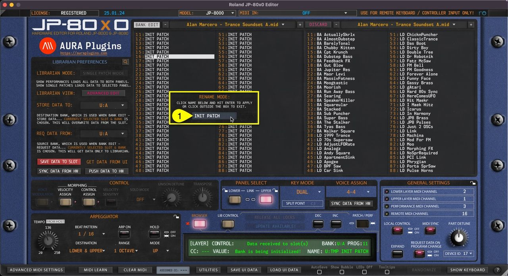

*Figure: rename slot*

**NOTE:** New name is only applied by pressing ENTER on your keyboard. Clicking outside the box will cancel the renaming.
