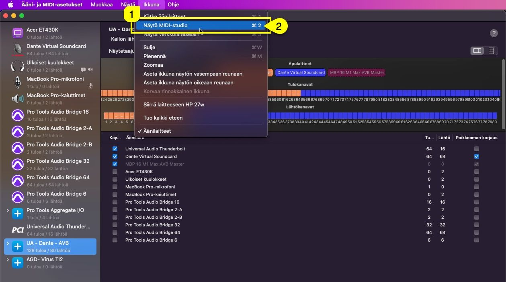
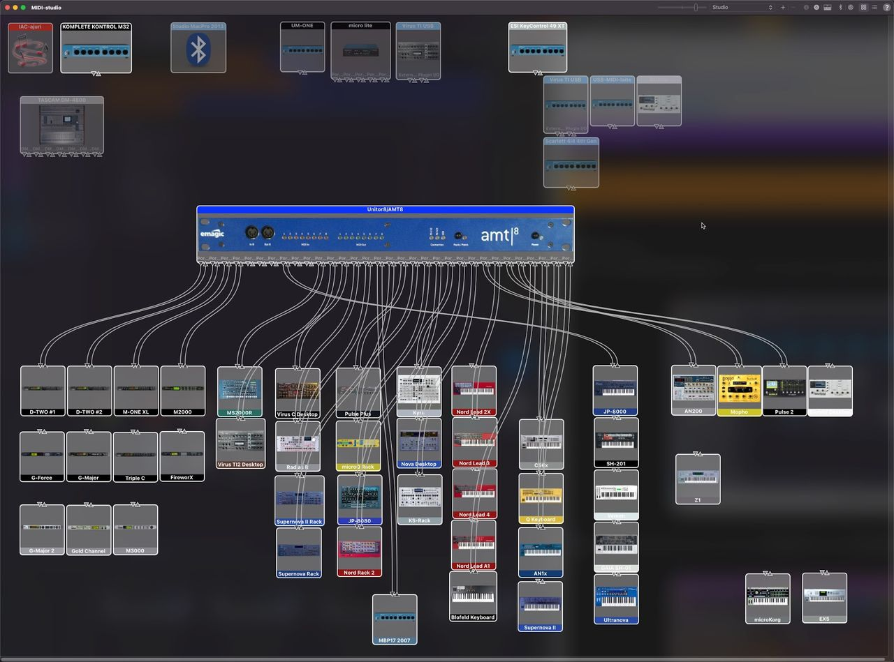
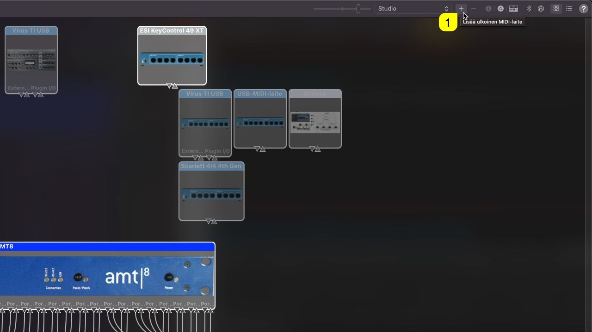
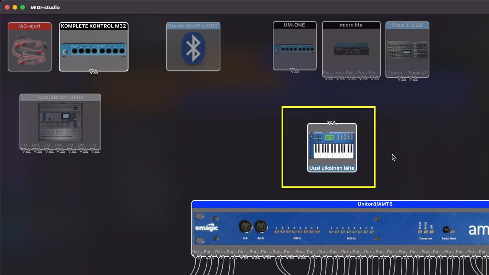
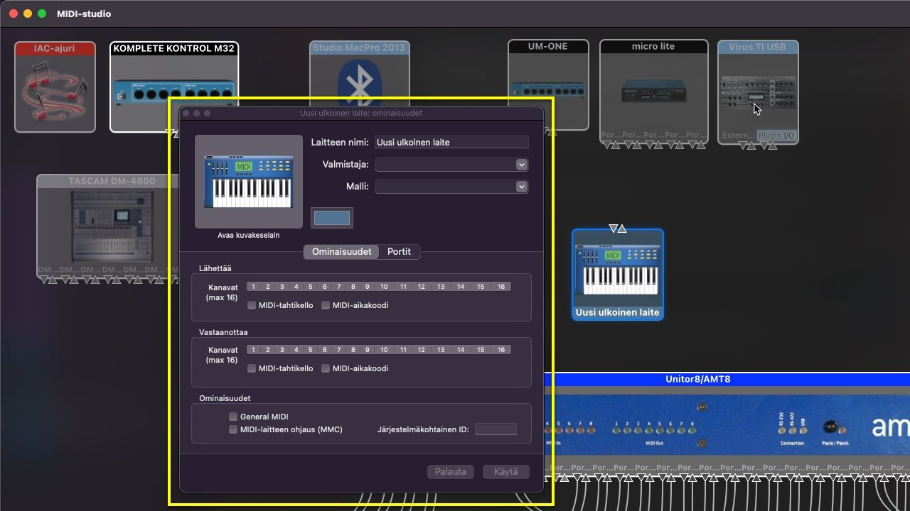
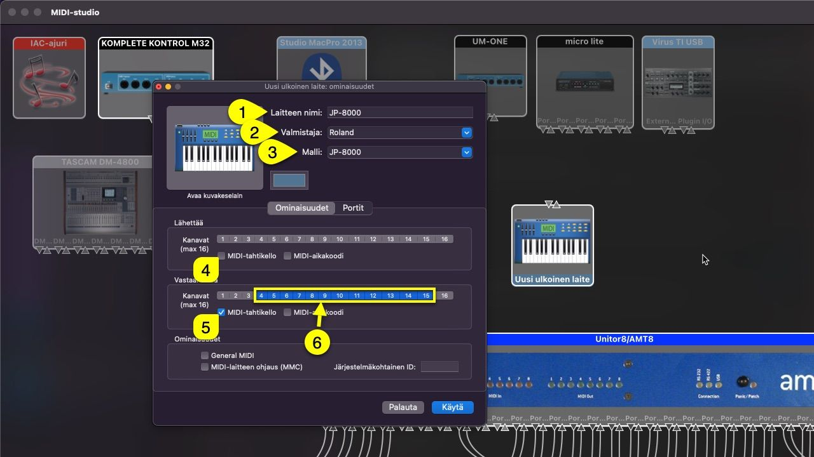
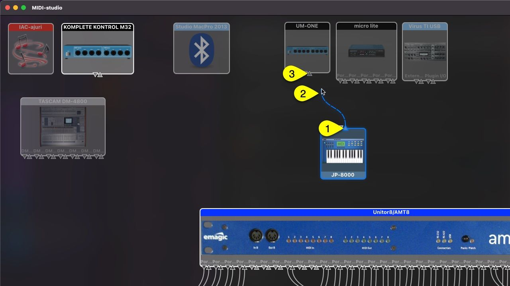
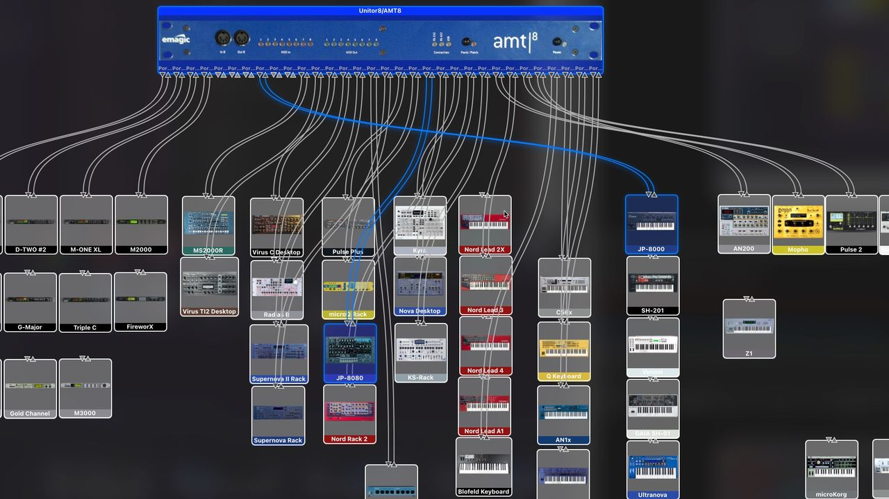

# Roland JP-80×0 Editor – macOS MIDI Configuration

This setup **is not mandatory if you remember** all of your port numbers & routings out of your head. This guide will help you, if your setup is anything like ours: dozens and dozens of ports in use!

**HEADS UP :** This is usually the step which is skipped and then you get connection timed out errors and such. Read the guide, it will help you to succeed with the setup in the long run!

## Audio MIDI Setup.app

Start by opening **Audio MIDI Setup.app [1]** – You can find the app from `/Applications/Utilities`

*Figure: Open Audio MIDI Setup app*

Next we want to view MIDI devices and to do that, click **Window [1]** and select **Show MIDI-Studio [2]**

*Figure: Open MIDI-Studio*

And this is what you get (contents of the window will vary depending what your setup has configured already!):

*Figure: MIDI-Studio view*

## Creating new Devices

If you haven’t added the JP-8000 / JP-8080 to your MIDI-studio yet, here is how to do it:

**Click + -sign [1]** from the top right corner (add external midi-device)

*Figure: Add external MIDI-device*

The newly added device will pop somewhere in the window (without any logical placement!)

*Figure: Newly added External Device*

Double click the newly added device so we can start to modify its properties

*Figure: View External Device properties*

In this example, I am gonna add a JP-8000 to my rig. Lets update the properties:

- **Device Name [1]** = JP-8000
- **Manufacturer [2]** = Roland
- **Model [3]** = JP-8000
- **Check MIDI clock [4]** if your JP is the Clock provider (rarely the case..)
- **Check MIDI clock [5]** if you want your JP model to receive MIDI clock information from the DAW and choose the **channels [6]** where the clock is transmitted to. Some DAWs require additional steps to transmit the MIDI clock.

You can update the device color if you want, but it is only visual feedback to find the device from the jungle.

Once all fields are good to go, hit **Apply** and you can see the device name and color gets updated.

*Figure: Change Device Properties*

If you have multiple JP’s in your setup, add more devices and make sure each of the devices have individual **Device Name [1]** as set above. Like JP-8080 #1 and JP-8080 #2 etc. This helps you down the road when we connect the hardware to the Editor.

## Connecting Device to MIDI-interface (virtually)

Making virtual connections within MIDI-studio helps us later down the line when we connect the hardware to the Editor and when we make external connections from DAW to hardware. Some DAWs like Logic Pro can see the Device Name created here in MIDI-studio.

Start by drawing the connection points from your external device output port to your MIDI-interface input port. Click and hold down the mouse button from **output port [1]** , start dragging the **cable [2]** towards your MIDI-interface **input port [3]** .

*Figure: Making connection in MIDI-studio*

Apply the same procedure for the MIDI input port from your device towards your MIDI-interface output port. The final result should have both cables connected as seen below. I have highlighted JP-8000 and JP-8080 and their cables from the spaghetti. (Keep in mind, this is our studio, yours can look a lot different).

*Figure: Roland JP-8080 and JP-8000 connected*

These settings are stored within macOS so you don’t have to re-do these settings unless you change your MIDI-interface.
