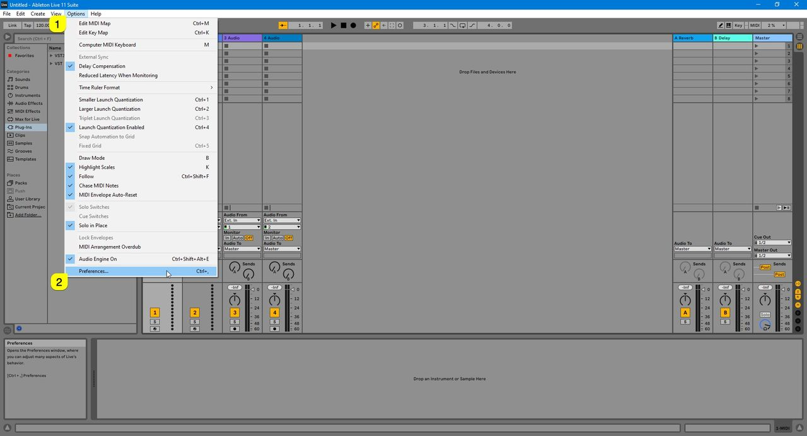
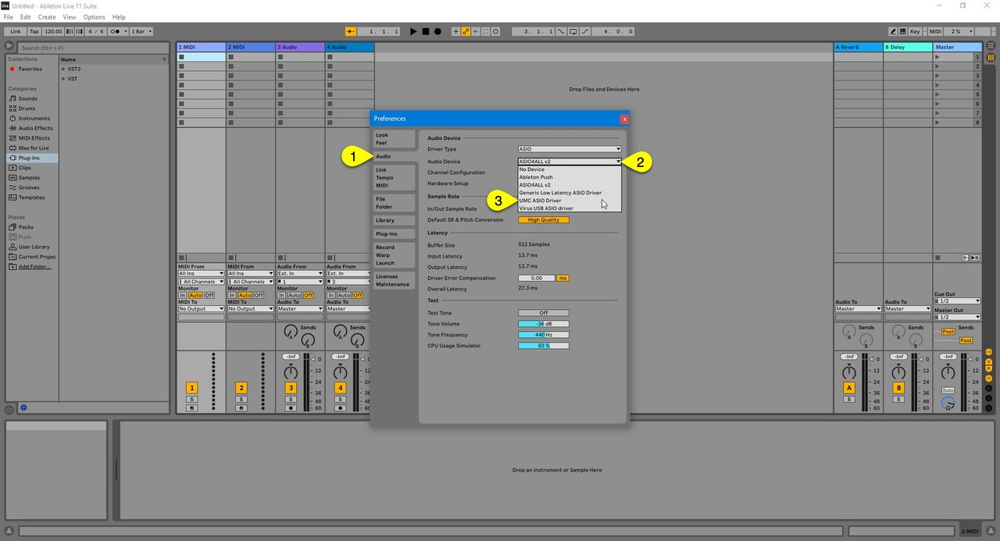
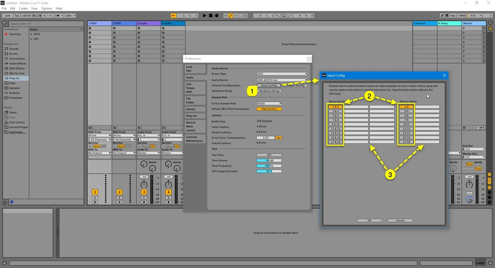
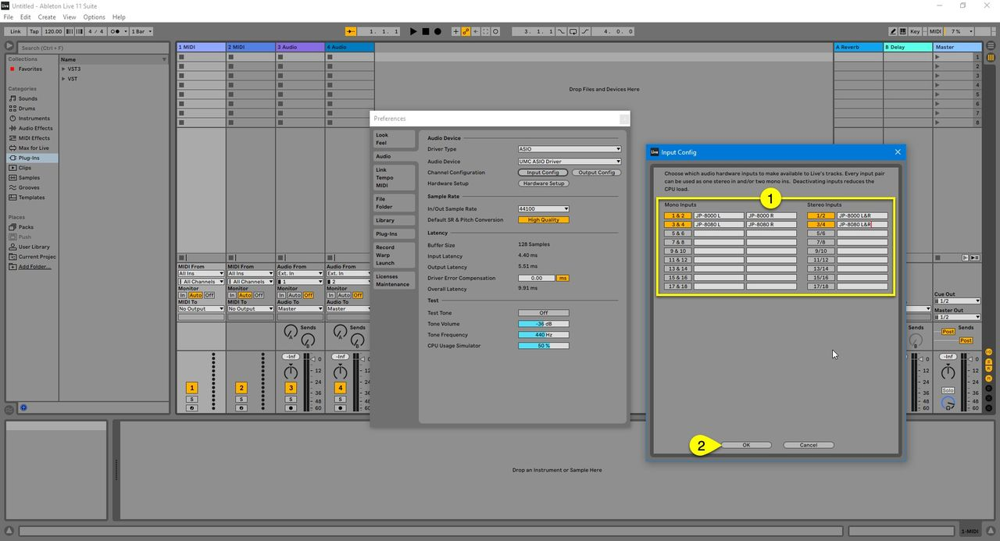
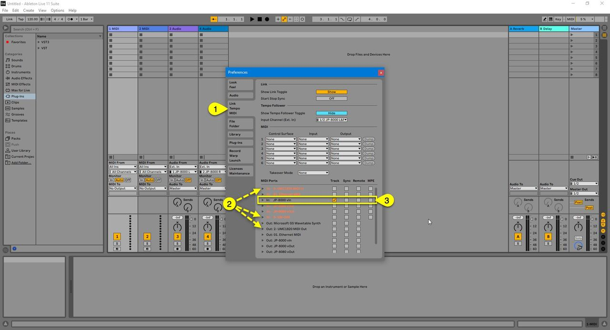
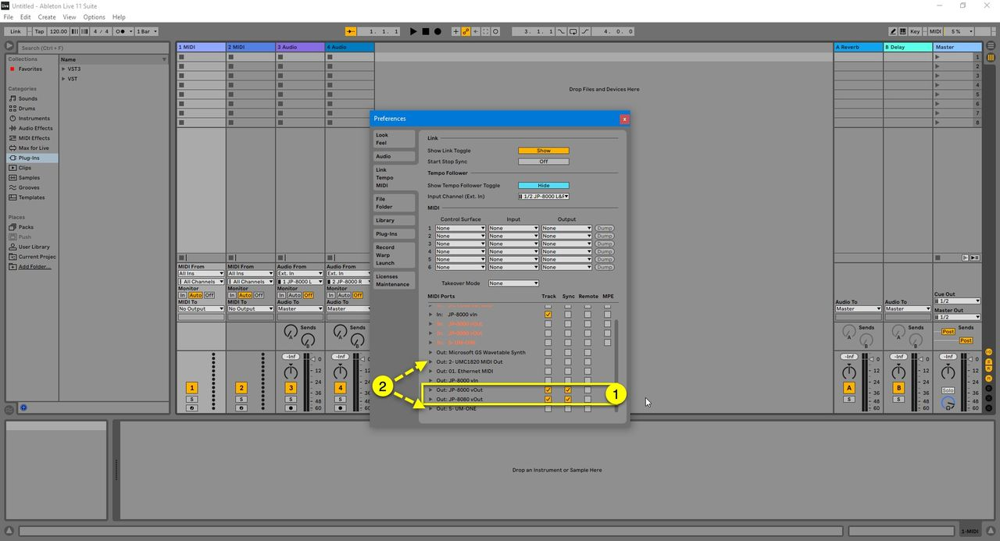
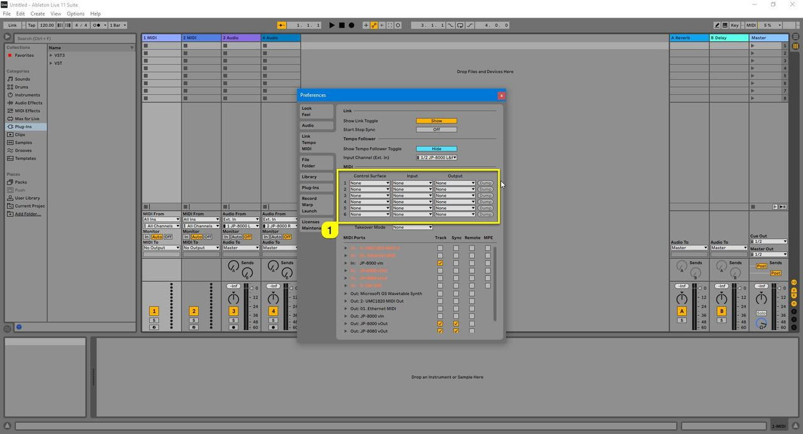
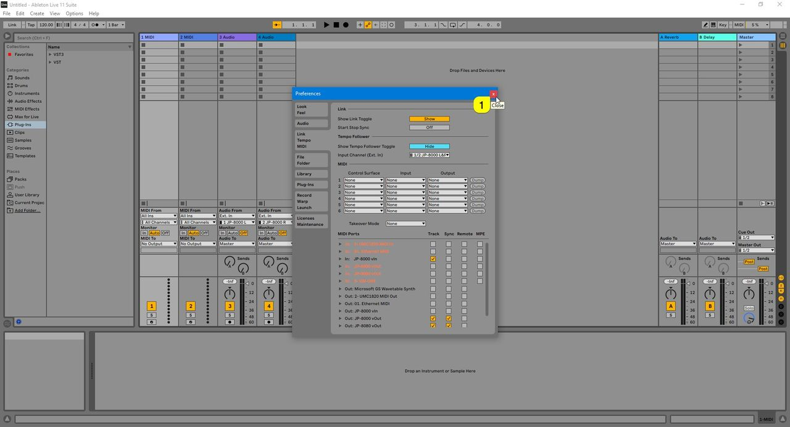

# Roland JP-80×0 Editor – Ableton Live

DISCLAIMER

*Our company & product has nothing to do with Ableton AG. If there is an issue with our product, open a support ticket in your account page. You can find support details at the end of this document. Support and updates are free to anyone who has bought the license from our store*

## Audio Configuration

First, open **Ableton Live** , click **Options [1]** from the top bar and select **Preferences… [2]** – We are making adjustments to Audio and MIDI settings which are crucial for our Editor to work flawlessly.

*Figure: Open Live Preferences*

**Open Audio [1]** tab and select your **Audio device [2]** you use for your setup (if not set already). We are going to use **UMC ASIO Driver [3]** .

*Figure: Assign Live Audio Device*

After the Audio engine is initialized, click **Input Config [1]** . Enable **input ports [2]** you use with your setup and **rename ports [3]** as they are routed.

*Figure: Live Input configuration*

Our **input ports [1]** are now renamed accordingly. **Click OK [2]** to close the input config.

*Figure: Input configuration completed*

## MIDI Configuration

Next we want to adjust MIDI ports and how they are shown in Live. Click on **LINK / TEMPO / MIDI [1]** to open it. Check and make sure all the **physical MIDI ports [2]** are disabled from the MIDI section.

Now you can Enable **Roland JP-8000 vIn [3]** to trigger other VSTs in your session (if JP-8000 is used as your master keyboard).

*Figure: Modify Live MIDI ports*

**ATTENTION :** Our Editor uses DIRECT connection from MIDI interface to the hardware. Therefore the hardware ports need to be disabled from the DAW settings!

While we are at it, let's **enable virtual ports [1]** created in loopMIDI / MIDI-OX guide. When you use the virtual ports on MIDI tracks, you get tight DAW timing. Note that **physical MIDI ports [2]** are unchecked so that we can use them with the Editor.

*Figure: Enable virtual MIDI ports in Live preferences*

Check “**tracking**” and “**sync**” for the JP virtual output ports. With sync toggled on, you can pass MIDI clock information from DAW to your hardware which is used when LFOs or Effects are clocked to incoming MIDI clock status.

Before we are all done, make sure the physical ports which are used to connect with JP are not used within the **Control Surfaces [1]** section!

*Figure: Disable physical hardware ports from control surface use*

Now can click **close [1]** to exit preferences.

*Figure: Live Preferences are done!*
