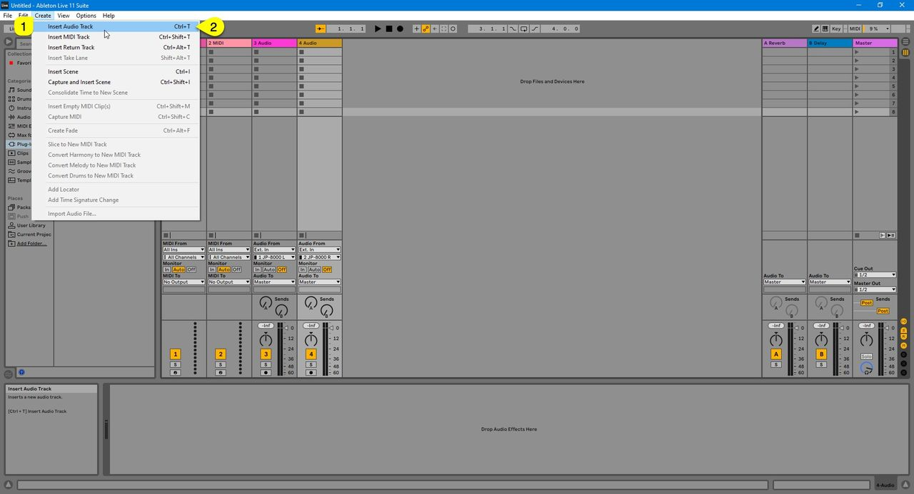
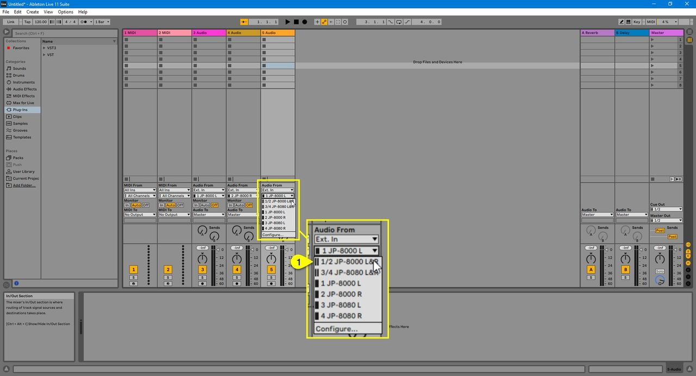
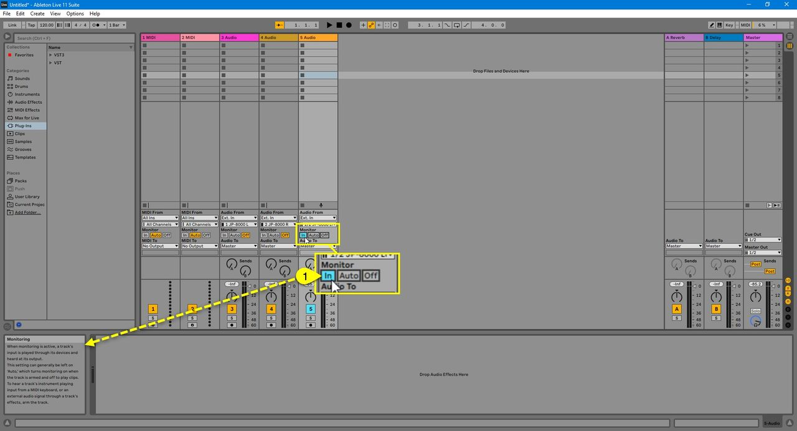
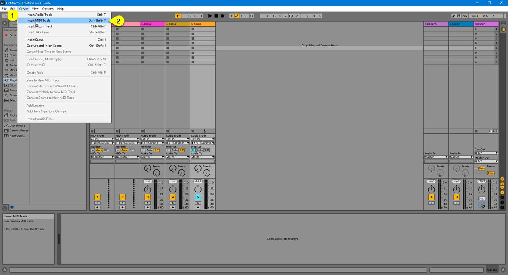
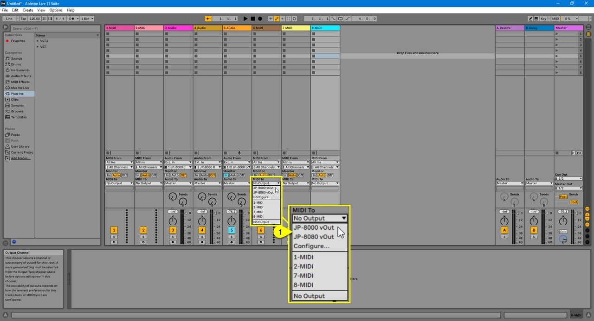
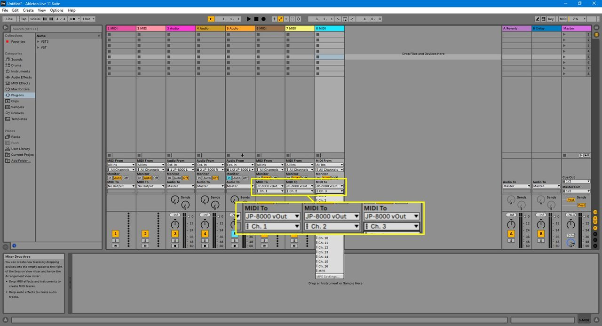
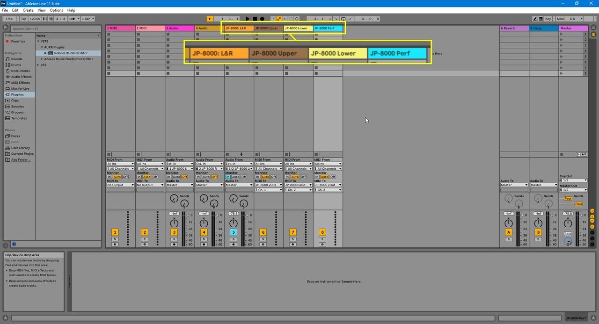

# Roland JP-80×0 Editor – Creating Tracks

Before we add the Editor to the session, let's add AUDIO tracks and MIDI tracks for the JP.

## Creating Audio track(s)

**Click Create [1]** and select **Insert Audio Track [2]** to create Audio track or use key command Ctrl+T.

*Figure: Create new Audio track in Live*

**Assign input [1]** accordingly so that you get the JP signal into Live.

*Figure: Assign input for the JP in Live*

Now you can enable **Input Monitoring [1]** to hear the JP via Live. If you play any keys and you have your inputs configured properly, you should get Audio in!

*Figure: Enable input monitoring in Live*

## Creating MIDI tracks

Now we are ready to create MIDI tracks which we are going to use for making sequences

**Click Create [1]** and select **Insert MIDI Track [2]** to create MIDI tracks or use Ctrl+Shift+T key combination. Repeat so that you get 3 new MIDI tracks!

*Figure: Create new MIDI tracks in Live*

Assign MIDI output port to **virtual JP port [1]** for all three MIDI tracks just created.

*Figure: Assign MIDI port for all three MIDI tracks*

Assign MIDI channels so that the first MIDI track sends to channel 1, second to 2 and third to 3.

*Figure: Assign MIDI channels per tracks*

## Renaming tracks for clarity

To finalize this part of configuration, rename tracks as you prefer. Here is a screenshot how we’ve done it

*Figure: JP related tracks renamed for clarity*

Now we are ready to add the Editor (finally huh?!)
