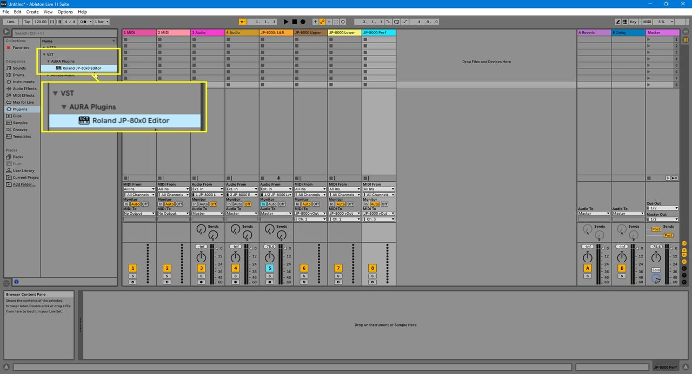
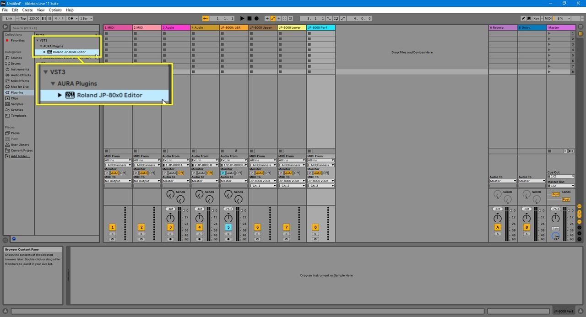
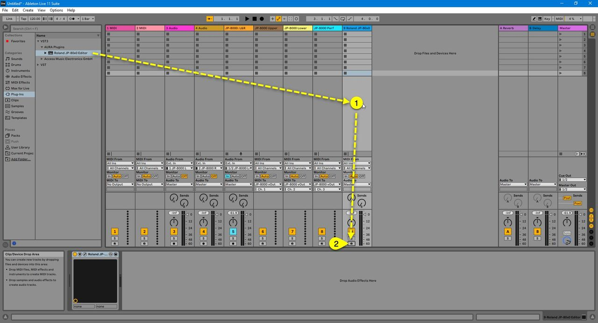
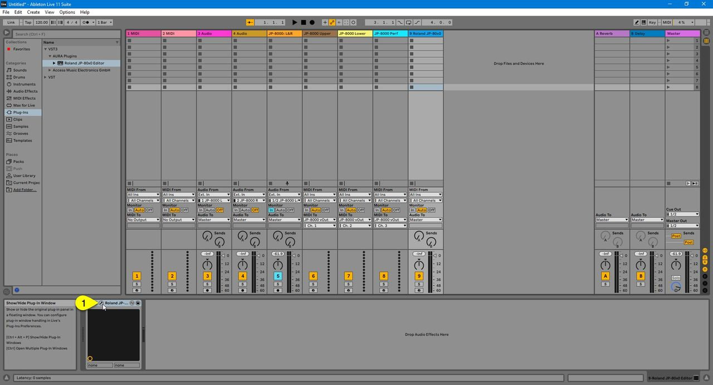
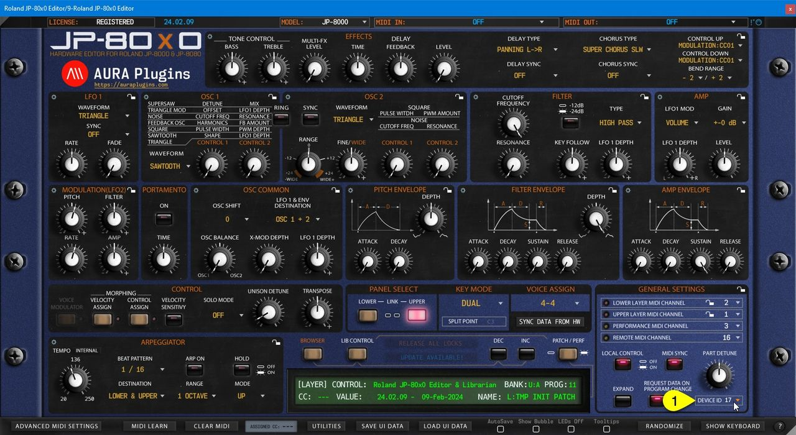
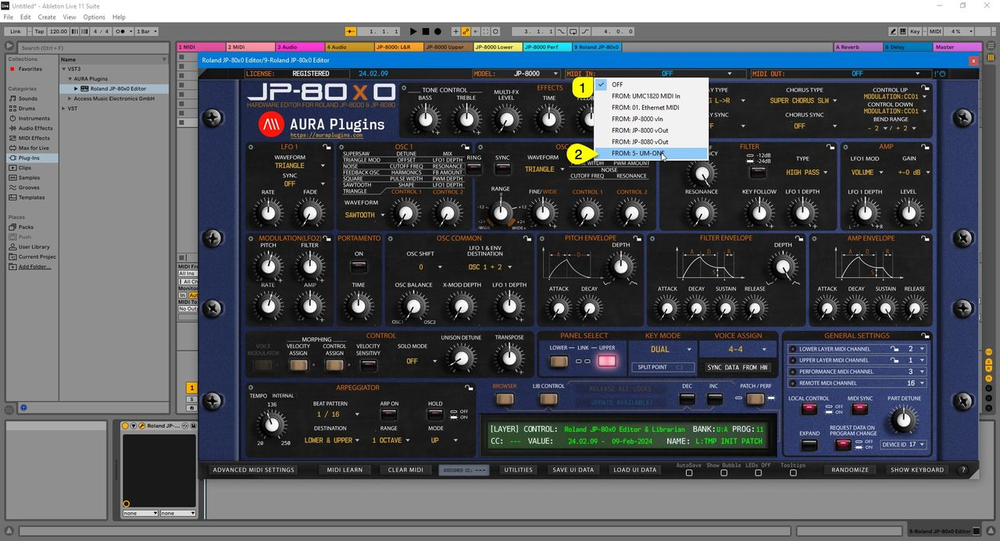
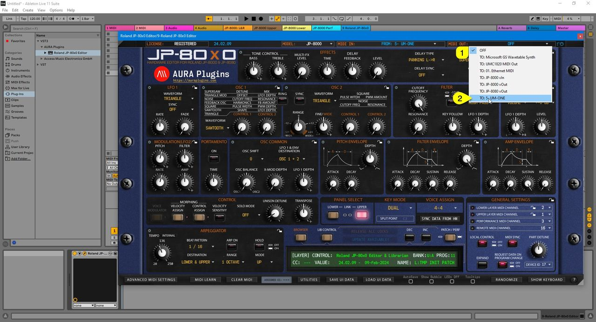
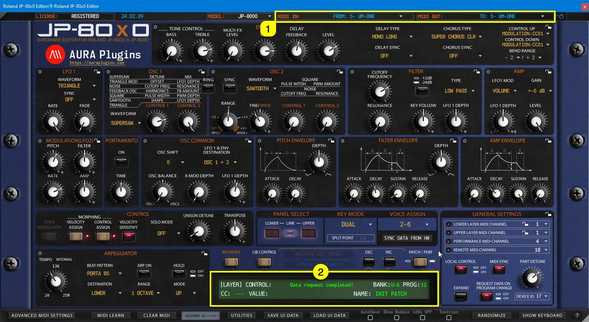

# Roland JP-80×0 Editor – Insert Plug-in in Live

## VST2 (legacy)

You have the option to use the legacy VST2 format if you wish to do so. We would recommend using VST3 for parameter automation simplicity and it has a modern SDK (developer framework) under the hood. VST3 MIDI integration isn’t that great, but we can’t fix that.

You can find the VST2 version from the **VST -> AURA Plugins** folder.

*Figure: VST2 plug-in location*

## VST3

You can find the VST3 version from **VST3 -> AURA Plugins** folder. In this guide, we are using VST3

*Figure: VST3 plug-in location*

## Insert the plug-in to Empty track

Drag the Editor to **empty area [1]** in your Live tracks view. Before you rush to open the Editor User Interface, **DISABLE track arm [2]** toggle while setting the MIDI ports!

*Figure: Insert plug-in and disable track arm toggle*

Now you can open the Editor User Interface by clicking the **wrench [1]** icon in Live.

*Figure: Open Editor user interface*

## Device ID check

First we have to match the Editor Device ID with what you’ve set in your JP. In our case it is 17. You can check how yours is set from the JP-8000 or JP-8080 Config guide if you skipped that part.

*Figure: Check and match Device ID with hardware*

## MIDI Input and MIDI Output ports

## MIDI Input

Click **MIDI IN [1]** area to view which MIDI ports are available. Select the MIDI input port where your JP MIDI Out is connected into. In our case, we have the JP-8000 connected in **UM-ONE port [2]** .

*Figure: Editor MIDI input port*

## MIDI Output

Click **MIDI OUT [1]** area to view which MIDI ports are available. Select the MIDI output port which is connected to your JP MIDI input. In our case, we have JP-8000 connected to **UM-ONE port [2]** .

*Figure: Editor MIDI output port*

Once you set the MIDI output port, our Editor will make a ping / request call to the hardware unit. If **MIDI ports [1]** are properly set, **Editor display [2]** will say “**Data request completed!**” or “**Click Sync Data from HW to continue**”.

*Figure: Editor connected to hardware*

Check Main Functions and Librarian guides to learn more about the Editor usage.
