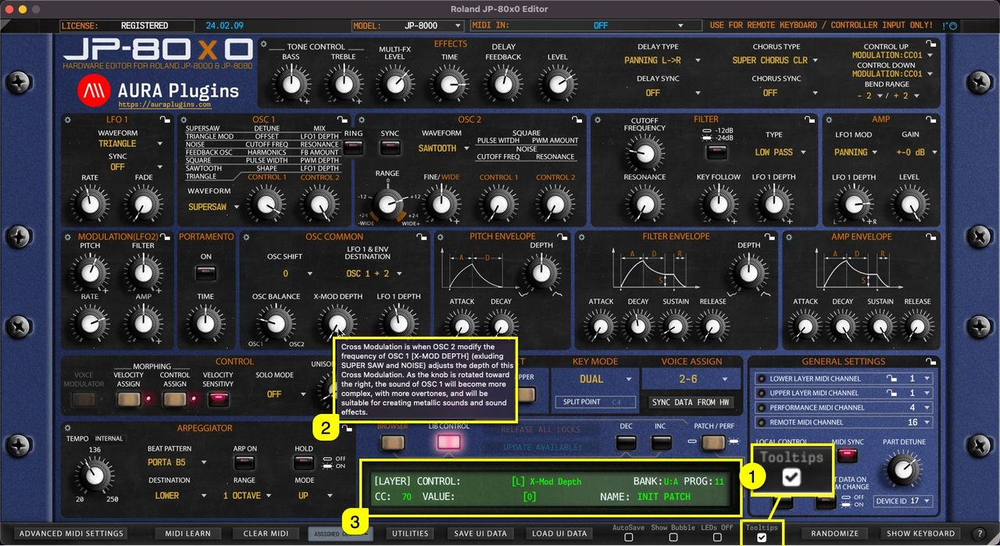

# Roland JP-80×0 Editor – How To Display Parameter Tooltips

**When Tooltips [1]** is toggled on, **tooltip text [2]** will appear if you hold your mouse cursor steadily over the parameter. You also get parameter info displayed in the **Editor control display [3]** while hovering over parameters, like CC number assigned by default, parameter name and the current value.

*Tooltips are courtesy of Roland Corporation and more details can be found from JP-8000 / JP-8080 User Manual.*

*Figure: JP-80x0 Editor User Manual - Tooltips*
