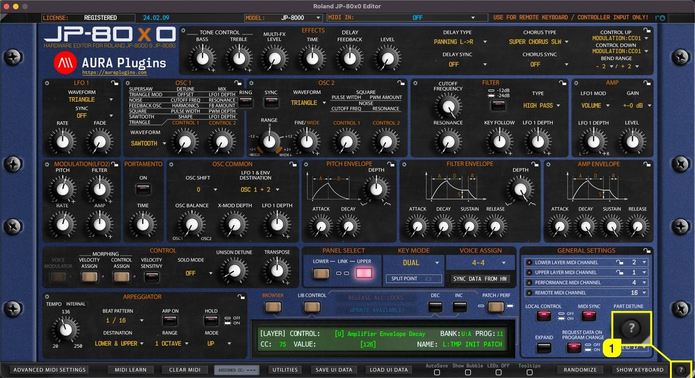
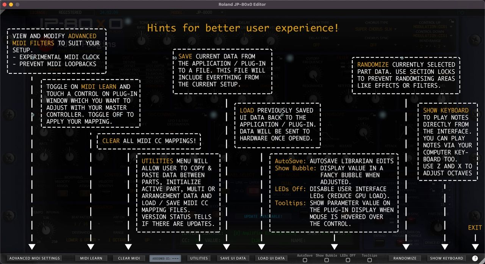

# Roland JP-80×0 Editor – How To Show Quick Help

Get quick tips of the bottom bar functions when you click the **? [1]** mark in the bottom bar.

*Figure: JP-80x0 Editor User Manual - Quick help Trigger*

Use the same button to close the quick tips view.

*Figure: JP-80x0 Editor User Manual - Quick help for Bottom Bar*
