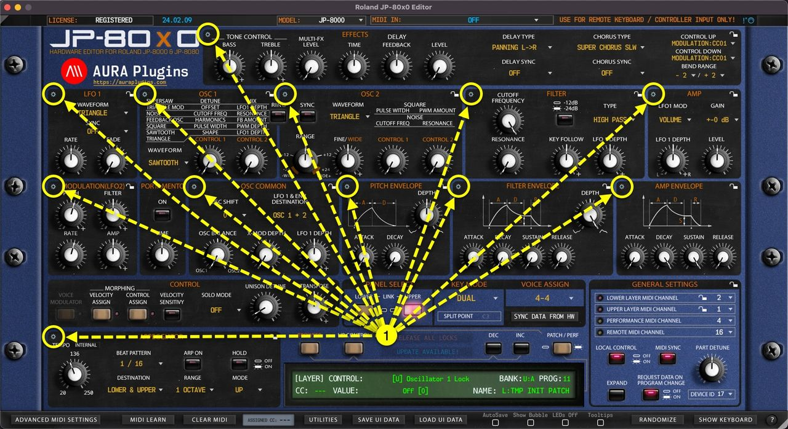
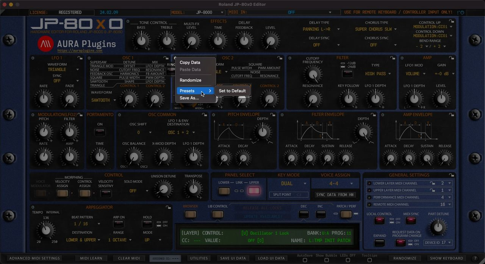

# Roland JP-80×0 Editor – How To Use Section Menus

We added a Section Menu function to aid with creating sounds, recalling favorite section settings or saving your own as you go. You can even Randomize a single section to create exciting new textures! Section Menu opens when you click any of the “ **gears** ” **[1]** icon in the user interface.

*Figure: JP-80x0 Editor User Manual - Section Menus*

## Section Menu Items

*Figure: JP-80x0 Editor User Manual - Section Menu Items*

- **Copy Data**\
  Copy Section Data to clipboard.
- **Paste Data**\
  Paste Section Data from clipboard.
- **Randomize**\
  Randomize Section Data with Randomizer settings applied from Utilities Menu & Advance MIDI Settings page.
- **Presets**\
  Load a preset saved for the set Section. The first item on the list is always “ **Set to Initial Values** ” which loads Section default settings.
- **Save As…**\
  You have a great Filter setup you want to use in later sound design? No problem, just save your Filter or any other section data to HDD for later use.

Data is stored in

*~/Music/AURA Plugins/Roland JP-80x0 Editor/UI DATA/Section Presets/(section name)*
