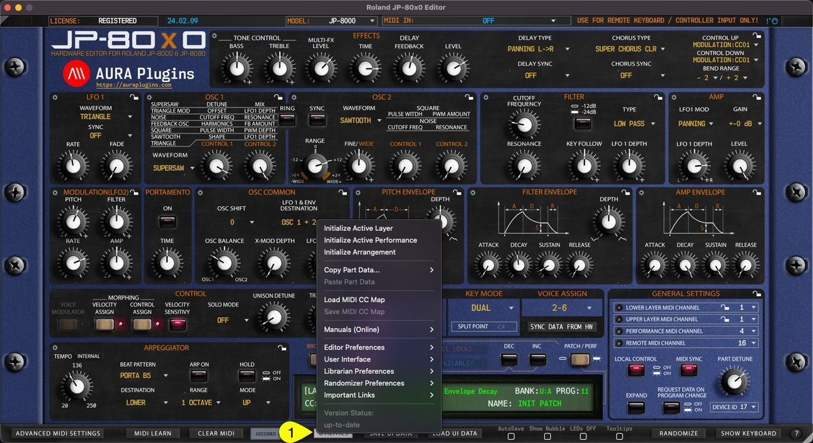

# Roland JP-80×0 Editor – Utilities Menu

**UTILITIES [1]** menu can be found from the bottom bar of the Editor. Once you click the UTILITIES button, a popup menu will appear giving you a lot of different utilities. We will go through these one by one.

*Figure: JP-80x0 Editor User Manual - Utilities Menu*

## Utilities menu items

- **Initialize Active Layer**
- **Initialize Active Performance**
- **Initialize Arrangement**
- **Copy Part Data…**
    - Currently Selected Patch
    - Patch + Layer Performance Data
- **Paste Part Data**
- **Load MIDI CC Map**
- **Save MIDI CC Map**
- **Manuals (Online) These are obvious, so not covering these..**
- **Editor Preferences**
    - Use active Model as Default
    - Enable LOG (CPU hungry)
    - Force MIDI Data to Active Layer
    - Disable Total Recall on Load
    - Enable Hardware Auto-connect
    - Enable DeviceID Scanning
    - Req Interval \* 0.6 -> \* 1.0
    - Save all settings as Defaults
    - Check available MIDI Ports
    - Panel Link
- **User Interface**
    - Use Hi-Res Graphics (4/5/8K)
    - Size: Auto (default)
    - Size: 50% – 175%
    - Enable Bubble Control by Default
    - Disable LEDs by Default
    - Enable Tooltips by Default
    - Show param values on Mouse over
    - Double Click resets control to…
- **Librarian Preferences**
    - Limit Search to Active Bank
    - Search results Containing…
    - Enable AutoSave by Default
    - Show Quick Edit by Default
- **Randomizer Preferences**
    - Focus on Active TAB content
    - Exclude Osc Pitch
    - Exclude LFO Assign Slots
    - Exclude Mode Menus
- **MIDI Preferences**
    - Enable KBD Local by Default
    - Advanced MIDI Settings default overwrites
    - DAW: Bypass Editor MIDI Processor
    - Disable Adv MIDI Settings Warnings
- **Important Links**

These are obvious, so not covering these..

- **Version Status**
    - Up-to-date
    - Update available
