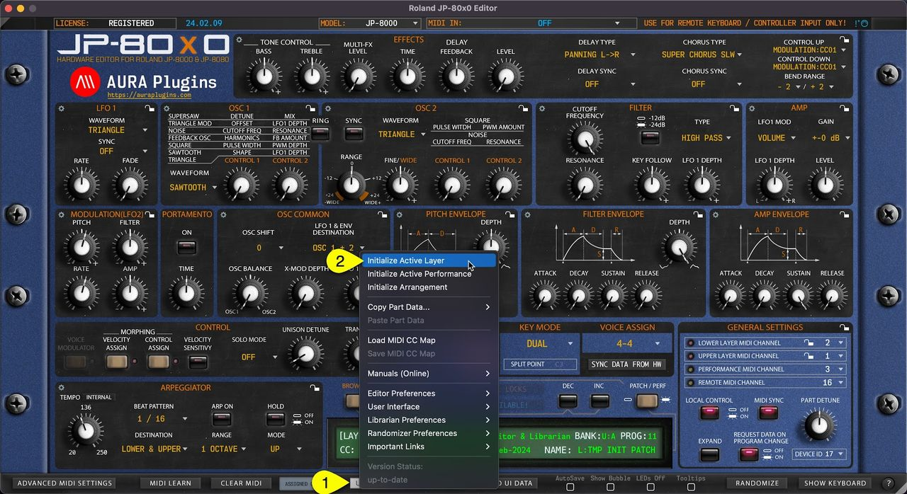
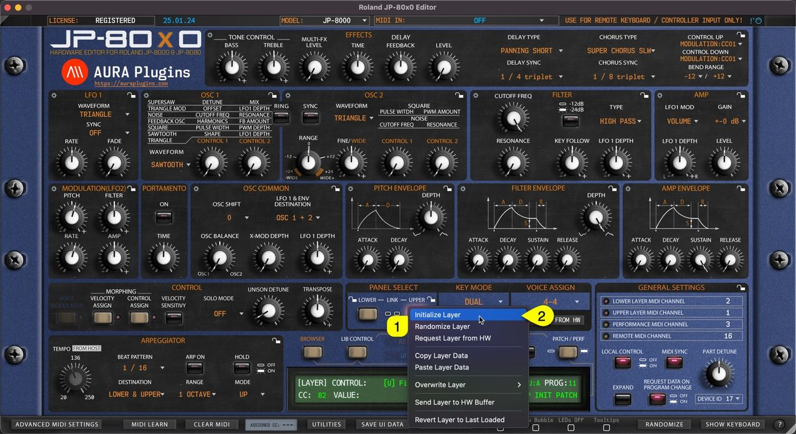

# Roland JP-80×0 Editor – Initialize Active Layer

You can Initialize Active Layer by clicking **Utilities Menu [1]** and then **Initialize Active Layer [2]** . This function will initialize whichever Layer you have active at the moment.

Upper or Lower Layer Patch, Velocity and Control assigned values will be initialized.

This is helpful if you load a performance which has a great patch on one layer, but the other one needs crafting from scratch.

*Figure: JP-80x0 Editor User Manual - Initialize Active Layer*

You can achieve the same result if you right click on the currently selected **layer toggle [1]** and select **Initialize Layer [2]** from the menu.

*Figure: initialize layer*
