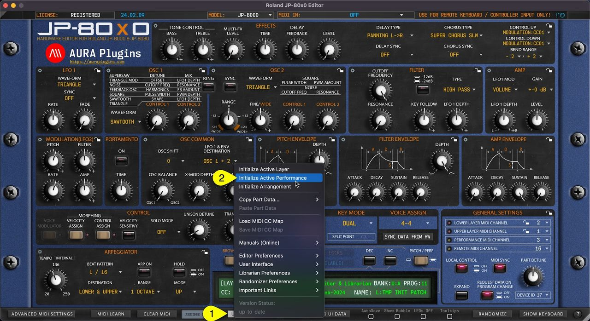

# Roland JP-80×0 Editor – Initialize Active Performance

You can Initialize Active Performance by clicking **Utilities Menu [1]** and then **Initialize Active Performance [2]** . This function will initialize both Layers.

Upper and Lower Layer Patch, Velocity and Control assign values will be initialized as well as Performance Settings also known as General Settings.

*Figure: JP-80x0 Editor User Manual - Initialize Active Performance*
