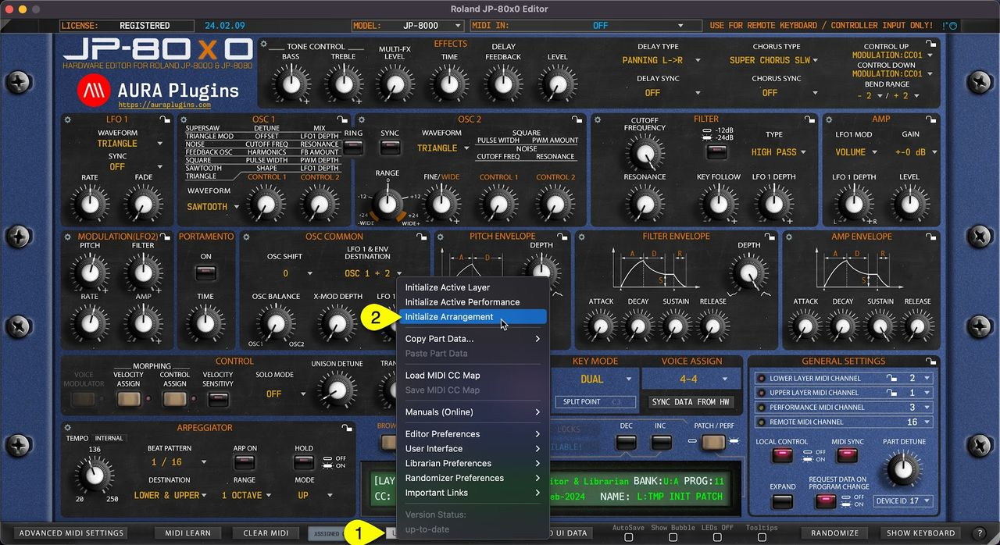

# Roland JP-80×0 Editor – Initialize Arrangement

You can Initialize Arrangement by clicking **Utilities Menu [1]** and then **Initialize Arrangement [2]** . This function will initialize the whole Editor to initial state.

This will also Initialize the Global Settings to default values.

*Figure: JP-80x0 Editor User Manual - Initialize Arrangement*
