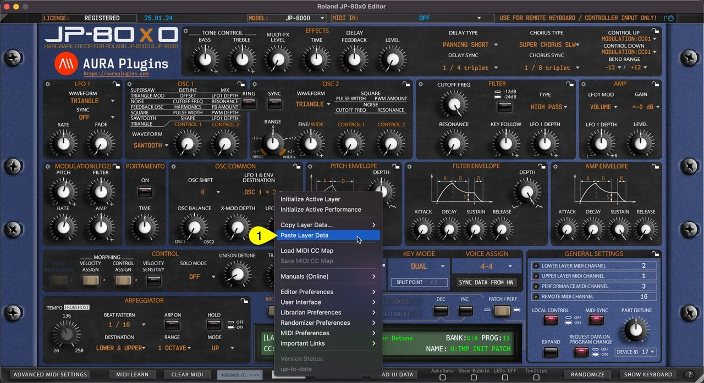
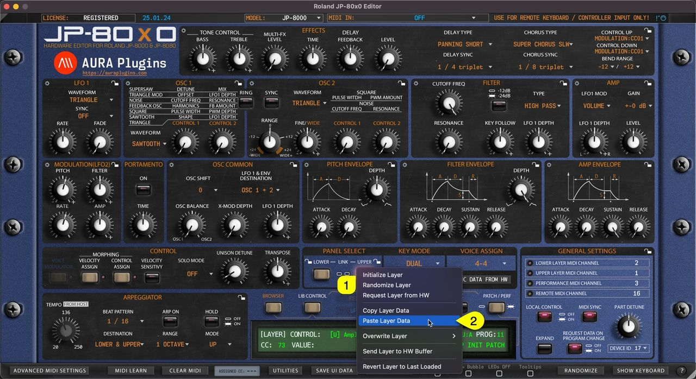

# Roland JP-80×0 Editor – Paste Layer Data

## Paste Layer Data

You can paste currently copied Layer data from the clipboard. Open Utilities Menu and select **Paste Layer Data… [1]** .

If you have single Layer data copied, then this is only pasted. On the other hand, if you have Layer and Layer Performance data on clipboard, then this will be pasted.

*Figure: paste layer data*

See previous page for explanation for each copy function and what they include.

You can achieve the same result if you right click on the currently selected layer **toggle [1]** and select **Paste Layer [2]** from the menu.

*Figure: paste layer data*
