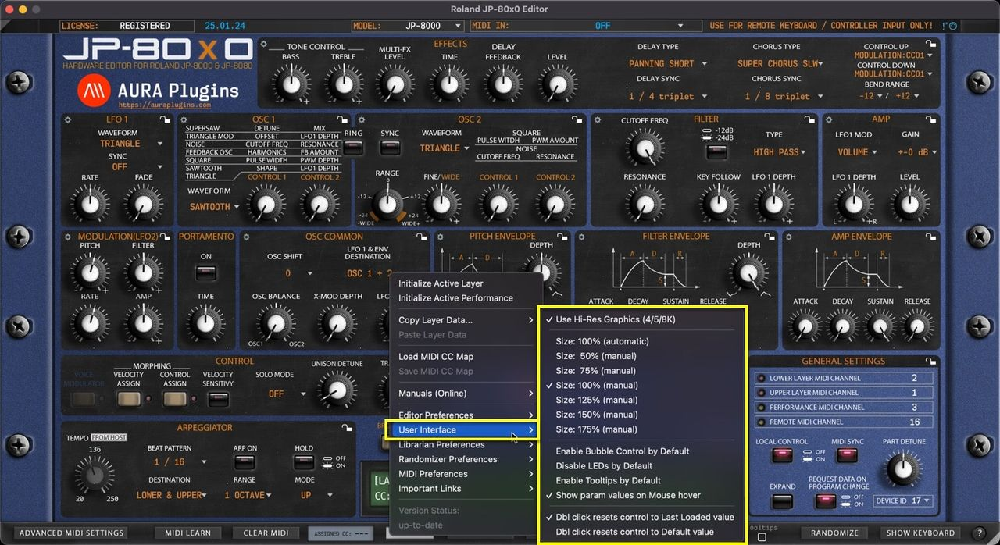

# Roland JP-80×0 Editor – Utilities: User Interface

*Figure: utilities user interface*

## Utilities Menu – User Interface Breakdown

## Use Hi-Res Graphics (4/5/8K)

Loads a bit better graphics for the end user – recommended if you have a proper display to show more pixels. Sharp graphics!

## Adjust Interface Size

Automatic or manually adjusted User Interface size. Automatic is recommended, but there might be cases where lower or much higher UI size is needed. Then this is your tool for it.

Double click top left corner triangle = adjusts UI to 100%. Single click shrinks the UI to 50%.

## Enable Bubble Control by Default

When enabled, Bubble is shown on the control by default when the parameter is adjusted.

## Disable LEDs by Default

Removes all the distraction LED blinks from the user interface and saves a bit of CPU/GPU. If you know what you are doing, then this can be toggled on all the time.

## Enable Tooltips by Default

This will show the tooltip everytime mouse is moved over to a control. Not all controls support tooltip, but when they do, it is shown with a bit of delay.

## Show param values on Mouse over

When enabled, the Editor Control Display area will always show the currently hovered control parameter value.

## Double Click resets control to…

## Last Loaded value

When double clicked, control is “reset” to the last loaded value. ie, when you change a patch, then a new “default” is memorized.

## Default value

If this option is chosen, then Initial Patch value is applied to the double function.
