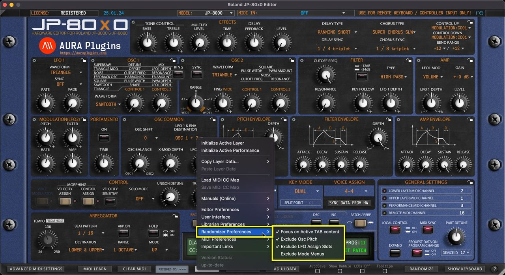

# Roland JP-80×0 Editor – Utilities: Randomizer Preferences

*Figure: randomizer preferences*

## Utilities Menu – Randomizer Preferences Breakdown

## Focus on Active TAB content

When toggled on, Randomizer focuses on randomizing actions towards the currently selected layer.

## Exclude Osc Pitch

When toggled on, Randomizer will exclude all Pitch related functions such as LFO pitch depth, Pitch Env and Osc 2 Pitch controls.

## Exclude LFO Assign Slots

When toggled on, all LFO assignments will by bypassed when randomizer is triggered

## Exclude Mode Menus

All MODE menu items will be excluded by the randomizer when this option is toggled on
