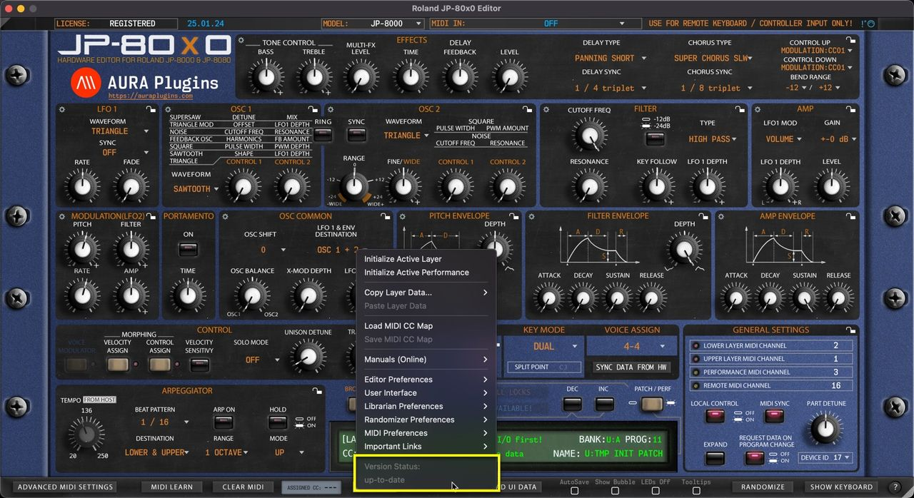

# Roland JP-80×0 Editor – Version Status

*Figure: version status*

## up-to-date

Displays that the current version of the Editor is up-to-date.

## Update Available

If there is an update available, you’ll see “**Update Available**” enabled here. Clicking it will reveal the most recent update changelog.
