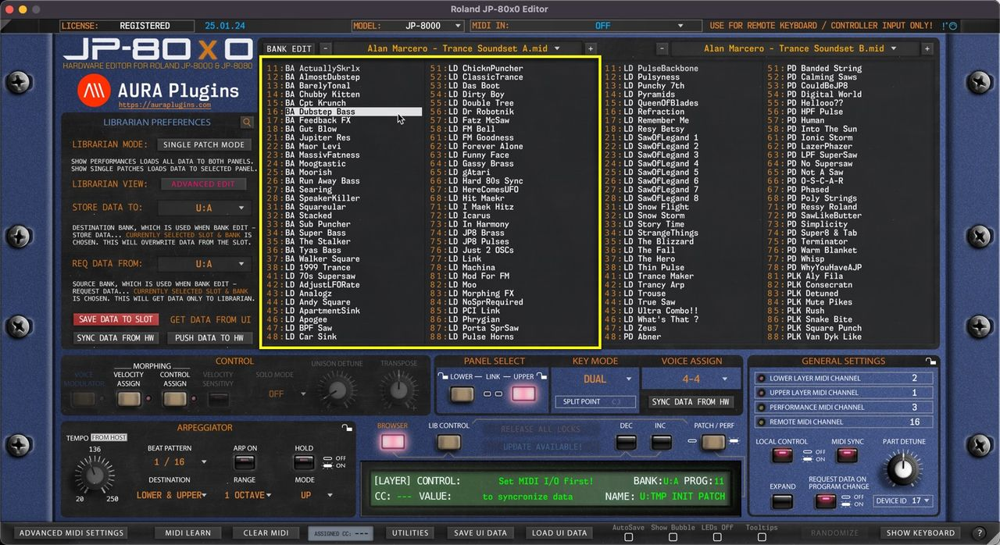
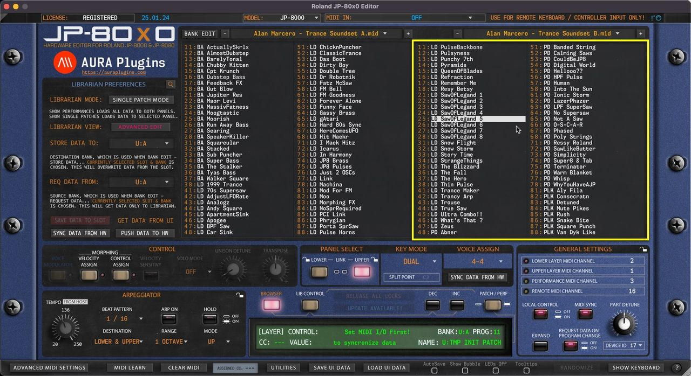

# Roland JP-80×0 Editor – Librarian Data Views

Our Librarian has two views: primary is “ **Edit Buffer** ” view and secondary is “ **Source** ” view.

This is really straight forward, left is your Edit Buffer , where you can request, rename, move and paste data. The right view is your Source of copy / search results view which can be changed once the Edit Buffer is locked due to unsaved changes.

Let's break down how they perform below..

*Figure: librarian view left*

## Left Data View

Like mentioned earlier, the LEFT view is your “ **BUFFER** ” view. All bank requests are fetched into this view, where you can store them in your HDD. You can drag’n’drop and paste data to the left view, rename items in the left view etc.

*Figure: librarian view right*

## Right Data View

This is our “ **SOURCE** ” view. Going further: Any data from source view can be copied & pasted or dragged over to “BUFFER” view.

If search is triggered, search results will be shown in this view.

You can change the banks in the SOURCE view while the BUFFER view is locked due to unsaved changes.

This is helpful when you want to make a bank of your own from different patches / performances / search results and what not.

Data can not be pasted to any of the slots in this view.
