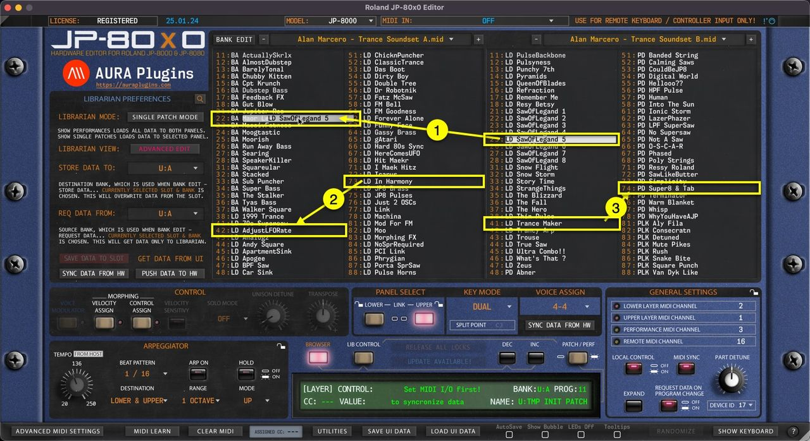
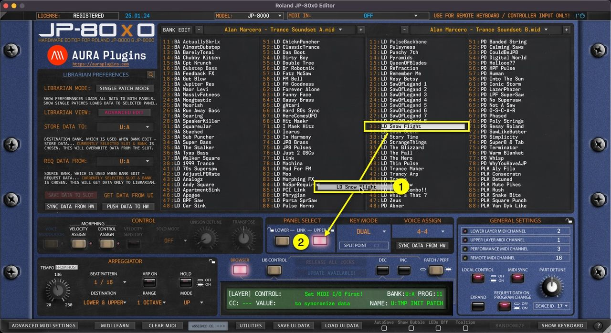

# Roland JP-80×0 Editor – Librarian Drag and Drop

## Librarian Drag’n’Drop

You can drag’n’drop data from:

- **[1]** SOURCE -> BUFFER list
- **[2]** BUFFER -> BUFFER list

BUT you can NOT drag’n’drop data **from [3]** SOURCE -> SOURCE list. BUFFER -> SOURCE list is also disabled. This is by design explained in the previous article.

*Figure: librarian drag and drop 1*

**NOTE:** You can also drag’n’drop data from Librarian slots to PANEL SELECT buttons (UPPER / LOWER), which will load the PATCH data to the slot you drop it on!

## Drag’n’Drop to PANEL

As note above states, you can drag’n’drop data from any **Librarian Slot [1]** to **UPPER** or **LOWER [2]** panel toggles and data is then sent to hardware on that specific layer.

*Figure: librarian drag and drop 2*
