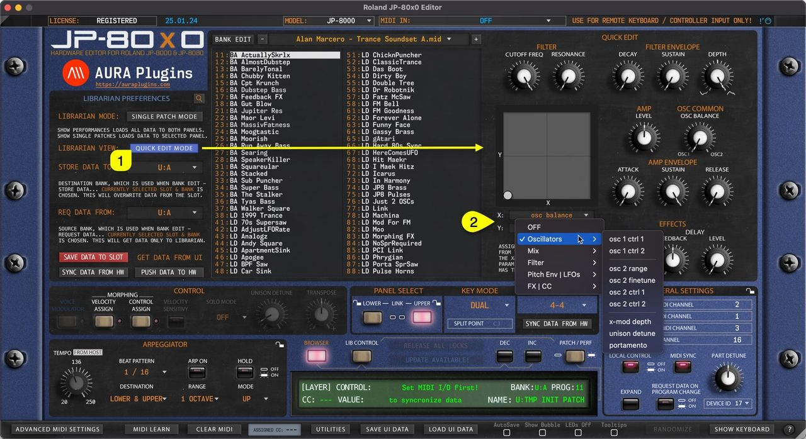

# Roland JP-80×0 Editor – Quick Edit View

Librarian has an additional view to make quick edits on SINGLE PATCHES or PERFORMANCES while browsing them through the Librarian: Quick Edit Mode.

Once **Quick Edit Mode [1]** is toggled on, RIGHT list view is replaced with Quick Edit controls and customizable XY PAD.

You can choose different controls for the X and Y axis by clicking the **control name [2]** on each of the axes.

*Figure: librarian quick edit mode*
