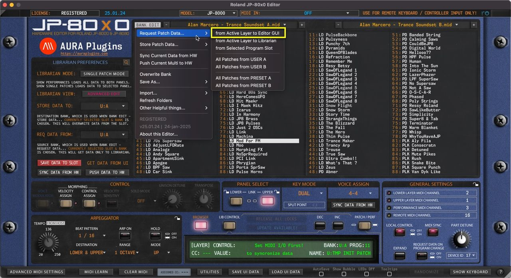
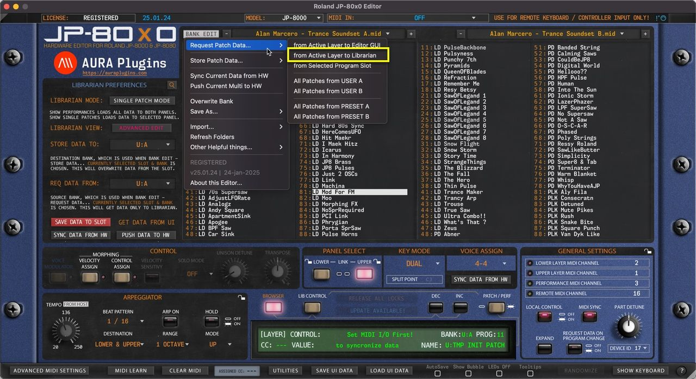
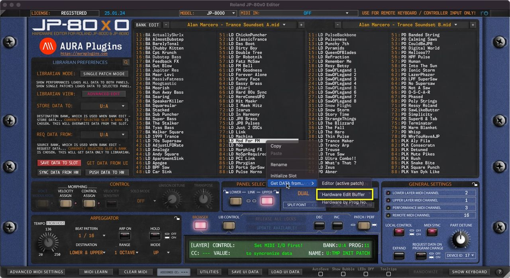
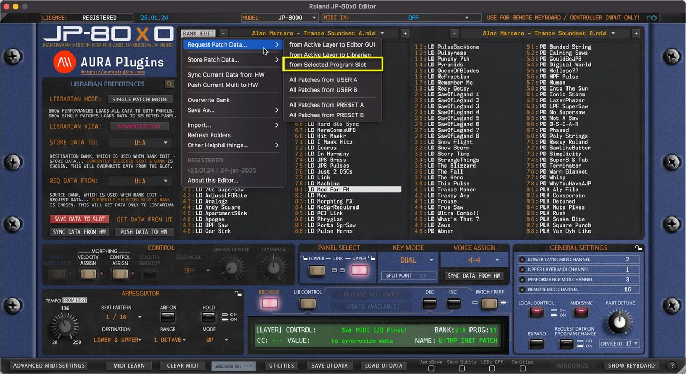
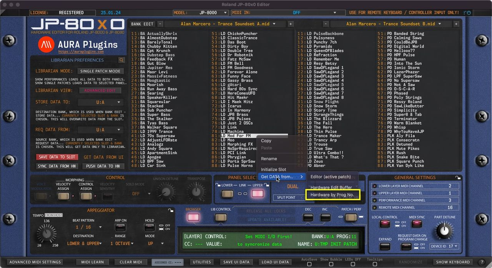
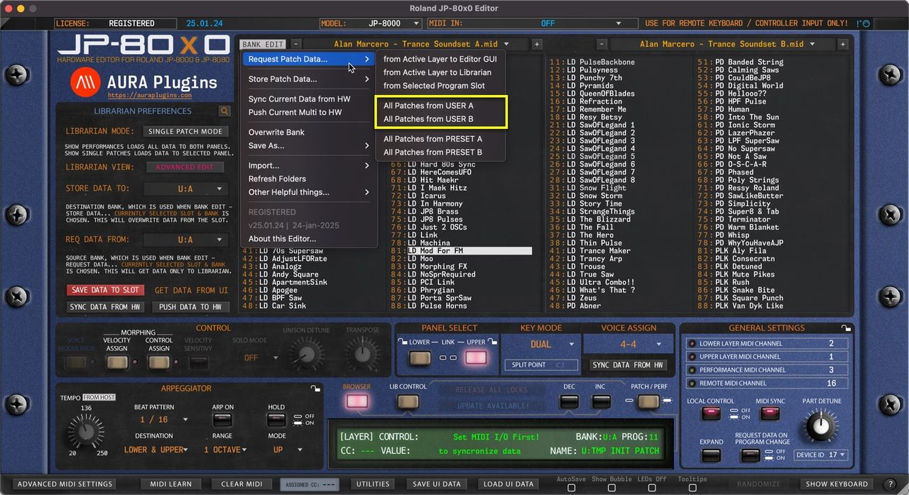
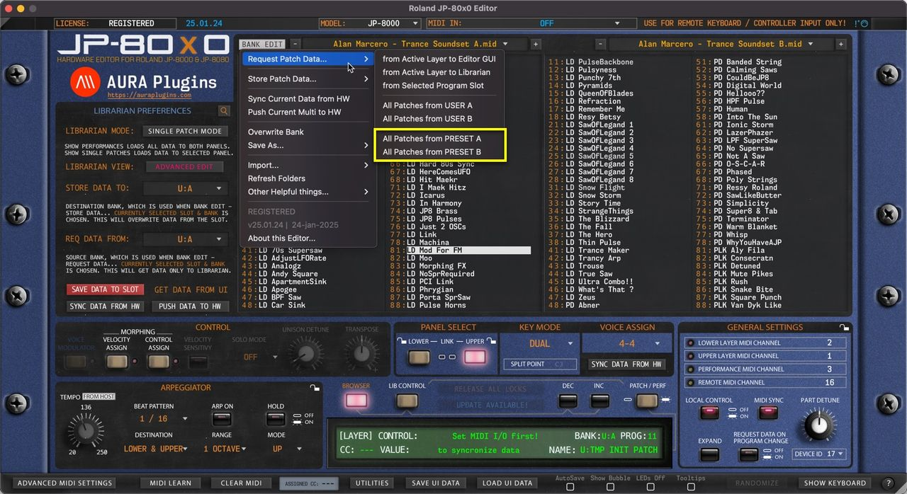
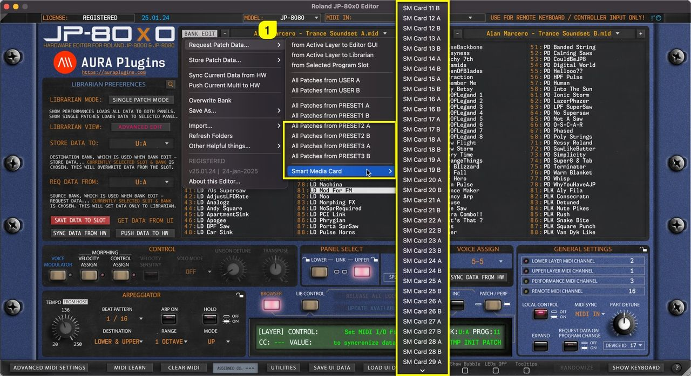

# Roland JP-80×0 Editor – Request Patch Data from Hardware

**NOTE:** To successfully request the patch data from the hardware, STOP all activities on your DAW so that the SysEx data is received as expected!

## from Active Layer to Editor GUI

Open the **BANK EDIT** menu and choose **Request Patch Data … -> from Active Layer to Editor GUI** to get the buffer data from the Hardware to the Editor User Interface. In this case, Librarian will get the data to Editor UI from the UPPER PANEL as it is the selected panel.

*Figure: request patch to user interface*

## from Active Layer to Librarian

Open the **BANK EDIT** menu and choose **Request Patch Data … -> from Active Layer to Librarian** to get the buffer data from the currently selected panel to the Librarian. In this case, UPPER PANEL data is requested to the selected slot, which is slot 81.

*Figure: request patch from layer to librarian*

You can achieve the same result with **Right mouse click** at the top of slot 81 and choose **Get DATA from … -> Editor (active patch)** .

*Figure: request patch data to librarian via right click*

## Hardware Edit Buffer

If the Edit buffer differs from the Editor buffer, you can also request the Edit Buffer to the Librarian slot with **right mouse click** at the top of slot and choose **Get DATA from … -> Hardware Edit Buffer** .

*Figure: request edit buffer to librarian*

## from Selected Program Slot

Open the **BANK EDIT** menu and choose **Request Patch Data … -> from Selected Program Slot** to get Patch from U:A 81.

U:A is defined in the REQ DATA FROM menu on the left hand side view. Slot is determined by the user selection in the Librarian View.

*Figure: request patch from slot*

You can achieve the same result with **right mouse click** at the top of any slot and choose **Get DATA from … -> Hardware by Prog No** .

*Figure: request data from slot right click*

**NOTE:** REQ DATA FROM menu selection defines the Bank Address for hardware requests!

## All Data from USER Bank

Open the **BANK EDIT** menu and choose **Request Patch Data … -> All Patches from USER A / B** of your choice.

This action will request all USER bank Patches to the Librarian from your hardware.

*Figure: request user data to librarian*

## All Data from PRESET Bank

Open the **BANK EDIT** menu and choose **Request Patch Data … -> All Patches from PRESET A, B** … of your choice.

This action will request all PRESET bank Patches to the Librarian from your hardware.

*Figure: request from preset banks*

When **Hardware MODEL [1]** is set to JP-8080, you have a lot more options for PRESET banks as well as for Smart Memory Card slots (if inserted).

*Figure: request patches from roland jp-8080*
