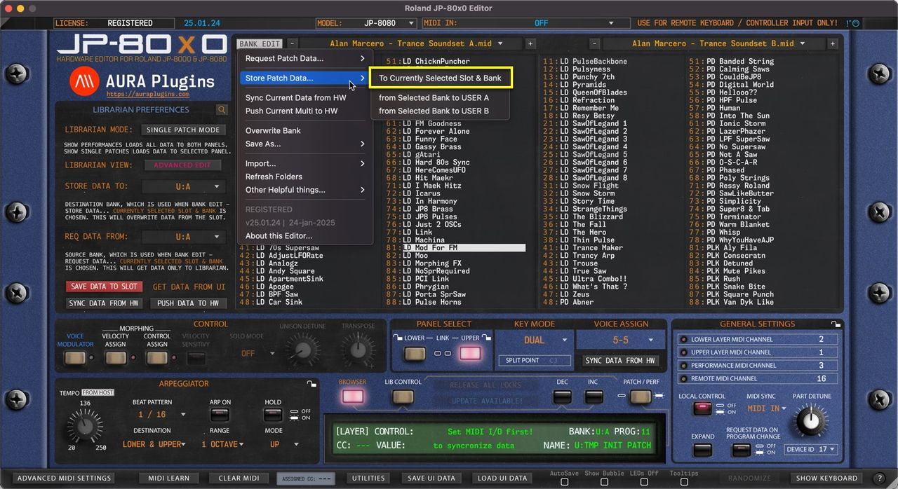
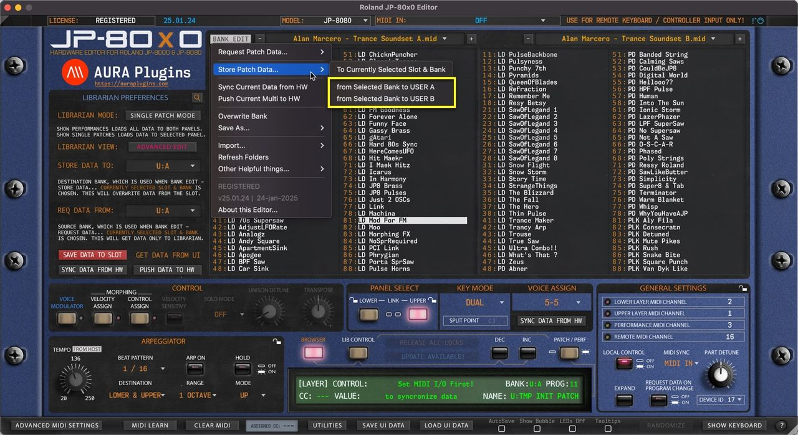

# Roland JP-80×0 Editor – Store Patch Data to Hardware

**NOTE** : Before you start data writing to hardware, make sure you know which slot you are overwriting and STOP all activities on your DAW in regards to the hardware to ensure data is written properly!

## To Currently Selected Slot & Bank

Open the **BANK EDIT** menu and choose **Store Patch Data … -> To Currently Selected Slot & Bank** to write currently selected Librarian Slot to hardware. In this case we would overwrite Slot 81 in bank U:A which is chosen in the left hand side view under the STORE DATA TO menu.

*Figure: store patch to slot and bank*

## from Selected Bank to USER A / B

Open the **BANK EDIT** menu and choose **Store Patch Data … -> from Selected Bank to USER A / B** to write the entire USER bank of your choice with the data from Active Librarian View which in this case is LEFT view (slot 81 chosen on LEFT list).

This means, you can select either view (LEFT / RIGHT) and write the hardware memory with a bank in question. Extension to this is that you can do search, ie, bass and write all the results from the active view to hardware!

*Figure: write user bank*
