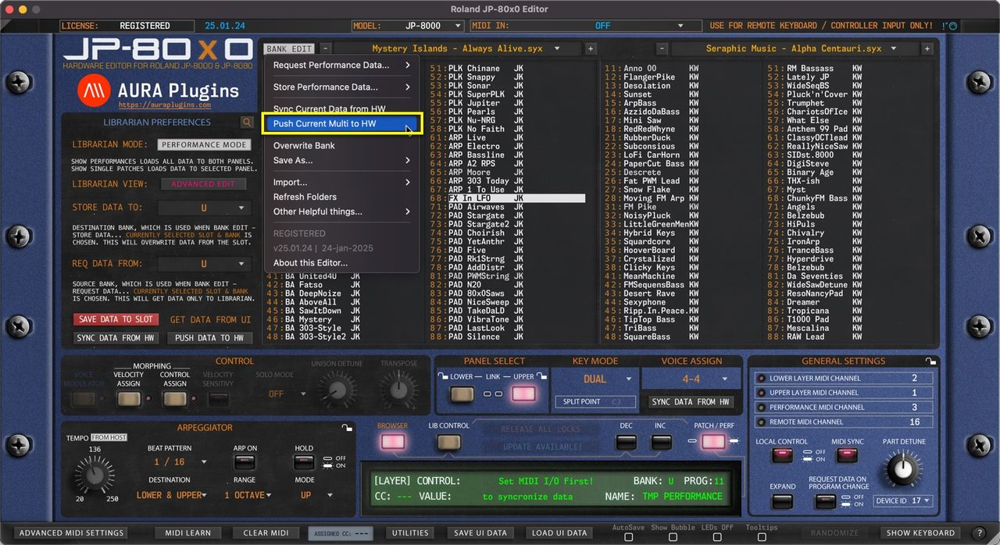

# Roland JP-80×0 Editor – Push Current Data to HW

Open the **BANK EDIT** menu and choose **Push Current Data to HW** to send your Global Settings, Performance and Layer settings to your Hardware. This can be used to force the hardware buffer to match with the Editor.

*Figure: push current data to hardware*

**NOTE:** With Push Current Data to HW function you can recover your User Interface data back to your Hardware in case your MIDI interface ports are different to previously set ports!
