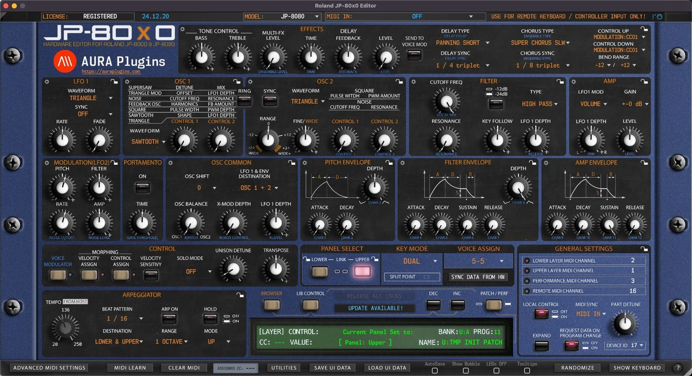

# Introduction

*Figure: main interface*

Thank you for your interest towards our Editor & Librarian software.

We built our Roland JP-80x0 Editor to control Roland JP-8000 and/or Roland JP-8080 model over MIDI. Modern synths come up with an integration tool to hook your synth into DAW and we wanted to give this same opportunity to you as well. Connect MIDI input & output, Audio jack cables to mixing console / sound card and fire up your Computer to get started!

Roland JP-80x0 Editor User Manual contains instructions to get the Editor installed and configured. Please read this manual through carefully. Any feedback with comments on how to improve the documentation is welcomed.

Let's dig in!

> **DISCLAIMER:** Our company & product has nothing to do with Roland Corporation.  
> If there is an issue with our product, open a support ticket from my account page.  
> You can find support details at the end of this document.  
> Updates are free per release year. Check FAQ for more details.
