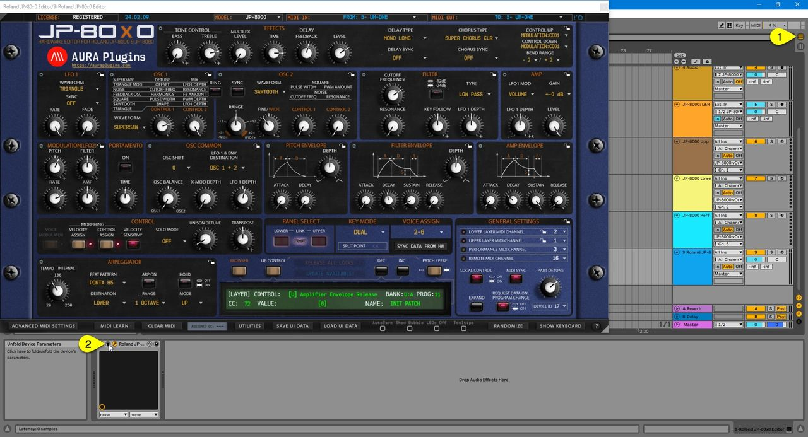
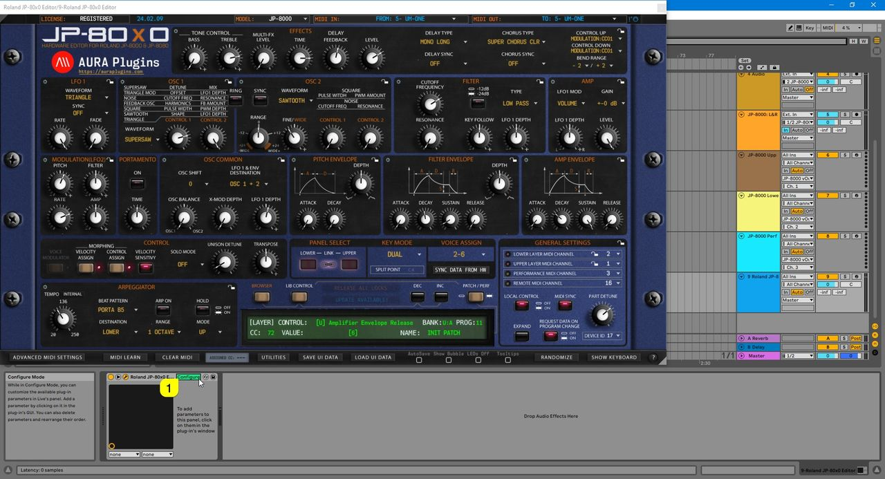

# Roland JP-80×0 Editor – Automation in Live

## Learning Parameters for Automation

You can automate almost every parameter of your JP with our Editor in DAW without having to remember CC numbers or have spread sheets constantly open on your screen.

**Click toggle [1]** to view the arrangement view. Now click the **Unfold Device Parameters [2]** button.

*Figure: Unfolding Device Parameters in Live*

> **NOTE:** Parameters sent as **MIDI CC** can be automated smoothly. Automating **SysEx**-based parameters may make the Editor user interface or your DAW sluggish. We are looking into the cause. If you need to automate a SysEx parameter, automate a MIDI controller that the JP-8080 accepts for Control Up or Control Down instead (Aftertouch, Breath or a Control Change), and set that parameter’s range with Control Assign (MORPHING [CONTROL ASSIGN]). See your JP-8080 Owner’s Manual for the Control Assign steps.

Toggle **Configure [1]** from Device Parameters view to enable parameter learning.

*Figure: Configure Parameters for Automation*

Notice that if JP has **layer link [1]** toggled on, learning parameters will be troublesome. Click the **link [1]** button to unlink layers.

*Figure: Unlink layers before learning automation parameters*

Now if you move parameters from the **Editor User Interface [1]** or Hardware, Live will register the **parameters [2]** .

*Figure: Learning parameters*

Now if you toggle on **Automation [1]** , all of the parameters you assigned in Configuration mode will be shown in the **Editor track [2]** in Live.

*Figure: View Automation and assigned parameters*

## Closure

Here is a summary of what is happening in Live now that everything is configured as they should be!

- **[1]** Track hosting our Editor.
    - Ideal for automation,
    - Patch and Performance change & value edits per layer,
    - Librarian Edits,
    - and Total Recall : Data is sent to hardware automatically when the project is loaded.
- **[2]** Stereo Audio track.
    - Audio Inputs from JP-8000 selected as source of audio.
    - Could be split into two Mono tracks if output mode is set to parallel out.
    - Input Monitoring is toggled on so that we can hear everything happening with the JP-8000.
- **[3 & 4]** MIDI tracks assigned to JP-8000 vOut Port.
    - MIDI channel is set to 1 and 2. Now if we take a look at the Editor MIDI channels in the General Settings area, we can see that channel 1 is assigned to the Upper Layer and channel 2 is assigned to the Lower Layer.
    - Best use for sending DAW clocked / timed MIDI notes to hardware.
- **[5]** same as above, but MIDI channel is assigned to channel 3.
    - This channel is the same as the Performance MIDI channel in the Editor.
    - If you change the output port destination to our Editor track, you can play both layers at the same time, even if they don’t share the same MIDI channel.

*Figure: Closure*

Check the rest of the Editor Functions from the Main Functions and Librarian sections.

If you have trouble with the Editor setup / configuration, check the troubleshooting section.
