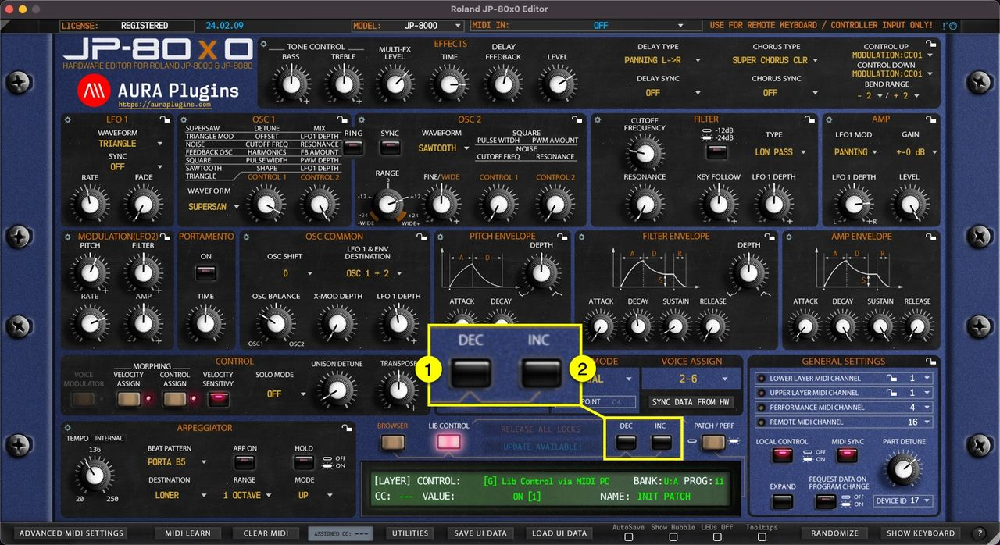
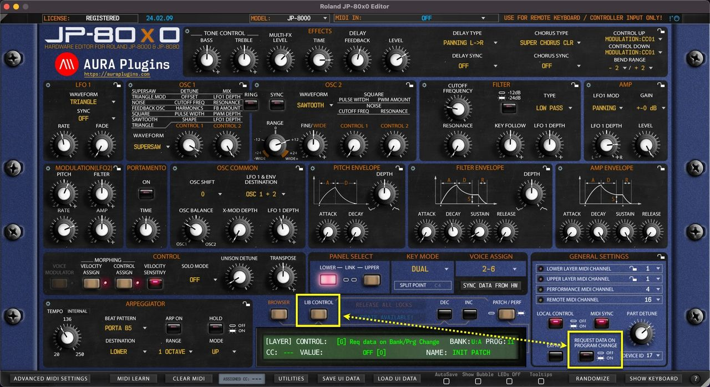
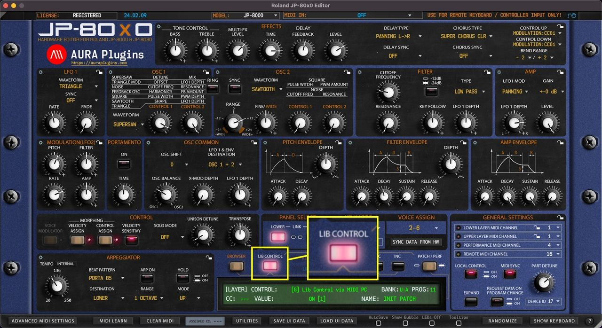

# Roland JP-80×0 Editor – How To Change Programs

## PROGRAM CHANGE BUTTONS

**DEC [1]** button will change to previous program.

**INC [2]** button will change to the next program.

This will trigger a MIDI Out message with appropriate program number based on the PROG Display value. Each part has its own set of Program Change buttons.

See below how it will behave when **Request Data on Program Change** is toggled on / off.

*Figure: JP-80x0 Editor User Manual - Program Change Buttons*

## REQUEST DATA ON PROGRAM CHANGE

**REQUEST DATA ON PROGRAM CHANGE** means that if the Editor receives a program and/or bank change message from MIDI input, our Editor will initiate a Data request from the JP to the Editor user interface.

Inputs valid for this function:

- MIDI In port (Plug-in).
- DAW gateway (Plug-in).
- Remote Keyboard MIDI In port (Standalone Application).
- Editor Program Change buttons (per part) (\*1).
- Editor Program Number display (per part) (\*2).
- Editor Bank Number display (per part) (\*3).

*Figure: JP-80x0 Editor User Manual - Request Data on Program Change*

If this switch is toggled off, our Editor will only send the program change messages to the hardware but won’t be requesting any data back. This is good in some cases where you might want to quickly browse hardware patches.

(\*1 See above for Program Change Buttons).

(\*2 See below for Program Number Display).

(\*3 See next page for Bank Number Display).

**TIP**: Turn off Request Data On Program Change and Lib Control to quickly browse through the hardware presets. Once you hit a sound you want to work on, click Sync Data from HW button to request the data to the Editor user interface and work it from there!

*Figure: JP-80x0 Editor User Manual - Change Program on Hardware Only*

## LIBRARY CONTROL ON PROGRAM CHANGE

**Lib Control** switch allows you to take control of your library patches with incoming program changes via MIDI or with the Editor user interface DEC / INC buttons and Bank Number Display / Program Number Display menus.

*Figure: JP-80x0 Editor User Manual - Library Control on Program Change*

> **NOTE #1:** Patches are sent to the hardware on the currently selected part when the menu is used to change programs.

> **NOTE #2:** If the program change message is received from MIDI channel 4 and none of your layers are set to channel 4, no action will be taken.

> **NOTE #3:** If the program change message is received from MIDI channel 1 and both layers are set to channel 1, no action will be taken. Change the MIDI channel temporarily to a different channel.

## PROGRAM NUMBER DISPLAY / SELECTION MENU (\*3)

**PROG Display [1]** acts as a menu as well as a display to show the current Part Patch program number. You can quickly navigate to different banks of programs without having to click Program Change buttons like crazy.

*Figure: JP-80x0 Editor User Manual - Program Change Menu*

In default status ( **REQUEST DATA ON PROGRAM CHANGE** ), this popup menu will display program numbers in different banks of programs. See image below.

*Figure: JP-80x0 Editor User Manual - Program Change Menu Default mode*

But things get exciting when you toggle on **LIB CONTROL [1]** switch: You can now view currently active Librarian Bank patches on the menu and browse them directly from the main user interface!

*Figure: JP-80x0 Editor User Manual - Program Change Menu Lib Control On*

Check above for further details about the Library Control function.
