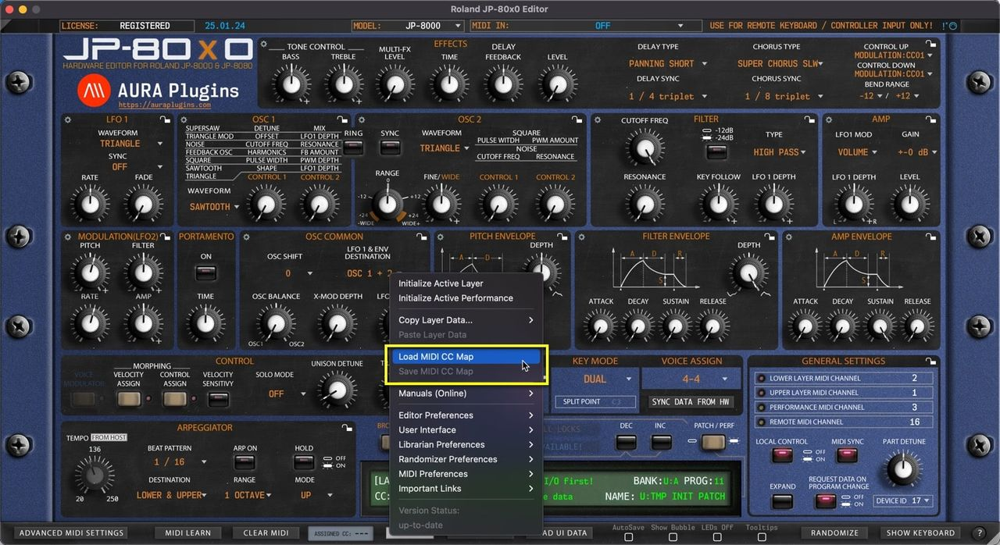

# Roland JP-80×0 Editor – Save and Load MIDI CC Maps

*Figure: load save cc maps*

## Save MIDI CC Map

If you have learned MIDI CC controls from your master controller you can save the mapping to HDD. Say you have General MIDI controls cc #12 assigned to filter cutoff (74) and #13 assigned to filter resonance (71), you can save the current mapping to a file and open it every time you insert a new instance of the Editor.

## Load MIDI CC Map

This function loads your custom CC mapping to the Editor and over-rides the default CC assignments.

> **NOTE:** Loading custom CC mappings does not over-ride hardware CC messages. ie. Cutoff from hardware is still assigned to #74, while DAW (midi controller) CC is mapped to #12
