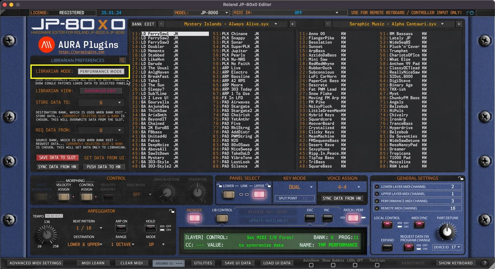

# Roland JP-80×0 Editor – Librarian Data Types

## Single Patch Mode

Editor defaults to **SINGLE PATCH MODE** on new instances. Singles from the Librarian can be loaded to the UPPER or LOWER panel of your choice. If the UPPER panel button is lit, then data will be sent to the UPPER panel in the hardware.

You can load two individual SINGLES in the JP, giving you two different “parts”. ie, load a PAD on LOWER panel and a LEAD on UPPER panel. Panels can be linked to the same MIDI channel or they can have individual channels too.

*Figure: librarian data types performance mode*

## Performance Mode

When PERFORMANCE MODE is toggled on, Editor will show the PERFORMANCE banks in the Librarian View. Each PERFORMANCE is built containing data from BOTH layers.

When PERFORMANCE is loaded, it will overwrite both panels on the hardware temp memory.

> **NOTE:** With Section Locks, you can lock a specific section from Performance Changes. ie, if the UPPER PANEL is locked, then changing Performance only affects the LOWER PANEL.
