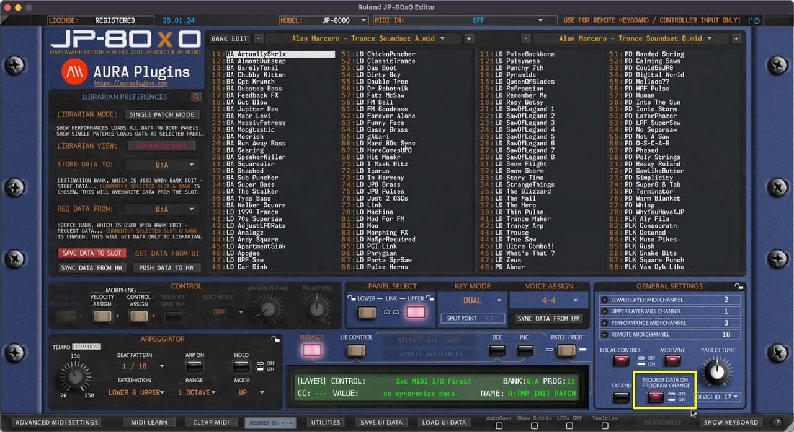
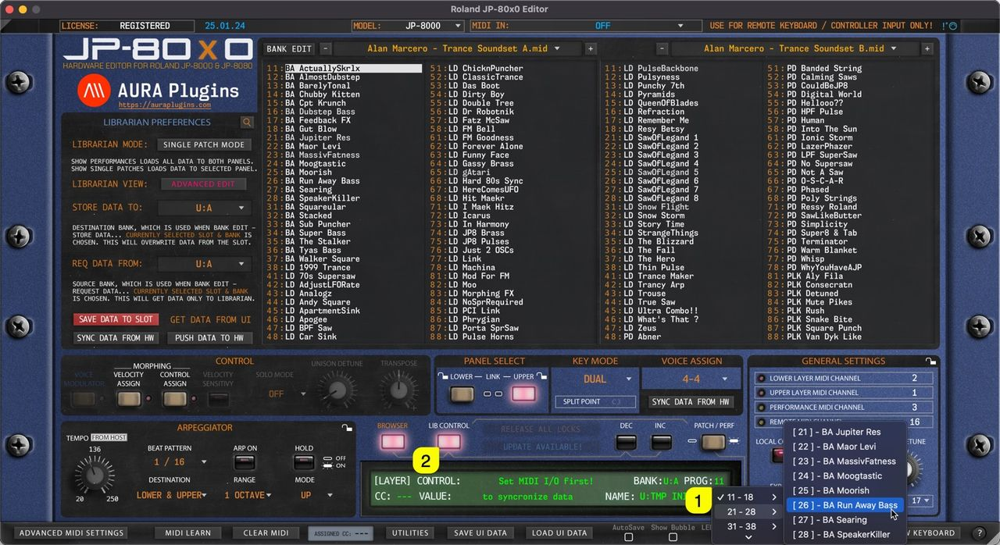
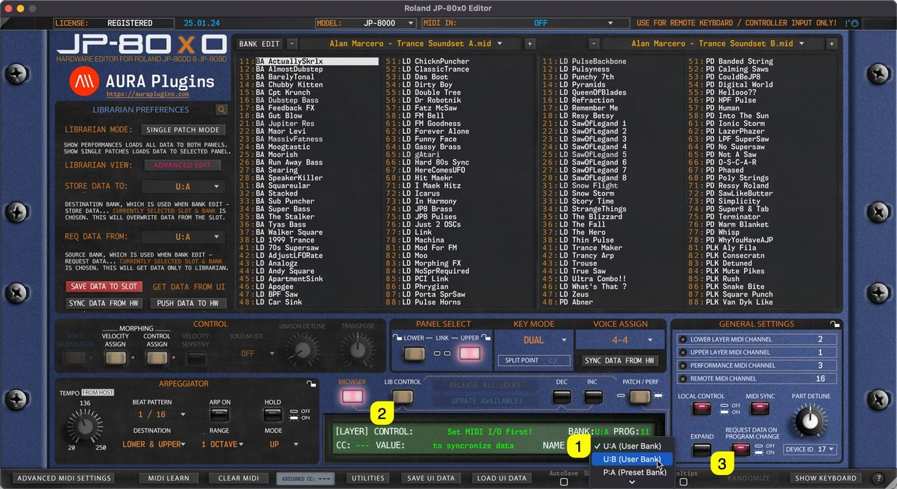

# Roland JP-80×0 Editor – Sending Data To Hardware

## Double Click

You can send any **slot data [1]** from the Librarian view to a selected Panel / **Layer [2]** by **double clicking** the item.

In SINGLE PATCH mode this data will be sent to the **currently selected [2]** Layer.

In PERFORMANCE mode the data will replace both layers.

*Figure: librarian double click*

## Arrow Keys

You can use the computer keyboard arrow up, down, left and right keys to navigate librarian slot content as long as the mouse cursor is above the librarian view.

Data is sent to the currently active slot in the hardware while Librarian View is in SINGLE PATCH mode. PERFORMANCE mode overwrites both layers.

*Figure: librarian arrow keys*

## Program Change Buttons

Program Change DEC / INC buttons have two functions:

1. If **LIB CONTROL [1]** is toggled on, then data from the Librarian View is sent to currently active slot on **Program DEC / INC [2]** trigger, ie. INC is clicked, then BA Maor Levi is sent to the currently active slot.
2. If **LIB CONTROL [1]** is toggled off, then Program Change command is sent to hardware based on **BANK and PROG menu [3]** values, ie. if PROG is 11 and INC is clicked, then PROG 12 is requested from hardware to the currently active layer.

*Figure: librarian program change*

## MIDI Program Change

Similar to User Interface Program Change DEC / INC buttons, incoming MIDI Program Change has the same effect. You can optionally disable incoming MIDI Program Change commands from the Advanced MIDI Settings view.

Data is either sent to hardware from the Librarian View based on the incoming Program Change value or requested from the hardware to the Editor User Interface based on the same Program Change value.

> **NOTE:** When user toggles between LIB CONTROL states, REQUEST DATA ON PROGRAM CHANGE button gets disabled. Engage the button again if you want to request hardware programs to the Editor User Interface after MIDI Program Change is sent. See image below.

*Figure: librarian request data on program change*

## PROG menu

Users can also send Programs to the hardware by clicking the **PROG [1]** menu and selecting an item from the list. Note that **LIB CONTROL [2]** is on, so data is sent to hardware from the Librarian View and PROG menu items are populated with the currently active Librarian View program names.

*Figure: librarian prog menu*

## and BANK menu…

Other option is to change BANK via the **BANK [1]** menu. Note that in this case the **LIB CONTROL [2]** is toggled off, which results in renaming menu items with hardware bank locations. Also, **REQUEST DATA ON PROGRAM CHANGE [3]** is on, which means data is requested to the User Interface instead of sending it to the hardware.

*Figure: librarian bank menu*
