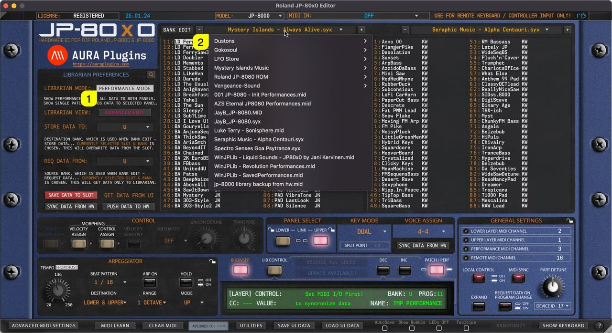

# Roland JP-80×0 Editor – Browsing Banks

## Single Patch mode

When **SINGLE PATCH MODE [1]** is selected, users can open a drop down menu by clicking the **bank name [2]** area with mouse click. With this drop down list, users can see all of the available banks detected by the Editor.

*Figure: librarian patch banks*

## Performance mode

Same applies to Performances when **PERFORMANCE MODE [1]** is toggled on. Users can view all of the detected Performance Banks by clicking the **bank name [2]** area.

*Figure: librarian performance banks*

> **NOTE:** When a bank is selected, slot names are updated in the list view with corresponding program names.
