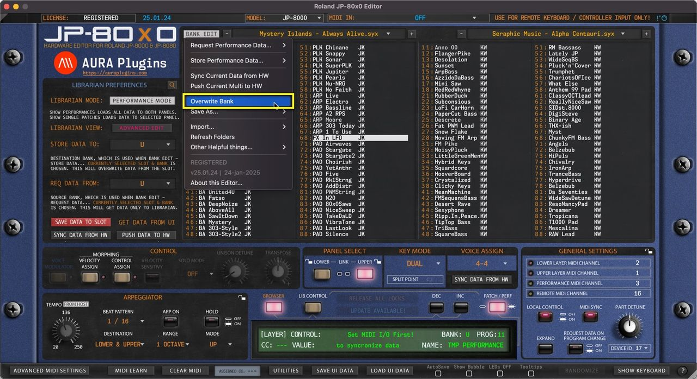
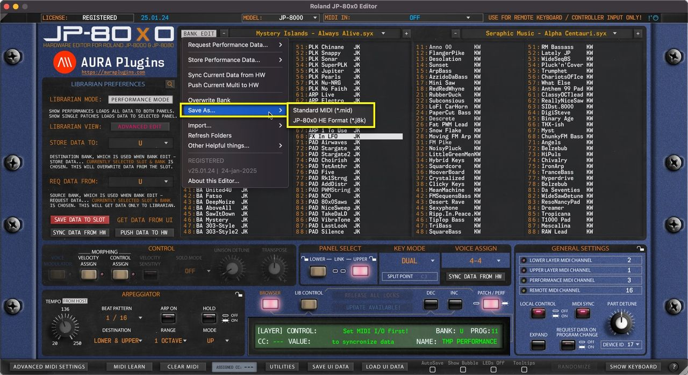

# Roland JP-80×0 Editor – Saving Banks

## Overwrite Bank

Open the **BANK EDIT** menu and choose **Overwrite Bank** to overwrite any changes you’ve made to the current Bank. This will permanently overwrite the currently selected bank in your HDD which in this case would be Mystery Islands – Always Alive.syx .

*Figure: overwrite bank*

## Save As…

Open the **BANK EDIT** menu and choose **Save As… -> Standard MIDI / JP-80x0 HE Format** to save any changes you’ve made to the bank with a new name. This keeps the banks and their edits in good order – And you will always have the original file in hand just in case something goes wrong!

We recommend j8k format, but standard MIDI works too – it is up to you.

*Figure: save as*

> **NOTE #1:** You can always DISCARD any changes you’ve made in the Librarian by clicking the **DISCARD [1]** button.

> **NOTE #2:** You can see a **red asterix [2]** right next to the BROWSER toggle in the main User Interface IF Librarian has any unsaved changes! This will disappear once save or discard is triggered.

> **NOTE #3:** Librarian Mode toggle becomes unavailable IF there are any unsaved changes in the Librarian.

*Figure: discard bank changes*
