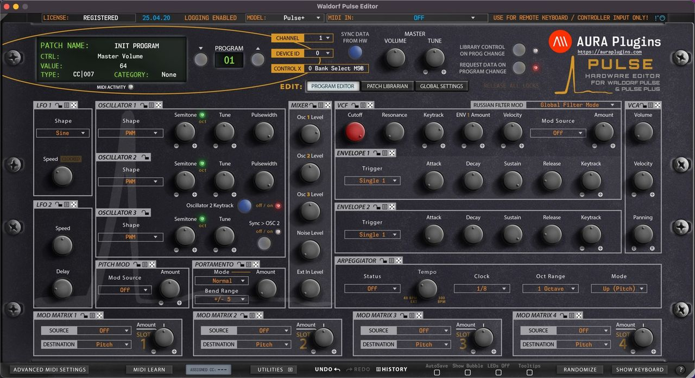

# Introduction

Thank you for your interest towards our Editor & Librarian software.

We built our Waldorf Pulse Editor to control Pulse and Pulse Plus models over MIDI. Modern synths come up with an integration tool to hook your synth into DAW and we wanted to give this same opportunity to you as well. Connect MIDI input & output, Audio jack cables to mixing console / sound card and fire up your Computer to get started!

Waldorf Pulse Editor User Manual contains instructions to get the Editor installed and configured. Please read this manual through carefully. Any feedback with comments on how to improve the documentation is welcomed.

**This page is under re-write.** Please refer to the older support pages while this is being updated:

https://docs.auraplugins.com/kb/user-guide/waldorf-pulsex-user-manual/

**DISCLAIMER**

Our company & product has nothing to do with Waldorf Music GmbH.  
If there is an issue with our product, open a support ticket from my account page.  
You can find support details at the end of this document.  
Updates are free per release year. Check FAQ for more details.

> **NOTE:** This manual is still being worked on. Until it's complete, please refer to the [Access Virus Editor User Manual](../../access-virus-editor/user-manual/00-introduction.md) or the [Roland JP-80x0 Editor User Manual](../../roland-jp-80x0-editor/user-manual/00-introduction.md) for how the editor's functions work.
